# MasRainman rainfall reports

Updated 14 Nov 2026, 02:50 PM IST. Tap a file to open it; use ⋯ → *Download* (or *Open in browser*) to save it.

## Tamil Nadu · Rain so far (live)
up to 14 Nov, 2:30 PM — [MP4](files/rain_live_2026-11-14_1430.mp4) · [GIF](files/rain_live_2026-11-14_1430.gif) · [PNG](files/rain_live_2026-11-14_1430.png)

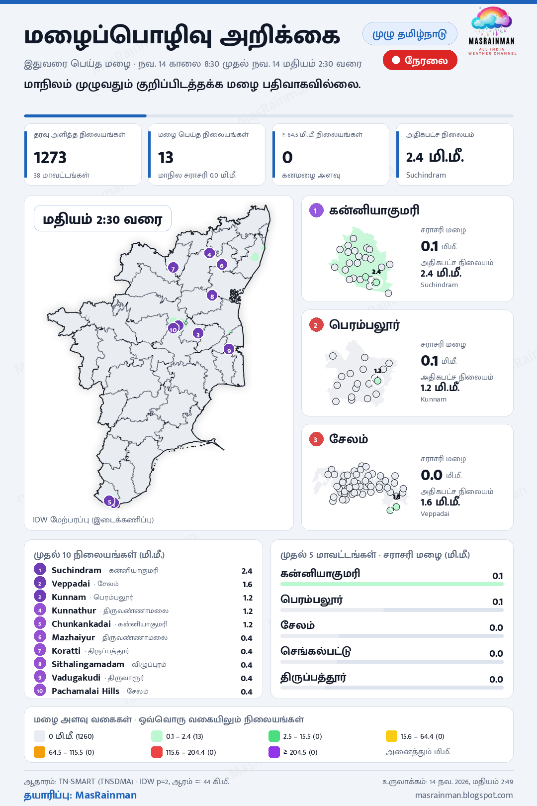

## KTCC · Rain so far (live)
up to 14 Nov, 2:30 PM — [MP4](files/rain_ktcc_live_2026-11-14_1430.mp4) · [GIF](files/rain_ktcc_live_2026-11-14_1430.gif) · [PNG](files/rain_ktcc_live_2026-11-14_1430.png)

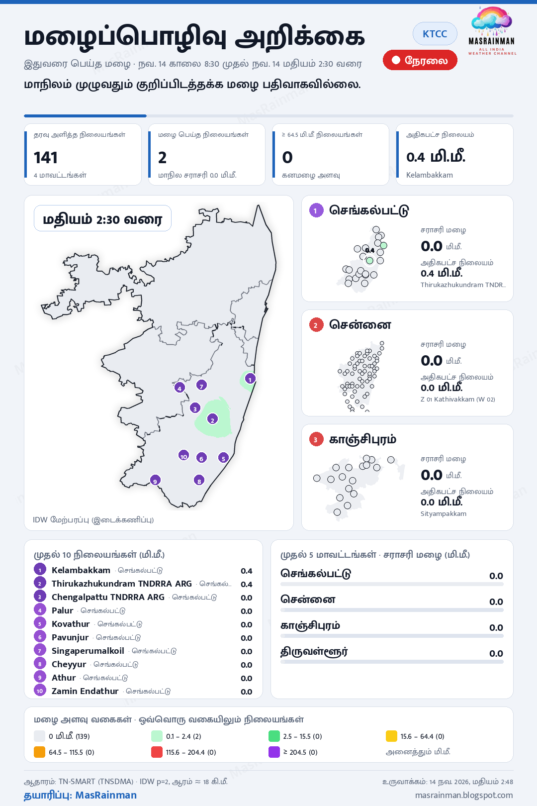

## Karnataka · Rain so far (live)
up to 14 Nov, 2:30 PM — [MP4](files/rain_ka_live_2026-11-14_1430.mp4) · [GIF](files/rain_ka_live_2026-11-14_1430.gif) · [PNG](files/rain_ka_live_2026-11-14_1430.png)

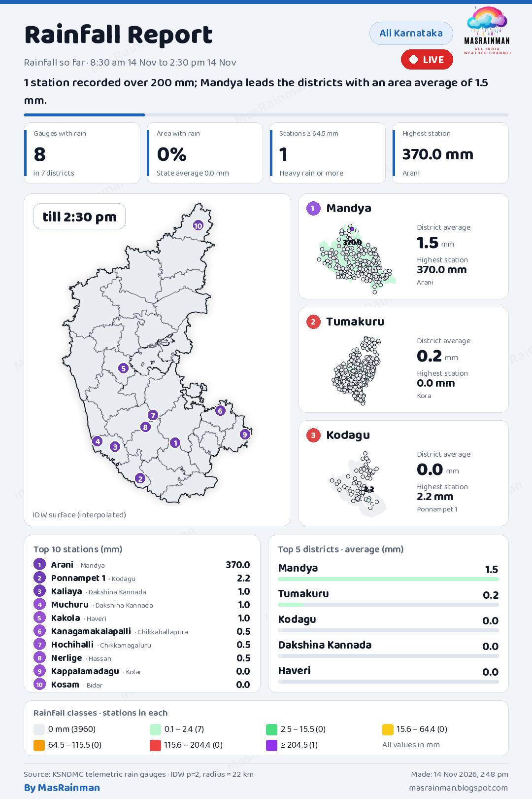

## Telangana · Rain so far (live)
up to 14 Nov, 2:00 PM — [MP4](files/rain_tg_live_2026-11-14_1400.mp4) · [GIF](files/rain_tg_live_2026-11-14_1400.gif) · [PNG](files/rain_tg_live_2026-11-14_1400.png)

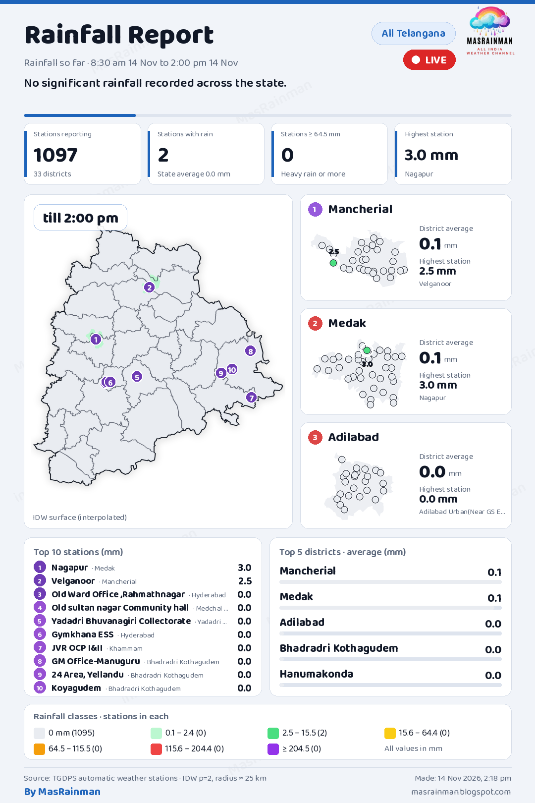

## Andhra Pradesh · Rain so far (live)
up to 14 Nov, 1:00 PM — [MP4](files/rain_ap_live_2026-11-14_1300.mp4) · [GIF](files/rain_ap_live_2026-11-14_1300.gif) · [PNG](files/rain_ap_live_2026-11-14_1300.png)

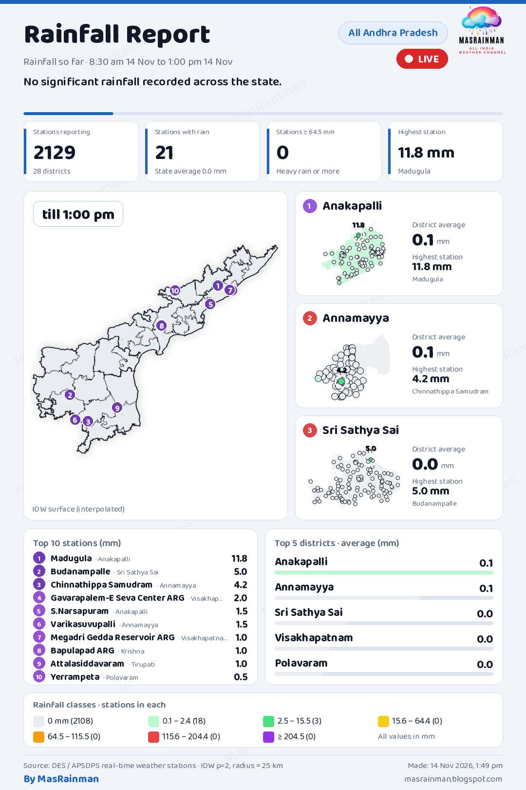

## Telangana · Past 24 hours, hour by hour
rain-day 14 Nov 2026 — [MP4](files/rain_tg_live24_2026-11-14.mp4) · [PNG](files/rain_tg_live24_2026-11-14.png)

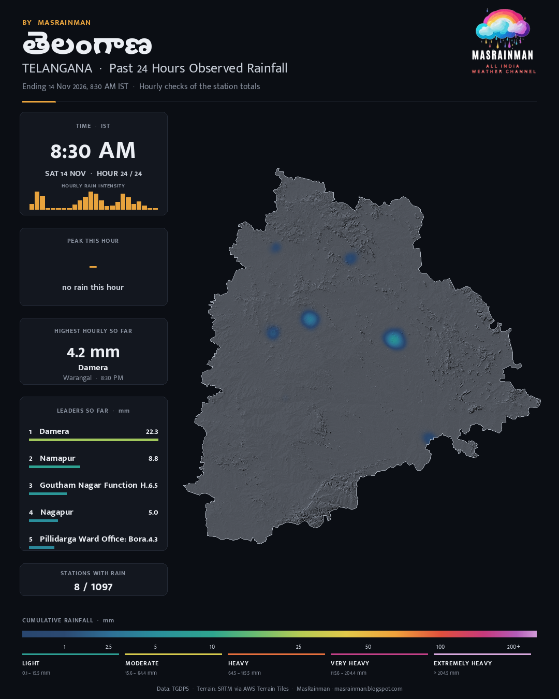

## Telangana · 24-hour rain
rain-day 14 Nov 2026 — [MP4](files/rain_tg_daily_2026-11-14.mp4) · [GIF](files/rain_tg_daily_2026-11-14.gif) · [PNG](files/rain_tg_daily_2026-11-14.png)

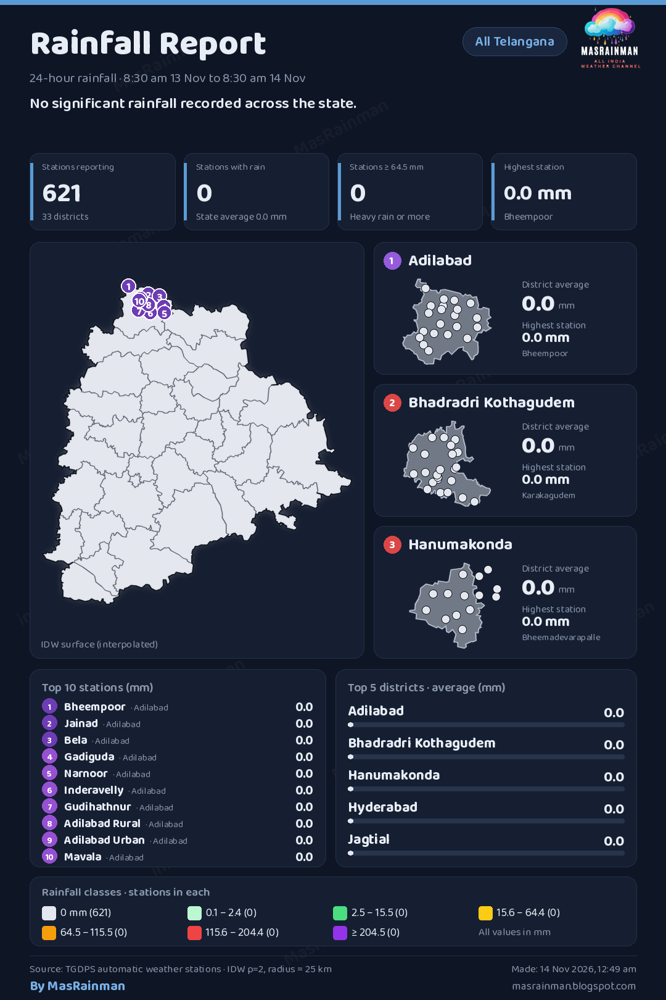

## Telangana · Total rain (multi-day)
03 Nov → 14 Nov 2026 — [MP4](files/rain_tg_accum_2026-11-03_to_2026-11-14.mp4) · [GIF](files/rain_tg_accum_2026-11-03_to_2026-11-14.gif) · [PNG](files/rain_tg_accum_2026-11-03_to_2026-11-14.png) · [Station list](files/rain_tg_accum_2026-11-03_to_2026-11-14_list.png) [p2](files/rain_tg_accum_2026-11-03_to_2026-11-14_list_p2.png) [p3](files/rain_tg_accum_2026-11-03_to_2026-11-14_list_p3.png) · [Print PDF](files/rain_tg_accum_2026-11-03_to_2026-11-14_list.pdf)

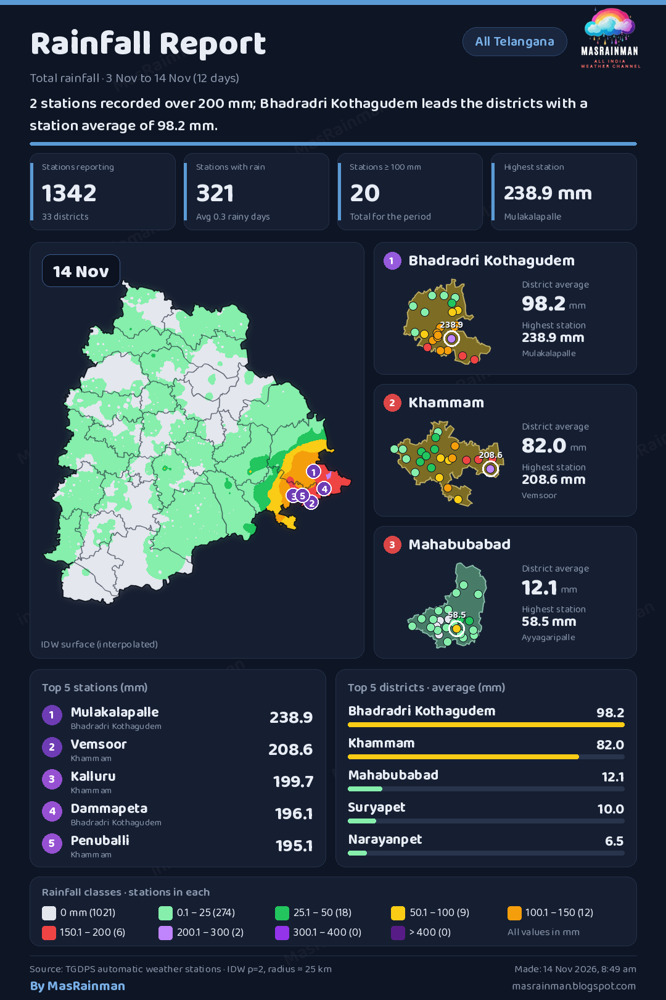

## KTCC · Past 24 hours, hour by hour
rain-day 14 Nov 2026 — [MP4](files/rain_ktcc_live24_2026-11-14.mp4) · [PNG](files/rain_ktcc_live24_2026-11-14.png)

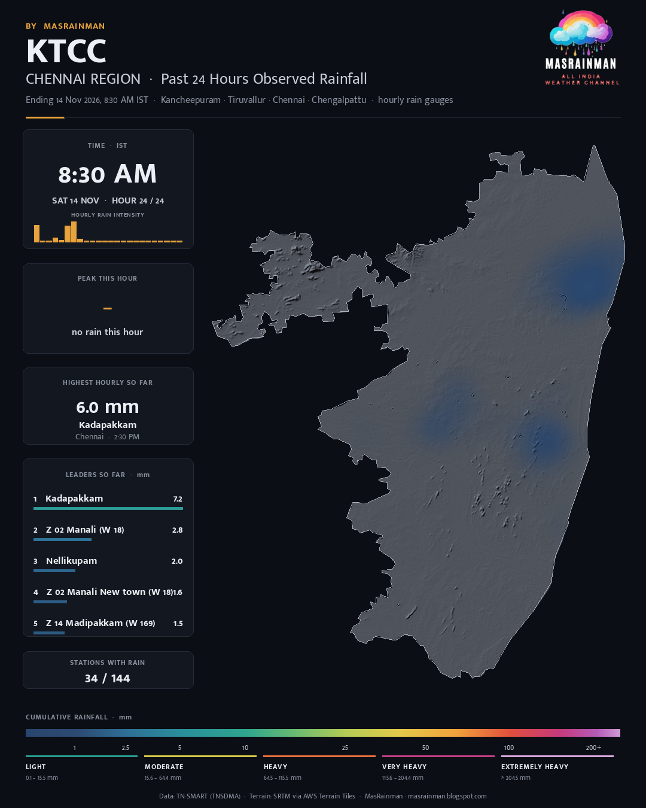

## Kerala · 24-hour rain (Malayalam)
rain-day 14 Nov 2026 — [MP4](files/rain_kl_daily_2026-11-14_ml.mp4) · [GIF](files/rain_kl_daily_2026-11-14_ml.gif) · [PNG](files/rain_kl_daily_2026-11-14_ml.png) · [Station list](files/rain_kl_daily_2026-11-14_ml_list.png) · [Print PDF](files/rain_kl_daily_2026-11-14_ml_list.pdf)

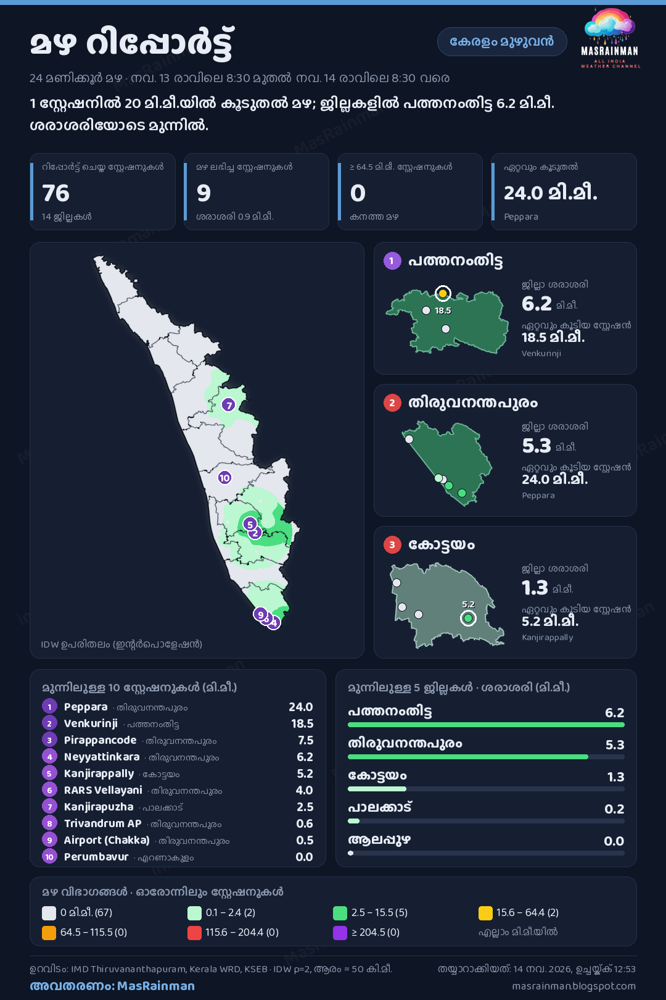

## Kerala · 24-hour rain (English)
rain-day 14 Nov 2026 — [MP4](files/rain_kl_daily_2026-11-14_en.mp4) · [GIF](files/rain_kl_daily_2026-11-14_en.gif) · [PNG](files/rain_kl_daily_2026-11-14_en.png) · [Station list](files/rain_kl_daily_2026-11-14_en_list.png) · [Print PDF](files/rain_kl_daily_2026-11-14_en_list.pdf)

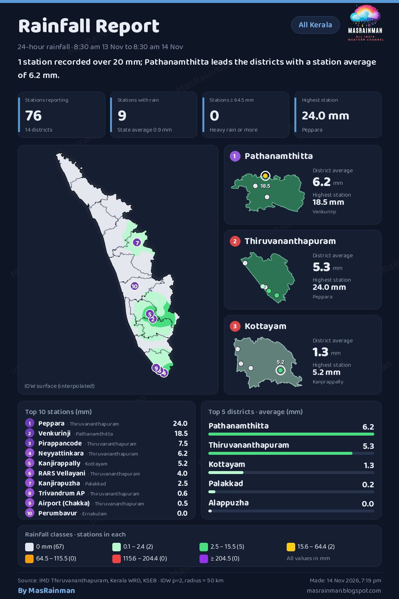

## Kerala · Total rain (multi-day) (Malayalam)
19 Oct → 14 Nov 2026 — [MP4](files/rain_kl_accum_2026-10-19_to_2026-11-14_ml.mp4) · [GIF](files/rain_kl_accum_2026-10-19_to_2026-11-14_ml.gif) · [PNG](files/rain_kl_accum_2026-10-19_to_2026-11-14_ml.png) · [Station list](files/rain_kl_accum_2026-10-19_to_2026-11-14_ml_list.png) [p2](files/rain_kl_accum_2026-10-19_to_2026-11-14_ml_list_p2.png) [p3](files/rain_kl_accum_2026-10-19_to_2026-11-14_ml_list_p3.png) · [Print PDF](files/rain_kl_accum_2026-10-19_to_2026-11-14_ml_list.pdf)

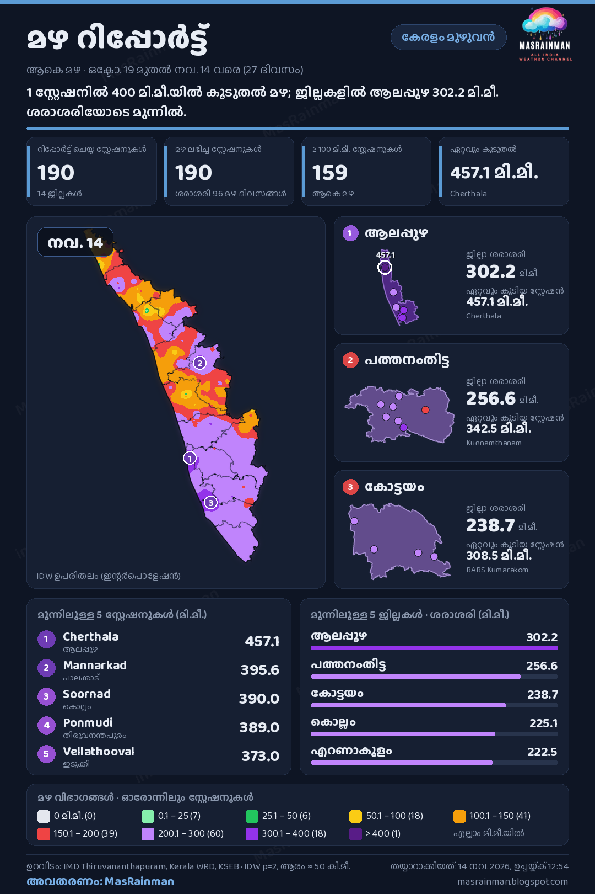

## Kerala · Total rain (multi-day) (English)
19 Oct → 14 Nov 2026 — [MP4](files/rain_kl_accum_2026-10-19_to_2026-11-14_en.mp4) · [GIF](files/rain_kl_accum_2026-10-19_to_2026-11-14_en.gif) · [PNG](files/rain_kl_accum_2026-10-19_to_2026-11-14_en.png) · [Station list](files/rain_kl_accum_2026-10-19_to_2026-11-14_en_list.png) [p2](files/rain_kl_accum_2026-10-19_to_2026-11-14_en_list_p2.png) [p3](files/rain_kl_accum_2026-10-19_to_2026-11-14_en_list_p3.png) · [Print PDF](files/rain_kl_accum_2026-10-19_to_2026-11-14_en_list.pdf)

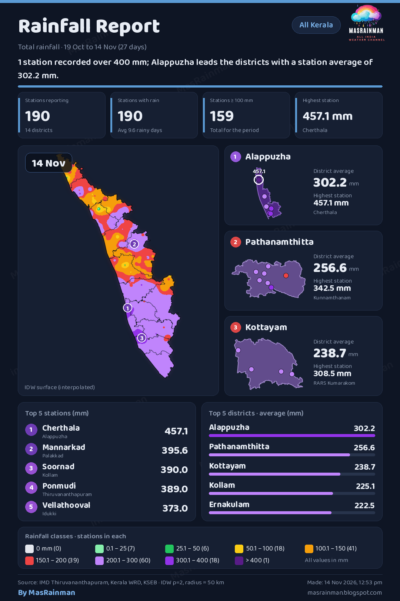

## Karnataka · Past 24 hours, hour by hour
rain-day 14 Nov 2026 — [MP4](files/rain_ka_live24_2026-11-14.mp4) · [PNG](files/rain_ka_live24_2026-11-14.png)

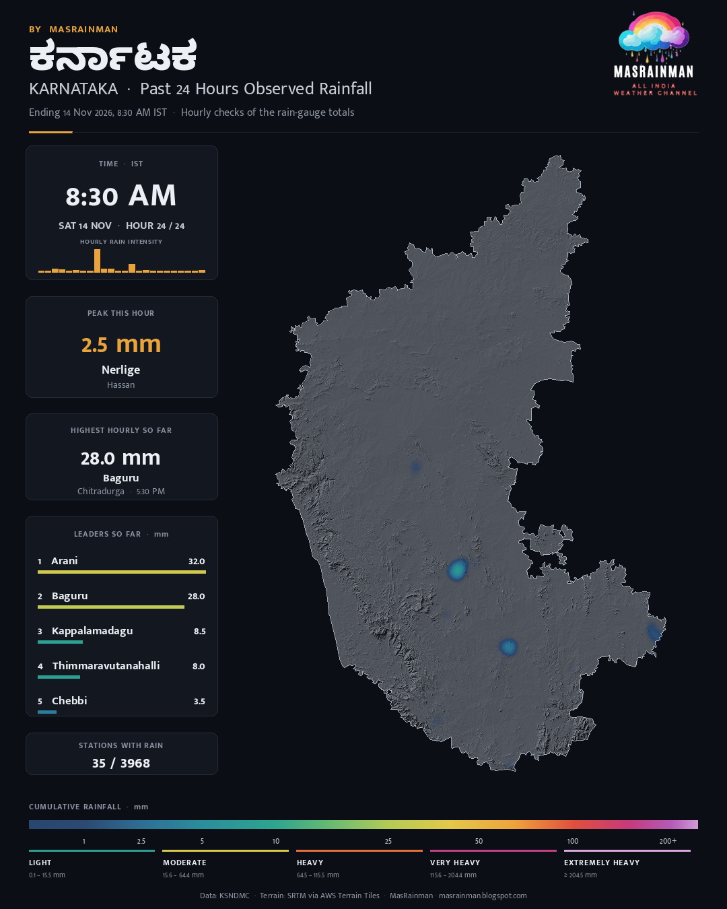

## Andhra Pradesh · Past 24 hours, hour by hour
rain-day 14 Nov 2026 — [MP4](files/rain_ap_live24_2026-11-14.mp4) · [PNG](files/rain_ap_live24_2026-11-14.png)

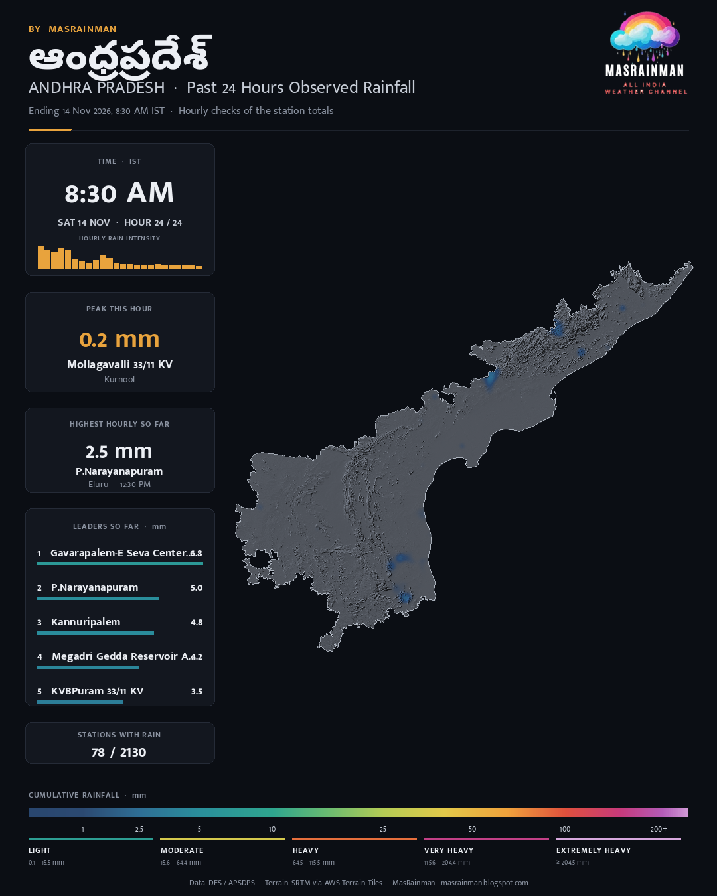

## Tamil Nadu · Satellite rain, past 24 hours
24 h up to 13 Nov, 11:29 AM — [MP4](files/rain_sat24_2026-11-13_1129_en.mp4) · [PNG](files/rain_sat24_2026-11-13_1129_en.png)

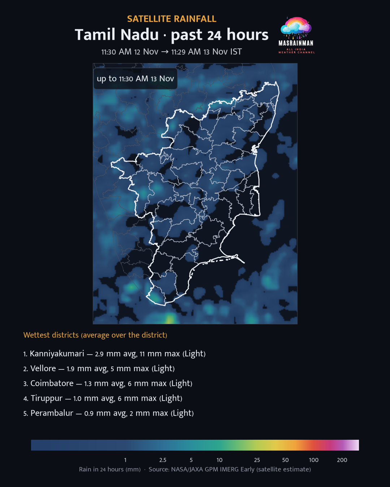

## Karnataka · Satellite rain, past 24 hours
24 h up to 13 Nov, 11:29 AM — [MP4](files/rain_ka_sat24_2026-11-13_1129_en.mp4) · [PNG](files/rain_ka_sat24_2026-11-13_1129_en.png)

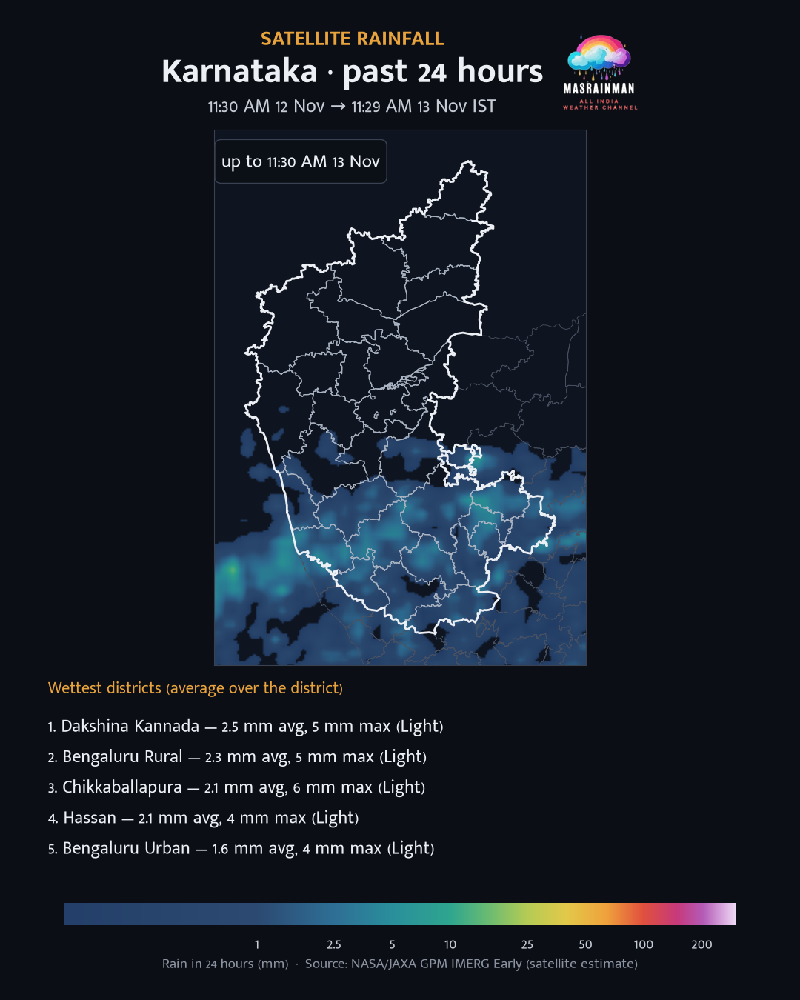

## Andhra Pradesh · Satellite rain, past 24 hours
24 h up to 13 Nov, 11:29 AM — [MP4](files/rain_ap_sat24_2026-11-13_1129_en.mp4) · [PNG](files/rain_ap_sat24_2026-11-13_1129_en.png)

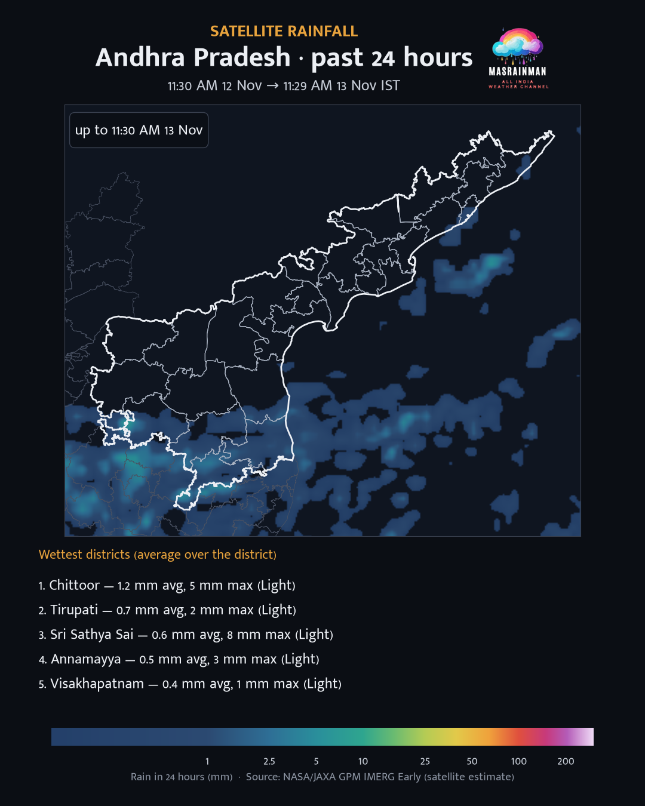

## Tamil Nadu · Past 24 hours, hour by hour
rain-day 13 Nov 2026 — [MP4](files/rain_live24_2026-11-13.mp4) · [PNG](files/rain_live24_2026-11-13.png)

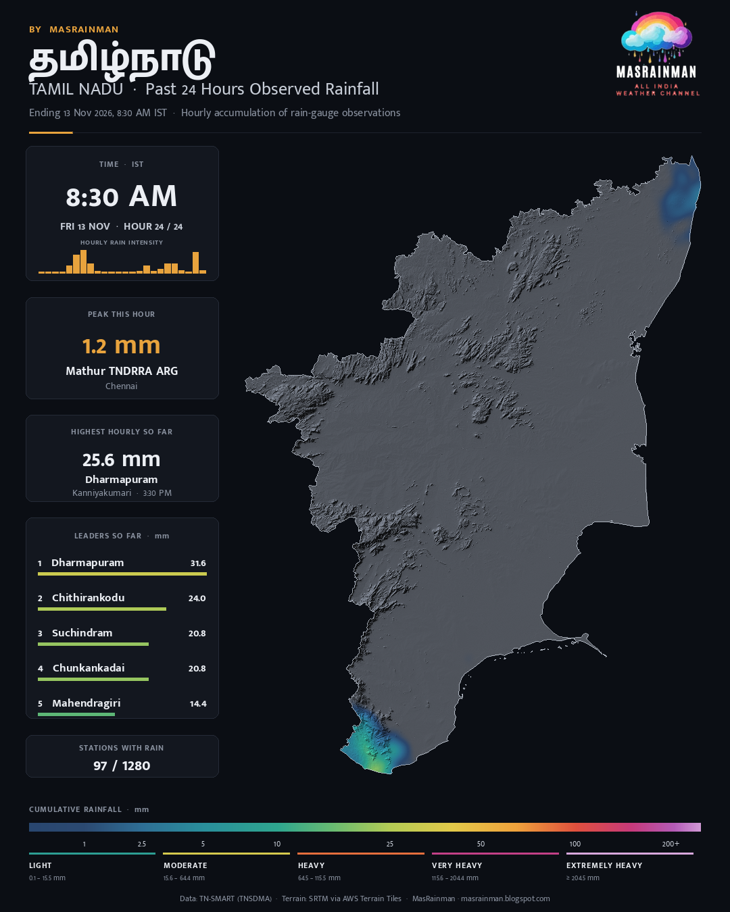

## Tamil Nadu · 24-hour rain
rain-day 13 Nov 2026 — [MP4](files/rain_daily_2026-11-13.mp4) · [GIF](files/rain_daily_2026-11-13.gif) · [PNG](files/rain_daily_2026-11-13.png) · [Station list](files/rain_daily_2026-11-13_list.png) [p2](files/rain_daily_2026-11-13_list_p2.png) · [Print PDF](files/rain_daily_2026-11-13_list.pdf)

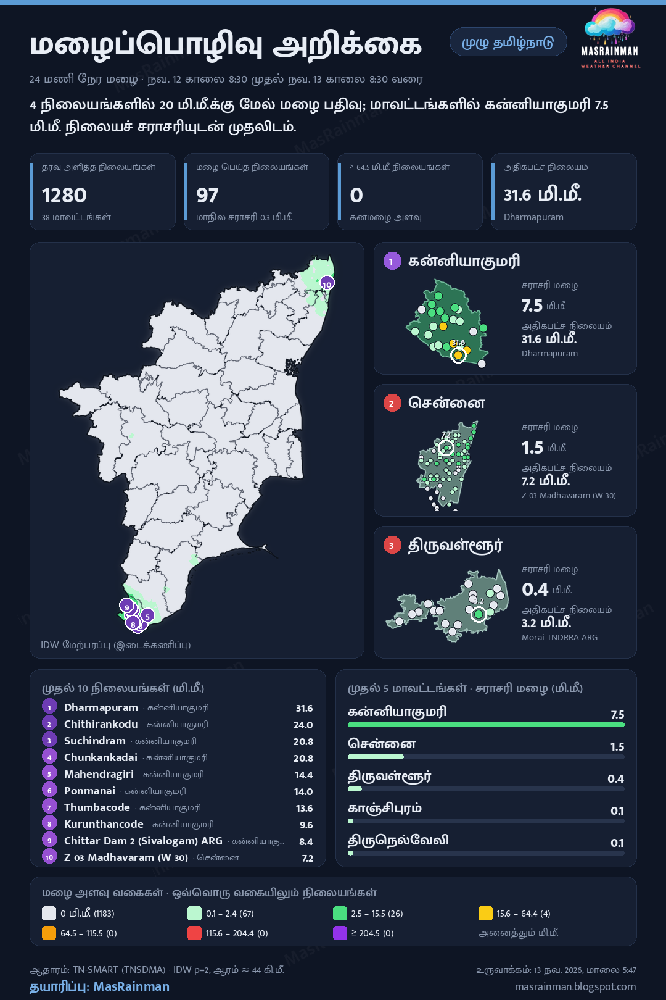

## Andhra Pradesh · 24-hour rain
rain-day 13 Nov 2026 — [MP4](files/rain_ap_daily_2026-11-13.mp4) · [GIF](files/rain_ap_daily_2026-11-13.gif) · [PNG](files/rain_ap_daily_2026-11-13.png) · [Station list](files/rain_ap_daily_2026-11-13_list.png) [p2](files/rain_ap_daily_2026-11-13_list_p2.png) · [Print PDF](files/rain_ap_daily_2026-11-13_list.pdf)

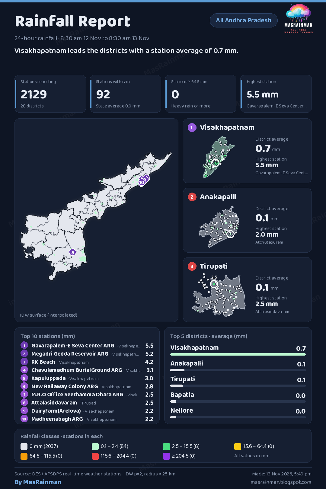

## Andhra Pradesh · Total rain (multi-day)
24 Oct → 13 Nov 2026 — [MP4](files/rain_ap_accum_2026-10-24_to_2026-11-13.mp4) · [GIF](files/rain_ap_accum_2026-10-24_to_2026-11-13.gif) · [PNG](files/rain_ap_accum_2026-10-24_to_2026-11-13.png) · [Station list](files/rain_ap_accum_2026-10-24_to_2026-11-13_list.png) [p2](files/rain_ap_accum_2026-10-24_to_2026-11-13_list_p2.png) [p3](files/rain_ap_accum_2026-10-24_to_2026-11-13_list_p3.png) [p4](files/rain_ap_accum_2026-10-24_to_2026-11-13_list_p4.png) [p5](files/rain_ap_accum_2026-10-24_to_2026-11-13_list_p5.png) [p6](files/rain_ap_accum_2026-10-24_to_2026-11-13_list_p6.png) [p7](files/rain_ap_accum_2026-10-24_to_2026-11-13_list_p7.png) [p8](files/rain_ap_accum_2026-10-24_to_2026-11-13_list_p8.png) [p9](files/rain_ap_accum_2026-10-24_to_2026-11-13_list_p9.png) [p10](files/rain_ap_accum_2026-10-24_to_2026-11-13_list_p10.png) [p11](files/rain_ap_accum_2026-10-24_to_2026-11-13_list_p11.png) [p12](files/rain_ap_accum_2026-10-24_to_2026-11-13_list_p12.png) [p13](files/rain_ap_accum_2026-10-24_to_2026-11-13_list_p13.png) [p14](files/rain_ap_accum_2026-10-24_to_2026-11-13_list_p14.png) [p15](files/rain_ap_accum_2026-10-24_to_2026-11-13_list_p15.png) · [Print PDF](files/rain_ap_accum_2026-10-24_to_2026-11-13_list.pdf)

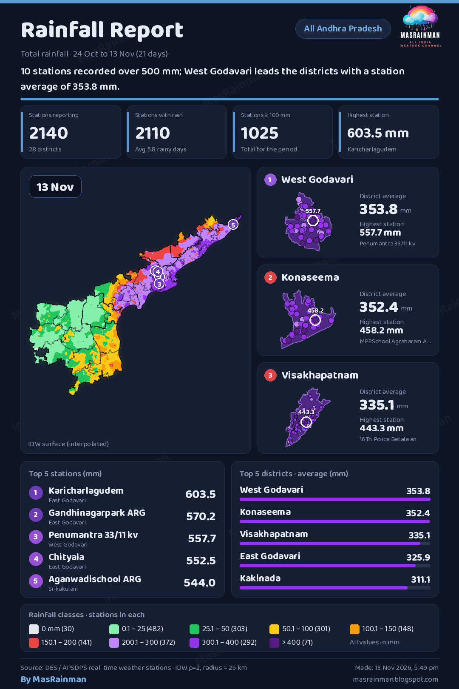

## Tamil Nadu · Total rain (multi-day)
01 Oct → 13 Nov 2026 — [MP4](files/rain_accum_2026-10-01_to_2026-11-13.mp4) · [GIF](files/rain_accum_2026-10-01_to_2026-11-13.gif) · [PNG](files/rain_accum_2026-10-01_to_2026-11-13.png) · [Station list](files/rain_accum_2026-10-01_to_2026-11-13_list.png) [p2](files/rain_accum_2026-10-01_to_2026-11-13_list_p2.png) [p3](files/rain_accum_2026-10-01_to_2026-11-13_list_p3.png) [p4](files/rain_accum_2026-10-01_to_2026-11-13_list_p4.png) [p5](files/rain_accum_2026-10-01_to_2026-11-13_list_p5.png) [p6](files/rain_accum_2026-10-01_to_2026-11-13_list_p6.png) [p7](files/rain_accum_2026-10-01_to_2026-11-13_list_p7.png) [p8](files/rain_accum_2026-10-01_to_2026-11-13_list_p8.png) [p9](files/rain_accum_2026-10-01_to_2026-11-13_list_p9.png) [p10](files/rain_accum_2026-10-01_to_2026-11-13_list_p10.png) · [Print PDF](files/rain_accum_2026-10-01_to_2026-11-13_list.pdf)

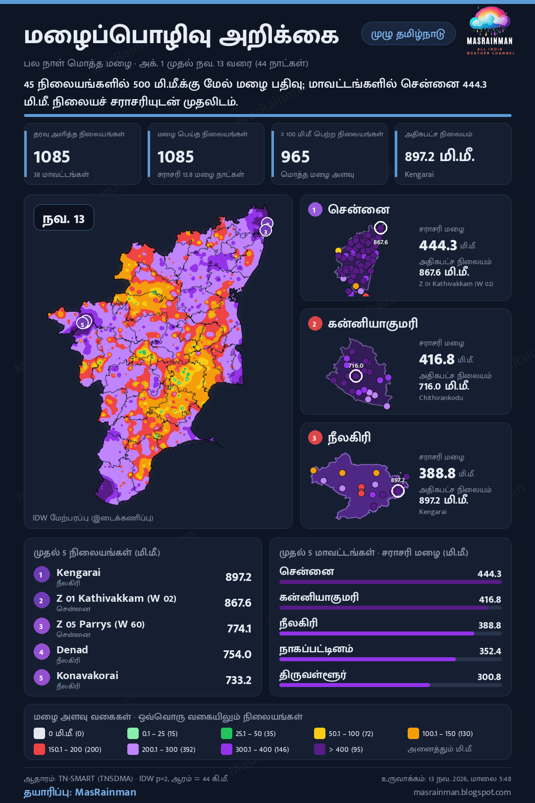

## Andhra Pradesh · Satellite radar 3D pass
pass at 10 Nov, 7:59 PM — [MP4](files/rain_ap_gpm3d_2026-11-10_1959_en.mp4) · [PNG](files/rain_ap_gpm3d_2026-11-10_1959_en.png)

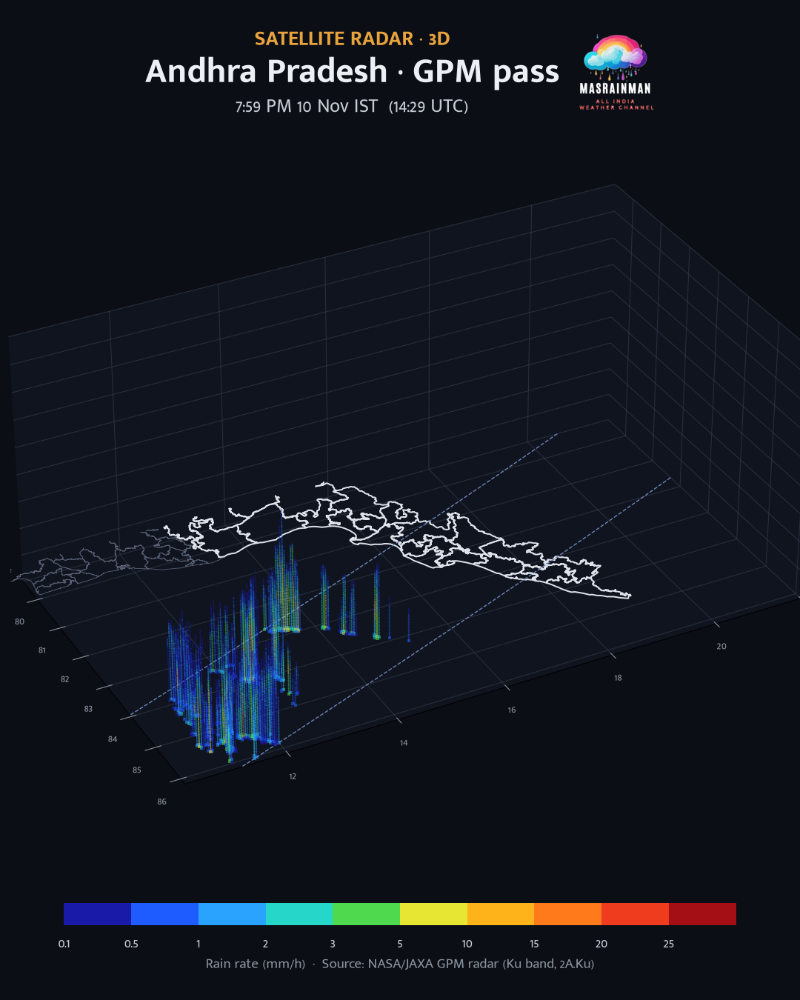

## Tamil Nadu · Satellite radar 3D pass
pass at 09 Nov, 8:42 PM — [MP4](files/rain_gpm3d_2026-11-09_2042_en.mp4) · [PNG](files/rain_gpm3d_2026-11-09_2042_en.png)

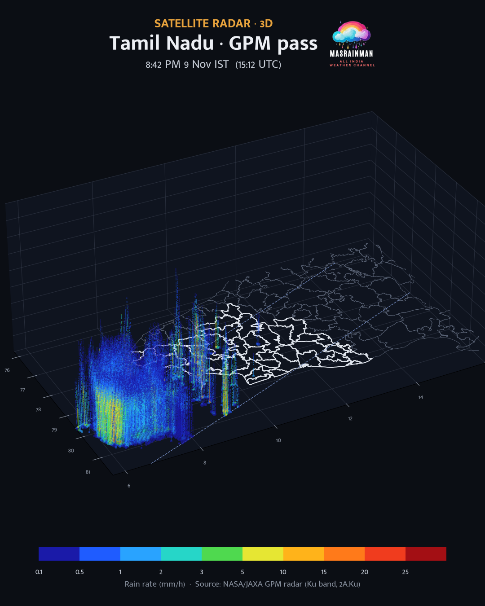

## Karnataka · Satellite radar 3D pass
pass at 08 Nov, 9:51 AM — [MP4](files/rain_ka_gpm3d_2026-11-08_0951_en.mp4) · [PNG](files/rain_ka_gpm3d_2026-11-08_0951_en.png)

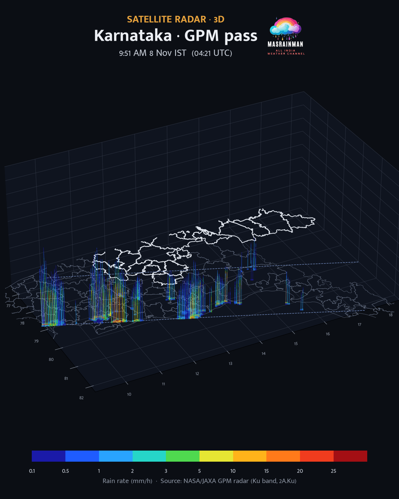

## Tamil Nadu · Monthly total
October 2026 — [MP4](files/rain_month_2026-10.mp4) · [GIF](files/rain_month_2026-10.gif) · [PNG](files/rain_month_2026-10.png)

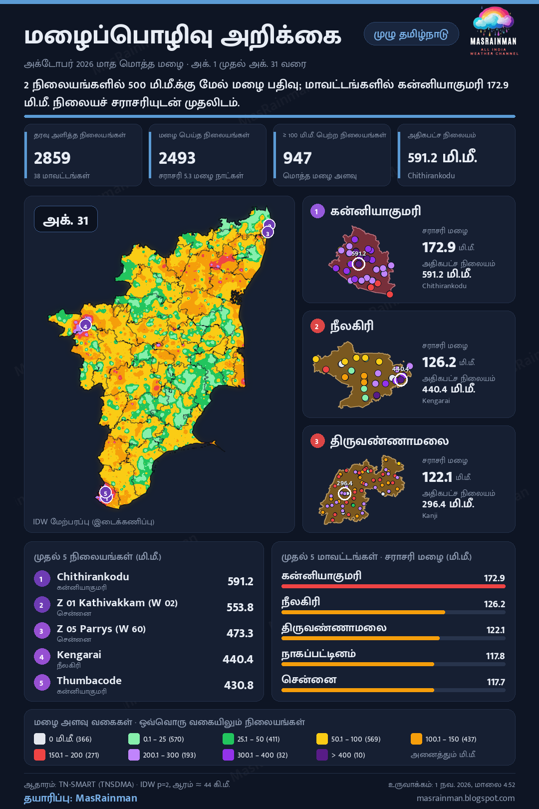

## All reports

| Report | Period | Files |
|---|---|---|
| Tamil Nadu · Rain so far (live) | up to 14 Nov, 2:30 PM | [MP4](files/rain_live_2026-11-14_1430.mp4) [GIF](files/rain_live_2026-11-14_1430.gif) [PNG](files/rain_live_2026-11-14_1430.png) |
| KTCC · Rain so far (live) | up to 14 Nov, 2:30 PM | [MP4](files/rain_ktcc_live_2026-11-14_1430.mp4) [GIF](files/rain_ktcc_live_2026-11-14_1430.gif) [PNG](files/rain_ktcc_live_2026-11-14_1430.png) |
| Karnataka · Rain so far (live) | up to 14 Nov, 2:30 PM | [MP4](files/rain_ka_live_2026-11-14_1430.mp4) [GIF](files/rain_ka_live_2026-11-14_1430.gif) [PNG](files/rain_ka_live_2026-11-14_1430.png) |
| Telangana · Rain so far (live) | up to 14 Nov, 2:00 PM | [MP4](files/rain_tg_live_2026-11-14_1400.mp4) [GIF](files/rain_tg_live_2026-11-14_1400.gif) [PNG](files/rain_tg_live_2026-11-14_1400.png) |
| Tamil Nadu · Rain so far (live) | up to 14 Nov, 1:30 PM | [MP4](files/rain_live_2026-11-14_1330.mp4) [GIF](files/rain_live_2026-11-14_1330.gif) [PNG](files/rain_live_2026-11-14_1330.png) |
| KTCC · Rain so far (live) | up to 14 Nov, 1:30 PM | [MP4](files/rain_ktcc_live_2026-11-14_1330.mp4) [GIF](files/rain_ktcc_live_2026-11-14_1330.gif) [PNG](files/rain_ktcc_live_2026-11-14_1330.png) |
| Karnataka · Rain so far (live) | up to 14 Nov, 1:30 PM | [MP4](files/rain_ka_live_2026-11-14_1330.mp4) [GIF](files/rain_ka_live_2026-11-14_1330.gif) [PNG](files/rain_ka_live_2026-11-14_1330.png) |
| Telangana · Rain so far (live) | up to 14 Nov, 1:00 PM | [MP4](files/rain_tg_live_2026-11-14_1300.mp4) [GIF](files/rain_tg_live_2026-11-14_1300.gif) [PNG](files/rain_tg_live_2026-11-14_1300.png) |
| Andhra Pradesh · Rain so far (live) | up to 14 Nov, 1:00 PM | [MP4](files/rain_ap_live_2026-11-14_1300.mp4) [GIF](files/rain_ap_live_2026-11-14_1300.gif) [PNG](files/rain_ap_live_2026-11-14_1300.png) |
| Tamil Nadu · Rain so far (live) | up to 14 Nov, 12:30 PM | [MP4](files/rain_live_2026-11-14_1230.mp4) [GIF](files/rain_live_2026-11-14_1230.gif) [PNG](files/rain_live_2026-11-14_1230.png) |
| KTCC · Rain so far (live) | up to 14 Nov, 12:30 PM | [MP4](files/rain_ktcc_live_2026-11-14_1230.mp4) [GIF](files/rain_ktcc_live_2026-11-14_1230.gif) [PNG](files/rain_ktcc_live_2026-11-14_1230.png) |
| Karnataka · Rain so far (live) | up to 14 Nov, 12:30 PM | [MP4](files/rain_ka_live_2026-11-14_1230.mp4) [GIF](files/rain_ka_live_2026-11-14_1230.gif) [PNG](files/rain_ka_live_2026-11-14_1230.png) |
| Telangana · Rain so far (live) | up to 14 Nov, 12:00 PM | [MP4](files/rain_tg_live_2026-11-14_1200.mp4) [GIF](files/rain_tg_live_2026-11-14_1200.gif) [PNG](files/rain_tg_live_2026-11-14_1200.png) |
| Andhra Pradesh · Rain so far (live) | up to 14 Nov, 12:00 PM | [MP4](files/rain_ap_live_2026-11-14_1200.mp4) [GIF](files/rain_ap_live_2026-11-14_1200.gif) [PNG](files/rain_ap_live_2026-11-14_1200.png) |
| Tamil Nadu · Rain so far (live) | up to 14 Nov, 11:30 AM | [MP4](files/rain_live_2026-11-14_1130.mp4) [GIF](files/rain_live_2026-11-14_1130.gif) [PNG](files/rain_live_2026-11-14_1130.png) |
| Karnataka · Rain so far (live) | up to 14 Nov, 11:30 AM | [MP4](files/rain_ka_live_2026-11-14_1130.mp4) [GIF](files/rain_ka_live_2026-11-14_1130.gif) [PNG](files/rain_ka_live_2026-11-14_1130.png) |
| Telangana · Rain so far (live) | up to 14 Nov, 11:00 AM | [MP4](files/rain_tg_live_2026-11-14_1100.mp4) [GIF](files/rain_tg_live_2026-11-14_1100.gif) [PNG](files/rain_tg_live_2026-11-14_1100.png) |
| Tamil Nadu · Rain so far (live) | up to 14 Nov, 10:30 AM | [MP4](files/rain_live_2026-11-14_1030.mp4) [GIF](files/rain_live_2026-11-14_1030.gif) [PNG](files/rain_live_2026-11-14_1030.png) |
| KTCC · Rain so far (live) | up to 14 Nov, 10:30 AM | [MP4](files/rain_ktcc_live_2026-11-14_1030.mp4) [GIF](files/rain_ktcc_live_2026-11-14_1030.gif) [PNG](files/rain_ktcc_live_2026-11-14_1030.png) |
| Karnataka · Rain so far (live) | up to 14 Nov, 10:30 AM | [MP4](files/rain_ka_live_2026-11-14_1030.mp4) [GIF](files/rain_ka_live_2026-11-14_1030.gif) [PNG](files/rain_ka_live_2026-11-14_1030.png) |
| Tamil Nadu · Rain so far (live) | up to 14 Nov, 9:30 AM | [MP4](files/rain_live_2026-11-14_0930.mp4) [GIF](files/rain_live_2026-11-14_0930.gif) [PNG](files/rain_live_2026-11-14_0930.png) |
| Karnataka · Rain so far (live) | up to 14 Nov, 9:30 AM | [MP4](files/rain_ka_live_2026-11-14_0930.mp4) [GIF](files/rain_ka_live_2026-11-14_0930.gif) [PNG](files/rain_ka_live_2026-11-14_0930.png) |
| Telangana · Past 24 hours, hour by hour | rain-day 14 Nov 2026 | [MP4](files/rain_tg_live24_2026-11-14.mp4) [PNG](files/rain_tg_live24_2026-11-14.png) |
| Telangana · 24-hour rain | rain-day 14 Nov 2026 | [MP4](files/rain_tg_daily_2026-11-14.mp4) [GIF](files/rain_tg_daily_2026-11-14.gif) [PNG](files/rain_tg_daily_2026-11-14.png) |
| Telangana · Total rain (multi-day) | 03 Nov → 14 Nov 2026 | [MP4](files/rain_tg_accum_2026-11-03_to_2026-11-14.mp4) [GIF](files/rain_tg_accum_2026-11-03_to_2026-11-14.gif) [PNG](files/rain_tg_accum_2026-11-03_to_2026-11-14.png) [LIST](files/rain_tg_accum_2026-11-03_to_2026-11-14_list.png) [PDF](files/rain_tg_accum_2026-11-03_to_2026-11-14_list.pdf) |
| Tamil Nadu · Rain so far (live) | up to 14 Nov, 8:30 AM | [MP4](files/rain_live_2026-11-14_0830.mp4) [GIF](files/rain_live_2026-11-14_0830.gif) [PNG](files/rain_live_2026-11-14_0830.png) |
| KTCC · Rain so far (live) | up to 14 Nov, 8:30 AM | [MP4](files/rain_ktcc_live_2026-11-14_0830.mp4) [GIF](files/rain_ktcc_live_2026-11-14_0830.gif) [PNG](files/rain_ktcc_live_2026-11-14_0830.png) |
| KTCC · Past 24 hours, hour by hour | rain-day 14 Nov 2026 | [MP4](files/rain_ktcc_live24_2026-11-14.mp4) [PNG](files/rain_ktcc_live24_2026-11-14.png) |
| Kerala · 24-hour rain | rain-day 14 Nov 2026 | [MP4](files/rain_kl_daily_2026-11-14_ml.mp4) [GIF](files/rain_kl_daily_2026-11-14_ml.gif) [PNG](files/rain_kl_daily_2026-11-14_ml.png) [LIST](files/rain_kl_daily_2026-11-14_ml_list.png) [PDF](files/rain_kl_daily_2026-11-14_ml_list.pdf) |
| Kerala · 24-hour rain | rain-day 14 Nov 2026 | [MP4](files/rain_kl_daily_2026-11-14_en.mp4) [GIF](files/rain_kl_daily_2026-11-14_en.gif) [PNG](files/rain_kl_daily_2026-11-14_en.png) [LIST](files/rain_kl_daily_2026-11-14_en_list.png) [PDF](files/rain_kl_daily_2026-11-14_en_list.pdf) |
| Kerala · Total rain (multi-day) | 19 Oct → 14 Nov 2026 | [MP4](files/rain_kl_accum_2026-10-19_to_2026-11-14_ml.mp4) [GIF](files/rain_kl_accum_2026-10-19_to_2026-11-14_ml.gif) [PNG](files/rain_kl_accum_2026-10-19_to_2026-11-14_ml.png) [LIST](files/rain_kl_accum_2026-10-19_to_2026-11-14_ml_list.png) [PDF](files/rain_kl_accum_2026-10-19_to_2026-11-14_ml_list.pdf) |
| Kerala · Total rain (multi-day) | 19 Oct → 14 Nov 2026 | [MP4](files/rain_kl_accum_2026-10-19_to_2026-11-14_en.mp4) [GIF](files/rain_kl_accum_2026-10-19_to_2026-11-14_en.gif) [PNG](files/rain_kl_accum_2026-10-19_to_2026-11-14_en.png) [LIST](files/rain_kl_accum_2026-10-19_to_2026-11-14_en_list.png) [PDF](files/rain_kl_accum_2026-10-19_to_2026-11-14_en_list.pdf) |
| Karnataka · Rain so far (live) | up to 14 Nov, 8:30 AM | [MP4](files/rain_ka_live_2026-11-14_0830.mp4) [GIF](files/rain_ka_live_2026-11-14_0830.gif) [PNG](files/rain_ka_live_2026-11-14_0830.png) |
| Karnataka · Past 24 hours, hour by hour | rain-day 14 Nov 2026 | [MP4](files/rain_ka_live24_2026-11-14.mp4) [PNG](files/rain_ka_live24_2026-11-14.png) |
| Andhra Pradesh · Past 24 hours, hour by hour | rain-day 14 Nov 2026 | [MP4](files/rain_ap_live24_2026-11-14.mp4) [PNG](files/rain_ap_live24_2026-11-14.png) |
| Andhra Pradesh · Rain so far (live) | up to 14 Nov, 8:00 AM | [MP4](files/rain_ap_live_2026-11-14_0800.mp4) [GIF](files/rain_ap_live_2026-11-14_0800.gif) [PNG](files/rain_ap_live_2026-11-14_0800.png) |
| Tamil Nadu · Rain so far (live) | up to 14 Nov, 7:30 AM | [MP4](files/rain_live_2026-11-14_0730.mp4) [GIF](files/rain_live_2026-11-14_0730.gif) [PNG](files/rain_live_2026-11-14_0730.png) |
| Karnataka · Rain so far (live) | up to 14 Nov, 7:30 AM | [MP4](files/rain_ka_live_2026-11-14_0730.mp4) [GIF](files/rain_ka_live_2026-11-14_0730.gif) [PNG](files/rain_ka_live_2026-11-14_0730.png) |
| Andhra Pradesh · Rain so far (live) | up to 14 Nov, 7:00 AM | [MP4](files/rain_ap_live_2026-11-14_0700.mp4) [GIF](files/rain_ap_live_2026-11-14_0700.gif) [PNG](files/rain_ap_live_2026-11-14_0700.png) |
| Tamil Nadu · Rain so far (live) | up to 14 Nov, 6:30 AM | [MP4](files/rain_live_2026-11-14_0630.mp4) [GIF](files/rain_live_2026-11-14_0630.gif) [PNG](files/rain_live_2026-11-14_0630.png) |
| Karnataka · Rain so far (live) | up to 14 Nov, 6:30 AM | [MP4](files/rain_ka_live_2026-11-14_0630.mp4) [GIF](files/rain_ka_live_2026-11-14_0630.gif) [PNG](files/rain_ka_live_2026-11-14_0630.png) |
| Telangana · Rain so far (live) | up to 14 Nov, 6:00 AM | [MP4](files/rain_tg_live_2026-11-14_0600.mp4) [GIF](files/rain_tg_live_2026-11-14_0600.gif) [PNG](files/rain_tg_live_2026-11-14_0600.png) |
| Andhra Pradesh · Rain so far (live) | up to 14 Nov, 6:00 AM | [MP4](files/rain_ap_live_2026-11-14_0600.mp4) [GIF](files/rain_ap_live_2026-11-14_0600.gif) [PNG](files/rain_ap_live_2026-11-14_0600.png) |
| Karnataka · Rain so far (live) | up to 14 Nov, 5:30 AM | [MP4](files/rain_ka_live_2026-11-14_0530.mp4) [GIF](files/rain_ka_live_2026-11-14_0530.gif) [PNG](files/rain_ka_live_2026-11-14_0530.png) |
| Telangana · Rain so far (live) | up to 14 Nov, 5:00 AM | [MP4](files/rain_tg_live_2026-11-14_0500.mp4) [GIF](files/rain_tg_live_2026-11-14_0500.gif) [PNG](files/rain_tg_live_2026-11-14_0500.png) |
| Tamil Nadu · Rain so far (live) | up to 14 Nov, 4:30 AM | [MP4](files/rain_live_2026-11-14_0430.mp4) [GIF](files/rain_live_2026-11-14_0430.gif) [PNG](files/rain_live_2026-11-14_0430.png) |
| Karnataka · Rain so far (live) | up to 14 Nov, 4:30 AM | [MP4](files/rain_ka_live_2026-11-14_0430.mp4) [GIF](files/rain_ka_live_2026-11-14_0430.gif) [PNG](files/rain_ka_live_2026-11-14_0430.png) |
| Telangana · Rain so far (live) | up to 14 Nov, 4:00 AM | [MP4](files/rain_tg_live_2026-11-14_0400.mp4) [GIF](files/rain_tg_live_2026-11-14_0400.gif) [PNG](files/rain_tg_live_2026-11-14_0400.png) |
| Andhra Pradesh · Rain so far (live) | up to 14 Nov, 4:00 AM | [MP4](files/rain_ap_live_2026-11-14_0400.mp4) [GIF](files/rain_ap_live_2026-11-14_0400.gif) [PNG](files/rain_ap_live_2026-11-14_0400.png) |
| Karnataka · Rain so far (live) | up to 14 Nov, 3:30 AM | [MP4](files/rain_ka_live_2026-11-14_0330.mp4) [GIF](files/rain_ka_live_2026-11-14_0330.gif) [PNG](files/rain_ka_live_2026-11-14_0330.png) |
| Telangana · Rain so far (live) | up to 14 Nov, 3:00 AM | [MP4](files/rain_tg_live_2026-11-14_0300.mp4) [GIF](files/rain_tg_live_2026-11-14_0300.gif) [PNG](files/rain_tg_live_2026-11-14_0300.png) |
| Andhra Pradesh · Rain so far (live) | up to 14 Nov, 3:00 AM | [MP4](files/rain_ap_live_2026-11-14_0300.mp4) [GIF](files/rain_ap_live_2026-11-14_0300.gif) [PNG](files/rain_ap_live_2026-11-14_0300.png) |
| Tamil Nadu · Rain so far (live) | up to 14 Nov, 2:30 AM | [MP4](files/rain_live_2026-11-14_0230.mp4) [GIF](files/rain_live_2026-11-14_0230.gif) [PNG](files/rain_live_2026-11-14_0230.png) |
| KTCC · Rain so far (live) | up to 14 Nov, 2:30 AM | [MP4](files/rain_ktcc_live_2026-11-14_0230.mp4) [GIF](files/rain_ktcc_live_2026-11-14_0230.gif) [PNG](files/rain_ktcc_live_2026-11-14_0230.png) |
| Karnataka · Rain so far (live) | up to 14 Nov, 2:30 AM | [MP4](files/rain_ka_live_2026-11-14_0230.mp4) [GIF](files/rain_ka_live_2026-11-14_0230.gif) [PNG](files/rain_ka_live_2026-11-14_0230.png) |
| Telangana · Rain so far (live) | up to 14 Nov, 2:00 AM | [MP4](files/rain_tg_live_2026-11-14_0200.mp4) [GIF](files/rain_tg_live_2026-11-14_0200.gif) [PNG](files/rain_tg_live_2026-11-14_0200.png) |
| Andhra Pradesh · Rain so far (live) | up to 14 Nov, 2:00 AM | [MP4](files/rain_ap_live_2026-11-14_0200.mp4) [GIF](files/rain_ap_live_2026-11-14_0200.gif) [PNG](files/rain_ap_live_2026-11-14_0200.png) |
| Karnataka · Rain so far (live) | up to 14 Nov, 1:30 AM | [MP4](files/rain_ka_live_2026-11-14_0130.mp4) [GIF](files/rain_ka_live_2026-11-14_0130.gif) [PNG](files/rain_ka_live_2026-11-14_0130.png) |
| Telangana · Rain so far (live) | up to 14 Nov, 1:00 AM | [MP4](files/rain_tg_live_2026-11-14_0100.mp4) [GIF](files/rain_tg_live_2026-11-14_0100.gif) [PNG](files/rain_tg_live_2026-11-14_0100.png) |
| Tamil Nadu · Rain so far (live) | up to 14 Nov, 12:30 AM | [MP4](files/rain_live_2026-11-14_0030.mp4) [GIF](files/rain_live_2026-11-14_0030.gif) [PNG](files/rain_live_2026-11-14_0030.png) |
| Karnataka · Rain so far (live) | up to 14 Nov, 12:30 AM | [MP4](files/rain_ka_live_2026-11-14_0030.mp4) [GIF](files/rain_ka_live_2026-11-14_0030.gif) [PNG](files/rain_ka_live_2026-11-14_0030.png) |
| Telangana · Rain so far (live) | up to 14 Nov, 12:00 AM | [MP4](files/rain_tg_live_2026-11-14_0000.mp4) [GIF](files/rain_tg_live_2026-11-14_0000.gif) [PNG](files/rain_tg_live_2026-11-14_0000.png) |
| Andhra Pradesh · Rain so far (live) | up to 14 Nov, 12:00 AM | [MP4](files/rain_ap_live_2026-11-14_0000.mp4) [GIF](files/rain_ap_live_2026-11-14_0000.gif) [PNG](files/rain_ap_live_2026-11-14_0000.png) |
| Tamil Nadu · Rain so far (live) | up to 13 Nov, 11:30 PM | [MP4](files/rain_live_2026-11-13_2330.mp4) [GIF](files/rain_live_2026-11-13_2330.gif) [PNG](files/rain_live_2026-11-13_2330.png) |
| Telangana · Rain so far (live) | up to 13 Nov, 11:00 PM | [MP4](files/rain_tg_live_2026-11-13_2300.mp4) [GIF](files/rain_tg_live_2026-11-13_2300.gif) [PNG](files/rain_tg_live_2026-11-13_2300.png) |
| Andhra Pradesh · Rain so far (live) | up to 13 Nov, 11:00 PM | [MP4](files/rain_ap_live_2026-11-13_2300.mp4) [GIF](files/rain_ap_live_2026-11-13_2300.gif) [PNG](files/rain_ap_live_2026-11-13_2300.png) |
| Tamil Nadu · Rain so far (live) | up to 13 Nov, 10:30 PM | [MP4](files/rain_live_2026-11-13_2230.mp4) [GIF](files/rain_live_2026-11-13_2230.gif) [PNG](files/rain_live_2026-11-13_2230.png) |
| KTCC · Rain so far (live) | up to 13 Nov, 10:30 PM | [MP4](files/rain_ktcc_live_2026-11-13_2230.mp4) [GIF](files/rain_ktcc_live_2026-11-13_2230.gif) [PNG](files/rain_ktcc_live_2026-11-13_2230.png) |
| Karnataka · Rain so far (live) | up to 13 Nov, 10:30 PM | [MP4](files/rain_ka_live_2026-11-13_2230.mp4) [GIF](files/rain_ka_live_2026-11-13_2230.gif) [PNG](files/rain_ka_live_2026-11-13_2230.png) |
| Telangana · Rain so far (live) | up to 13 Nov, 10:00 PM | [MP4](files/rain_tg_live_2026-11-13_2200.mp4) [GIF](files/rain_tg_live_2026-11-13_2200.gif) [PNG](files/rain_tg_live_2026-11-13_2200.png) |
| Andhra Pradesh · Rain so far (live) | up to 13 Nov, 10:00 PM | [MP4](files/rain_ap_live_2026-11-13_2200.mp4) [GIF](files/rain_ap_live_2026-11-13_2200.gif) [PNG](files/rain_ap_live_2026-11-13_2200.png) |
| Tamil Nadu · Rain so far (live) | up to 13 Nov, 9:30 PM | [MP4](files/rain_live_2026-11-13_2130.mp4) [GIF](files/rain_live_2026-11-13_2130.gif) [PNG](files/rain_live_2026-11-13_2130.png) |
| Karnataka · Rain so far (live) | up to 13 Nov, 9:30 PM | [MP4](files/rain_ka_live_2026-11-13_2130.mp4) [GIF](files/rain_ka_live_2026-11-13_2130.gif) [PNG](files/rain_ka_live_2026-11-13_2130.png) |
| Telangana · Rain so far (live) | up to 13 Nov, 9:00 PM | [MP4](files/rain_tg_live_2026-11-13_2100.mp4) [GIF](files/rain_tg_live_2026-11-13_2100.gif) [PNG](files/rain_tg_live_2026-11-13_2100.png) |
| Andhra Pradesh · Rain so far (live) | up to 13 Nov, 9:00 PM | [MP4](files/rain_ap_live_2026-11-13_2100.mp4) [GIF](files/rain_ap_live_2026-11-13_2100.gif) [PNG](files/rain_ap_live_2026-11-13_2100.png) |
| Tamil Nadu · Rain so far (live) | up to 13 Nov, 8:30 PM | [MP4](files/rain_live_2026-11-13_2030.mp4) [GIF](files/rain_live_2026-11-13_2030.gif) [PNG](files/rain_live_2026-11-13_2030.png) |
| Karnataka · Rain so far (live) | up to 13 Nov, 8:30 PM | [MP4](files/rain_ka_live_2026-11-13_2030.mp4) [GIF](files/rain_ka_live_2026-11-13_2030.gif) [PNG](files/rain_ka_live_2026-11-13_2030.png) |
| Telangana · Rain so far (live) | up to 13 Nov, 8:00 PM | [MP4](files/rain_tg_live_2026-11-13_2000.mp4) [GIF](files/rain_tg_live_2026-11-13_2000.gif) [PNG](files/rain_tg_live_2026-11-13_2000.png) |
| Andhra Pradesh · Rain so far (live) | up to 13 Nov, 8:00 PM | [MP4](files/rain_ap_live_2026-11-13_2000.mp4) [GIF](files/rain_ap_live_2026-11-13_2000.gif) [PNG](files/rain_ap_live_2026-11-13_2000.png) |
| Tamil Nadu · Rain so far (live) | up to 13 Nov, 7:30 PM | [MP4](files/rain_live_2026-11-13_1930.mp4) [GIF](files/rain_live_2026-11-13_1930.gif) [PNG](files/rain_live_2026-11-13_1930.png) |
| Karnataka · Rain so far (live) | up to 13 Nov, 7:30 PM | [MP4](files/rain_ka_live_2026-11-13_1930.mp4) [GIF](files/rain_ka_live_2026-11-13_1930.gif) [PNG](files/rain_ka_live_2026-11-13_1930.png) |
| Telangana · Rain so far (live) | up to 13 Nov, 7:00 PM | [MP4](files/rain_tg_live_2026-11-13_1900.mp4) [GIF](files/rain_tg_live_2026-11-13_1900.gif) [PNG](files/rain_tg_live_2026-11-13_1900.png) |
| Andhra Pradesh · Rain so far (live) | up to 13 Nov, 7:00 PM | [MP4](files/rain_ap_live_2026-11-13_1900.mp4) [GIF](files/rain_ap_live_2026-11-13_1900.gif) [PNG](files/rain_ap_live_2026-11-13_1900.png) |
| Tamil Nadu · Rain so far (live) | up to 13 Nov, 5:30 PM | [MP4](files/rain_live_2026-11-13_1730.mp4) [GIF](files/rain_live_2026-11-13_1730.gif) [PNG](files/rain_live_2026-11-13_1730.png) |
| KTCC · Rain so far (live) | up to 13 Nov, 5:30 PM | [MP4](files/rain_ktcc_live_2026-11-13_1730.mp4) [GIF](files/rain_ktcc_live_2026-11-13_1730.gif) [PNG](files/rain_ktcc_live_2026-11-13_1730.png) |
| Karnataka · Rain so far (live) | up to 13 Nov, 5:30 PM | [MP4](files/rain_ka_live_2026-11-13_1730.mp4) [GIF](files/rain_ka_live_2026-11-13_1730.gif) [PNG](files/rain_ka_live_2026-11-13_1730.png) |
| Andhra Pradesh · Rain so far (live) | up to 13 Nov, 5:00 PM | [MP4](files/rain_ap_live_2026-11-13_1700.mp4) [GIF](files/rain_ap_live_2026-11-13_1700.gif) [PNG](files/rain_ap_live_2026-11-13_1700.png) |
| Tamil Nadu · Rain so far (live) | up to 13 Nov, 4:30 PM | [MP4](files/rain_live_2026-11-13_1630.mp4) [GIF](files/rain_live_2026-11-13_1630.gif) [PNG](files/rain_live_2026-11-13_1630.png) |
| KTCC · Rain so far (live) | up to 13 Nov, 4:30 PM | [MP4](files/rain_ktcc_live_2026-11-13_1630.mp4) [GIF](files/rain_ktcc_live_2026-11-13_1630.gif) [PNG](files/rain_ktcc_live_2026-11-13_1630.png) |
| Karnataka · Rain so far (live) | up to 13 Nov, 4:30 PM | [MP4](files/rain_ka_live_2026-11-13_1630.mp4) [GIF](files/rain_ka_live_2026-11-13_1630.gif) [PNG](files/rain_ka_live_2026-11-13_1630.png) |
| Andhra Pradesh · Rain so far (live) | up to 13 Nov, 4:00 PM | [MP4](files/rain_ap_live_2026-11-13_1600.mp4) [GIF](files/rain_ap_live_2026-11-13_1600.gif) [PNG](files/rain_ap_live_2026-11-13_1600.png) |
| Tamil Nadu · Rain so far (live) | up to 13 Nov, 3:30 PM | [MP4](files/rain_live_2026-11-13_1530.mp4) [GIF](files/rain_live_2026-11-13_1530.gif) [PNG](files/rain_live_2026-11-13_1530.png) |
| KTCC · Rain so far (live) | up to 13 Nov, 3:30 PM | [MP4](files/rain_ktcc_live_2026-11-13_1530.mp4) [GIF](files/rain_ktcc_live_2026-11-13_1530.gif) [PNG](files/rain_ktcc_live_2026-11-13_1530.png) |
| Karnataka · Rain so far (live) | up to 13 Nov, 3:30 PM | [MP4](files/rain_ka_live_2026-11-13_1530.mp4) [GIF](files/rain_ka_live_2026-11-13_1530.gif) [PNG](files/rain_ka_live_2026-11-13_1530.png) |
| Andhra Pradesh · Rain so far (live) | up to 13 Nov, 3:00 PM | [MP4](files/rain_ap_live_2026-11-13_1500.mp4) [GIF](files/rain_ap_live_2026-11-13_1500.gif) [PNG](files/rain_ap_live_2026-11-13_1500.png) |
| Tamil Nadu · Rain so far (live) | up to 13 Nov, 2:30 PM | [MP4](files/rain_live_2026-11-13_1430.mp4) [GIF](files/rain_live_2026-11-13_1430.gif) [PNG](files/rain_live_2026-11-13_1430.png) |
| KTCC · Rain so far (live) | up to 13 Nov, 2:30 PM | [MP4](files/rain_ktcc_live_2026-11-13_1430.mp4) [GIF](files/rain_ktcc_live_2026-11-13_1430.gif) [PNG](files/rain_ktcc_live_2026-11-13_1430.png) |
| Karnataka · Rain so far (live) | up to 13 Nov, 2:30 PM | [MP4](files/rain_ka_live_2026-11-13_1430.mp4) [GIF](files/rain_ka_live_2026-11-13_1430.gif) [PNG](files/rain_ka_live_2026-11-13_1430.png) |
| Telangana · Rain so far (live) | up to 13 Nov, 2:00 PM | [MP4](files/rain_tg_live_2026-11-13_1400.mp4) [GIF](files/rain_tg_live_2026-11-13_1400.gif) [PNG](files/rain_tg_live_2026-11-13_1400.png) |
| Andhra Pradesh · Rain so far (live) | up to 13 Nov, 2:00 PM | [MP4](files/rain_ap_live_2026-11-13_1400.mp4) [GIF](files/rain_ap_live_2026-11-13_1400.gif) [PNG](files/rain_ap_live_2026-11-13_1400.png) |
| Tamil Nadu · Rain so far (live) | up to 13 Nov, 1:30 PM | [MP4](files/rain_live_2026-11-13_1330.mp4) [GIF](files/rain_live_2026-11-13_1330.gif) [PNG](files/rain_live_2026-11-13_1330.png) |
| Karnataka · Rain so far (live) | up to 13 Nov, 1:30 PM | [MP4](files/rain_ka_live_2026-11-13_1330.mp4) [GIF](files/rain_ka_live_2026-11-13_1330.gif) [PNG](files/rain_ka_live_2026-11-13_1330.png) |
| Andhra Pradesh · Rain so far (live) | up to 13 Nov, 1:00 PM | [MP4](files/rain_ap_live_2026-11-13_1300.mp4) [GIF](files/rain_ap_live_2026-11-13_1300.gif) [PNG](files/rain_ap_live_2026-11-13_1300.png) |
| Tamil Nadu · Rain so far (live) | up to 13 Nov, 12:30 PM | [MP4](files/rain_live_2026-11-13_1230.mp4) [GIF](files/rain_live_2026-11-13_1230.gif) [PNG](files/rain_live_2026-11-13_1230.png) |
| KTCC · Rain so far (live) | up to 13 Nov, 12:30 PM | [MP4](files/rain_ktcc_live_2026-11-13_1230.mp4) [GIF](files/rain_ktcc_live_2026-11-13_1230.gif) [PNG](files/rain_ktcc_live_2026-11-13_1230.png) |
| Andhra Pradesh · Rain so far (live) | up to 13 Nov, 12:00 PM | [MP4](files/rain_ap_live_2026-11-13_1200.mp4) [GIF](files/rain_ap_live_2026-11-13_1200.gif) [PNG](files/rain_ap_live_2026-11-13_1200.png) |
| Tamil Nadu · Rain so far (live) | up to 13 Nov, 11:30 AM | [MP4](files/rain_live_2026-11-13_1130.mp4) [GIF](files/rain_live_2026-11-13_1130.gif) [PNG](files/rain_live_2026-11-13_1130.png) |
| KTCC · Rain so far (live) | up to 13 Nov, 11:30 AM | [MP4](files/rain_ktcc_live_2026-11-13_1130.mp4) [GIF](files/rain_ktcc_live_2026-11-13_1130.gif) [PNG](files/rain_ktcc_live_2026-11-13_1130.png) |
| Tamil Nadu · Satellite rain, past 24 hours | 24 h up to 13 Nov, 11:29 AM | [MP4](files/rain_sat24_2026-11-13_1129_en.mp4) [PNG](files/rain_sat24_2026-11-13_1129_en.png) |
| Karnataka · Satellite rain, past 24 hours | 24 h up to 13 Nov, 11:29 AM | [MP4](files/rain_ka_sat24_2026-11-13_1129_en.mp4) [PNG](files/rain_ka_sat24_2026-11-13_1129_en.png) |
| Andhra Pradesh · Satellite rain, past 24 hours | 24 h up to 13 Nov, 11:29 AM | [MP4](files/rain_ap_sat24_2026-11-13_1129_en.mp4) [PNG](files/rain_ap_sat24_2026-11-13_1129_en.png) |
| Telangana · Rain so far (live) | up to 13 Nov, 11:00 AM | [MP4](files/rain_tg_live_2026-11-13_1100.mp4) [GIF](files/rain_tg_live_2026-11-13_1100.gif) [PNG](files/rain_tg_live_2026-11-13_1100.png) |
| Andhra Pradesh · Rain so far (live) | up to 13 Nov, 11:00 AM | [MP4](files/rain_ap_live_2026-11-13_1100.mp4) [GIF](files/rain_ap_live_2026-11-13_1100.gif) [PNG](files/rain_ap_live_2026-11-13_1100.png) |
| KTCC · Rain so far (live) | up to 13 Nov, 10:30 AM | [MP4](files/rain_ktcc_live_2026-11-13_1030.mp4) [GIF](files/rain_ktcc_live_2026-11-13_1030.gif) [PNG](files/rain_ktcc_live_2026-11-13_1030.png) |
| Telangana · Rain so far (live) | up to 13 Nov, 10:00 AM | [MP4](files/rain_tg_live_2026-11-13_1000.mp4) [GIF](files/rain_tg_live_2026-11-13_1000.gif) [PNG](files/rain_tg_live_2026-11-13_1000.png) |
| KTCC · Rain so far (live) | up to 13 Nov, 9:30 AM | [MP4](files/rain_ktcc_live_2026-11-13_0930.mp4) [GIF](files/rain_ktcc_live_2026-11-13_0930.gif) [PNG](files/rain_ktcc_live_2026-11-13_0930.png) |
| Andhra Pradesh · Rain so far (live) | up to 13 Nov, 9:00 AM | [MP4](files/rain_ap_live_2026-11-13_0900.mp4) [GIF](files/rain_ap_live_2026-11-13_0900.gif) [PNG](files/rain_ap_live_2026-11-13_0900.png) |
| Telangana · Past 24 hours, hour by hour | rain-day 13 Nov 2026 | [MP4](files/rain_tg_live24_2026-11-13.mp4) [PNG](files/rain_tg_live24_2026-11-13.png) |
| Telangana · 24-hour rain | rain-day 13 Nov 2026 | [MP4](files/rain_tg_daily_2026-11-13.mp4) [GIF](files/rain_tg_daily_2026-11-13.gif) [PNG](files/rain_tg_daily_2026-11-13.png) |
| Telangana · Total rain (multi-day) | 03 Nov → 13 Nov 2026 | [MP4](files/rain_tg_accum_2026-11-03_to_2026-11-13.mp4) [GIF](files/rain_tg_accum_2026-11-03_to_2026-11-13.gif) [PNG](files/rain_tg_accum_2026-11-03_to_2026-11-13.png) [LIST](files/rain_tg_accum_2026-11-03_to_2026-11-13_list.png) [PDF](files/rain_tg_accum_2026-11-03_to_2026-11-13_list.pdf) |
| Tamil Nadu · Past 24 hours, hour by hour | rain-day 13 Nov 2026 | [MP4](files/rain_live24_2026-11-13.mp4) [PNG](files/rain_live24_2026-11-13.png) |
| KTCC · Rain so far (live) | up to 13 Nov, 8:30 AM | [MP4](files/rain_ktcc_live_2026-11-13_0830.mp4) [GIF](files/rain_ktcc_live_2026-11-13_0830.gif) [PNG](files/rain_ktcc_live_2026-11-13_0830.png) |
| KTCC · Past 24 hours, hour by hour | rain-day 13 Nov 2026 | [MP4](files/rain_ktcc_live24_2026-11-13.mp4) [PNG](files/rain_ktcc_live24_2026-11-13.png) |
| Kerala · 24-hour rain | rain-day 13 Nov 2026 | [MP4](files/rain_kl_daily_2026-11-13_ml.mp4) [GIF](files/rain_kl_daily_2026-11-13_ml.gif) [PNG](files/rain_kl_daily_2026-11-13_ml.png) [LIST](files/rain_kl_daily_2026-11-13_ml_list.png) [PDF](files/rain_kl_daily_2026-11-13_ml_list.pdf) |
| Kerala · 24-hour rain | rain-day 13 Nov 2026 | [MP4](files/rain_kl_daily_2026-11-13_en.mp4) [GIF](files/rain_kl_daily_2026-11-13_en.gif) [PNG](files/rain_kl_daily_2026-11-13_en.png) [LIST](files/rain_kl_daily_2026-11-13_en_list.png) [PDF](files/rain_kl_daily_2026-11-13_en_list.pdf) |
| Kerala · Total rain (multi-day) | 19 Oct → 13 Nov 2026 | [MP4](files/rain_kl_accum_2026-10-19_to_2026-11-13_ml.mp4) [GIF](files/rain_kl_accum_2026-10-19_to_2026-11-13_ml.gif) [PNG](files/rain_kl_accum_2026-10-19_to_2026-11-13_ml.png) [LIST](files/rain_kl_accum_2026-10-19_to_2026-11-13_ml_list.png) [PDF](files/rain_kl_accum_2026-10-19_to_2026-11-13_ml_list.pdf) |
| Kerala · Total rain (multi-day) | 19 Oct → 13 Nov 2026 | [MP4](files/rain_kl_accum_2026-10-19_to_2026-11-13_en.mp4) [GIF](files/rain_kl_accum_2026-10-19_to_2026-11-13_en.gif) [PNG](files/rain_kl_accum_2026-10-19_to_2026-11-13_en.png) [LIST](files/rain_kl_accum_2026-10-19_to_2026-11-13_en_list.png) [PDF](files/rain_kl_accum_2026-10-19_to_2026-11-13_en_list.pdf) |
| Karnataka · Past 24 hours, hour by hour | rain-day 13 Nov 2026 | [MP4](files/rain_ka_live24_2026-11-13.mp4) [PNG](files/rain_ka_live24_2026-11-13.png) |
| Tamil Nadu · 24-hour rain | rain-day 13 Nov 2026 | [MP4](files/rain_daily_2026-11-13.mp4) [GIF](files/rain_daily_2026-11-13.gif) [PNG](files/rain_daily_2026-11-13.png) [LIST](files/rain_daily_2026-11-13_list.png) [PDF](files/rain_daily_2026-11-13_list.pdf) |
| Andhra Pradesh · Past 24 hours, hour by hour | rain-day 13 Nov 2026 | [MP4](files/rain_ap_live24_2026-11-13.mp4) [PNG](files/rain_ap_live24_2026-11-13.png) |
| Andhra Pradesh · 24-hour rain | rain-day 13 Nov 2026 | [MP4](files/rain_ap_daily_2026-11-13.mp4) [GIF](files/rain_ap_daily_2026-11-13.gif) [PNG](files/rain_ap_daily_2026-11-13.png) [LIST](files/rain_ap_daily_2026-11-13_list.png) [PDF](files/rain_ap_daily_2026-11-13_list.pdf) |
| Andhra Pradesh · Total rain (multi-day) | 24 Oct → 13 Nov 2026 | [MP4](files/rain_ap_accum_2026-10-24_to_2026-11-13.mp4) [GIF](files/rain_ap_accum_2026-10-24_to_2026-11-13.gif) [PNG](files/rain_ap_accum_2026-10-24_to_2026-11-13.png) [LIST](files/rain_ap_accum_2026-10-24_to_2026-11-13_list.png) [PDF](files/rain_ap_accum_2026-10-24_to_2026-11-13_list.pdf) |
| Tamil Nadu · Total rain (multi-day) | 01 Oct → 13 Nov 2026 | [MP4](files/rain_accum_2026-10-01_to_2026-11-13.mp4) [GIF](files/rain_accum_2026-10-01_to_2026-11-13.gif) [PNG](files/rain_accum_2026-10-01_to_2026-11-13.png) [LIST](files/rain_accum_2026-10-01_to_2026-11-13_list.png) [PDF](files/rain_accum_2026-10-01_to_2026-11-13_list.pdf) |
| Andhra Pradesh · Rain so far (live) | up to 13 Nov, 8:00 AM | [MP4](files/rain_ap_live_2026-11-13_0800.mp4) [GIF](files/rain_ap_live_2026-11-13_0800.gif) [PNG](files/rain_ap_live_2026-11-13_0800.png) |
| KTCC · Rain so far (live) | up to 13 Nov, 7:30 AM | [MP4](files/rain_ktcc_live_2026-11-13_0730.mp4) [GIF](files/rain_ktcc_live_2026-11-13_0730.gif) [PNG](files/rain_ktcc_live_2026-11-13_0730.png) |
| Telangana · Rain so far (live) | up to 13 Nov, 7:00 AM | [MP4](files/rain_tg_live_2026-11-13_0700.mp4) [GIF](files/rain_tg_live_2026-11-13_0700.gif) [PNG](files/rain_tg_live_2026-11-13_0700.png) |
| Andhra Pradesh · Rain so far (live) | up to 13 Nov, 7:00 AM | [MP4](files/rain_ap_live_2026-11-13_0700.mp4) [GIF](files/rain_ap_live_2026-11-13_0700.gif) [PNG](files/rain_ap_live_2026-11-13_0700.png) |
| KTCC · Rain so far (live) | up to 13 Nov, 6:30 AM | [MP4](files/rain_ktcc_live_2026-11-13_0630.mp4) [GIF](files/rain_ktcc_live_2026-11-13_0630.gif) [PNG](files/rain_ktcc_live_2026-11-13_0630.png) |
| Telangana · Rain so far (live) | up to 13 Nov, 6:00 AM | [MP4](files/rain_tg_live_2026-11-13_0600.mp4) [GIF](files/rain_tg_live_2026-11-13_0600.gif) [PNG](files/rain_tg_live_2026-11-13_0600.png) |
| KTCC · Rain so far (live) | up to 13 Nov, 5:30 AM | [MP4](files/rain_ktcc_live_2026-11-13_0530.mp4) [GIF](files/rain_ktcc_live_2026-11-13_0530.gif) [PNG](files/rain_ktcc_live_2026-11-13_0530.png) |
| Telangana · Rain so far (live) | up to 13 Nov, 5:00 AM | [MP4](files/rain_tg_live_2026-11-13_0500.mp4) [GIF](files/rain_tg_live_2026-11-13_0500.gif) [PNG](files/rain_tg_live_2026-11-13_0500.png) |
| KTCC · Rain so far (live) | up to 13 Nov, 4:30 AM | [MP4](files/rain_ktcc_live_2026-11-13_0430.mp4) [GIF](files/rain_ktcc_live_2026-11-13_0430.gif) [PNG](files/rain_ktcc_live_2026-11-13_0430.png) |
| Telangana · Rain so far (live) | up to 13 Nov, 4:00 AM | [MP4](files/rain_tg_live_2026-11-13_0400.mp4) [GIF](files/rain_tg_live_2026-11-13_0400.gif) [PNG](files/rain_tg_live_2026-11-13_0400.png) |
| KTCC · Rain so far (live) | up to 13 Nov, 3:30 AM | [MP4](files/rain_ktcc_live_2026-11-13_0330.mp4) [GIF](files/rain_ktcc_live_2026-11-13_0330.gif) [PNG](files/rain_ktcc_live_2026-11-13_0330.png) |
| Telangana · Rain so far (live) | up to 13 Nov, 3:00 AM | [MP4](files/rain_tg_live_2026-11-13_0300.mp4) [GIF](files/rain_tg_live_2026-11-13_0300.gif) [PNG](files/rain_tg_live_2026-11-13_0300.png) |
| KTCC · Rain so far (live) | up to 13 Nov, 2:30 AM | [MP4](files/rain_ktcc_live_2026-11-13_0230.mp4) [GIF](files/rain_ktcc_live_2026-11-13_0230.gif) [PNG](files/rain_ktcc_live_2026-11-13_0230.png) |
| Tamil Nadu · Satellite rain, past 24 hours | 24 h up to 12 Nov, 12:29 PM | [MP4](files/rain_sat24_2026-11-12_1229_en.mp4) [PNG](files/rain_sat24_2026-11-12_1229_en.png) |
| Karnataka · Satellite rain, past 24 hours | 24 h up to 12 Nov, 12:29 PM | [MP4](files/rain_ka_sat24_2026-11-12_1229_en.mp4) [PNG](files/rain_ka_sat24_2026-11-12_1229_en.png) |
| Andhra Pradesh · Satellite rain, past 24 hours | 24 h up to 12 Nov, 12:29 PM | [MP4](files/rain_ap_sat24_2026-11-12_1229_en.mp4) [PNG](files/rain_ap_sat24_2026-11-12_1229_en.png) |
| Telangana · Past 24 hours, hour by hour | rain-day 12 Nov 2026 | [MP4](files/rain_tg_live24_2026-11-12.mp4) [PNG](files/rain_tg_live24_2026-11-12.png) |
| Telangana · 24-hour rain | rain-day 12 Nov 2026 | [MP4](files/rain_tg_daily_2026-11-12.mp4) [GIF](files/rain_tg_daily_2026-11-12.gif) [PNG](files/rain_tg_daily_2026-11-12.png) |
| KTCC · Past 24 hours, hour by hour | rain-day 12 Nov 2026 | [MP4](files/rain_ktcc_live24_2026-11-12.mp4) [PNG](files/rain_ktcc_live24_2026-11-12.png) |
| Kerala · 24-hour rain | rain-day 12 Nov 2026 | [MP4](files/rain_kl_daily_2026-11-12_ml.mp4) [GIF](files/rain_kl_daily_2026-11-12_ml.gif) [PNG](files/rain_kl_daily_2026-11-12_ml.png) [LIST](files/rain_kl_daily_2026-11-12_ml_list.png) [PDF](files/rain_kl_daily_2026-11-12_ml_list.pdf) |
| Kerala · 24-hour rain | rain-day 12 Nov 2026 | [MP4](files/rain_kl_daily_2026-11-12_en.mp4) [GIF](files/rain_kl_daily_2026-11-12_en.gif) [PNG](files/rain_kl_daily_2026-11-12_en.png) [LIST](files/rain_kl_daily_2026-11-12_en_list.png) [PDF](files/rain_kl_daily_2026-11-12_en_list.pdf) |
| Karnataka · Past 24 hours, hour by hour | rain-day 12 Nov 2026 | [MP4](files/rain_ka_live24_2026-11-12.mp4) [PNG](files/rain_ka_live24_2026-11-12.png) |
| KTCC · Rain so far (live) | up to 12 Nov, 7:30 AM | [MP4](files/rain_ktcc_live_2026-11-12_0730.mp4) [GIF](files/rain_ktcc_live_2026-11-12_0730.gif) [PNG](files/rain_ktcc_live_2026-11-12_0730.png) |
| KTCC · Rain so far (live) | up to 12 Nov, 2:30 AM | [MP4](files/rain_ktcc_live_2026-11-12_0230.mp4) [GIF](files/rain_ktcc_live_2026-11-12_0230.gif) [PNG](files/rain_ktcc_live_2026-11-12_0230.png) |
| Tamil Nadu · Satellite rain, past 24 hours | 24 h up to 11 Nov, 11:29 AM | [MP4](files/rain_sat24_2026-11-11_1129_en.mp4) [PNG](files/rain_sat24_2026-11-11_1129_en.png) |
| Karnataka · Satellite rain, past 24 hours | 24 h up to 11 Nov, 11:29 AM | [MP4](files/rain_ka_sat24_2026-11-11_1129_en.mp4) [PNG](files/rain_ka_sat24_2026-11-11_1129_en.png) |
| Andhra Pradesh · Satellite rain, past 24 hours | 24 h up to 11 Nov, 11:29 AM | [MP4](files/rain_ap_sat24_2026-11-11_1129_en.mp4) [PNG](files/rain_ap_sat24_2026-11-11_1129_en.png) |
| Telangana · Past 24 hours, hour by hour | rain-day 11 Nov 2026 | [MP4](files/rain_tg_live24_2026-11-11.mp4) [PNG](files/rain_tg_live24_2026-11-11.png) |
| Telangana · 24-hour rain | rain-day 11 Nov 2026 | [MP4](files/rain_tg_daily_2026-11-11.mp4) [GIF](files/rain_tg_daily_2026-11-11.gif) [PNG](files/rain_tg_daily_2026-11-11.png) |
| Tamil Nadu · Past 24 hours, hour by hour | rain-day 11 Nov 2026 | [MP4](files/rain_live24_2026-11-11.mp4) [PNG](files/rain_live24_2026-11-11.png) |
| KTCC · Past 24 hours, hour by hour | rain-day 11 Nov 2026 | [MP4](files/rain_ktcc_live24_2026-11-11.mp4) [PNG](files/rain_ktcc_live24_2026-11-11.png) |
| Kerala · 24-hour rain | rain-day 11 Nov 2026 | [MP4](files/rain_kl_daily_2026-11-11_ml.mp4) [GIF](files/rain_kl_daily_2026-11-11_ml.gif) [PNG](files/rain_kl_daily_2026-11-11_ml.png) [LIST](files/rain_kl_daily_2026-11-11_ml_list.png) [PDF](files/rain_kl_daily_2026-11-11_ml_list.pdf) |
| Kerala · 24-hour rain | rain-day 11 Nov 2026 | [MP4](files/rain_kl_daily_2026-11-11_en.mp4) [GIF](files/rain_kl_daily_2026-11-11_en.gif) [PNG](files/rain_kl_daily_2026-11-11_en.png) [LIST](files/rain_kl_daily_2026-11-11_en_list.png) [PDF](files/rain_kl_daily_2026-11-11_en_list.pdf) |
| Karnataka · Past 24 hours, hour by hour | rain-day 11 Nov 2026 | [MP4](files/rain_ka_live24_2026-11-11.mp4) [PNG](files/rain_ka_live24_2026-11-11.png) |
| Tamil Nadu · 24-hour rain | rain-day 11 Nov 2026 | [MP4](files/rain_daily_2026-11-11.mp4) [GIF](files/rain_daily_2026-11-11.gif) [PNG](files/rain_daily_2026-11-11.png) [LIST](files/rain_daily_2026-11-11_list.png) [PDF](files/rain_daily_2026-11-11_list.pdf) |
| Andhra Pradesh · 24-hour rain | rain-day 11 Nov 2026 | [MP4](files/rain_ap_daily_2026-11-11.mp4) [GIF](files/rain_ap_daily_2026-11-11.gif) [PNG](files/rain_ap_daily_2026-11-11.png) |
| Andhra Pradesh · Total rain (multi-day) | 24 Oct → 11 Nov 2026 | [MP4](files/rain_ap_accum_2026-10-24_to_2026-11-11.mp4) [GIF](files/rain_ap_accum_2026-10-24_to_2026-11-11.gif) [PNG](files/rain_ap_accum_2026-10-24_to_2026-11-11.png) [LIST](files/rain_ap_accum_2026-10-24_to_2026-11-11_list.png) [PDF](files/rain_ap_accum_2026-10-24_to_2026-11-11_list.pdf) |
| Tamil Nadu · Total rain (multi-day) | 01 Oct → 11 Nov 2026 | [MP4](files/rain_accum_2026-10-01_to_2026-11-11.mp4) [GIF](files/rain_accum_2026-10-01_to_2026-11-11.gif) [PNG](files/rain_accum_2026-10-01_to_2026-11-11.png) [LIST](files/rain_accum_2026-10-01_to_2026-11-11_list.png) [PDF](files/rain_accum_2026-10-01_to_2026-11-11_list.pdf) |
| Andhra Pradesh · Satellite radar 3D pass | pass at 10 Nov, 7:59 PM | [MP4](files/rain_ap_gpm3d_2026-11-10_1959_en.mp4) [PNG](files/rain_ap_gpm3d_2026-11-10_1959_en.png) |
| Tamil Nadu · Satellite rain, past 24 hours | 24 h up to 10 Nov, 12:29 PM | [MP4](files/rain_sat24_2026-11-10_1229_en.mp4) [PNG](files/rain_sat24_2026-11-10_1229_en.png) |
| Karnataka · Satellite rain, past 24 hours | 24 h up to 10 Nov, 12:29 PM | [MP4](files/rain_ka_sat24_2026-11-10_1229_en.mp4) [PNG](files/rain_ka_sat24_2026-11-10_1229_en.png) |
| Andhra Pradesh · Satellite rain, past 24 hours | 24 h up to 10 Nov, 12:29 PM | [MP4](files/rain_ap_sat24_2026-11-10_1229_en.mp4) [PNG](files/rain_ap_sat24_2026-11-10_1229_en.png) |
| Telangana · Past 24 hours, hour by hour | rain-day 10 Nov 2026 | [MP4](files/rain_tg_live24_2026-11-10.mp4) [PNG](files/rain_tg_live24_2026-11-10.png) |
| Telangana · 24-hour rain | rain-day 10 Nov 2026 | [MP4](files/rain_tg_daily_2026-11-10.mp4) [GIF](files/rain_tg_daily_2026-11-10.gif) [PNG](files/rain_tg_daily_2026-11-10.png) |
| Tamil Nadu · Past 24 hours, hour by hour | rain-day 10 Nov 2026 | [MP4](files/rain_live24_2026-11-10.mp4) [PNG](files/rain_live24_2026-11-10.png) |
| KTCC · Past 24 hours, hour by hour | rain-day 10 Nov 2026 | [MP4](files/rain_ktcc_live24_2026-11-10.mp4) [PNG](files/rain_ktcc_live24_2026-11-10.png) |
| Kerala · 24-hour rain | rain-day 10 Nov 2026 | [MP4](files/rain_kl_daily_2026-11-10_ml.mp4) [GIF](files/rain_kl_daily_2026-11-10_ml.gif) [PNG](files/rain_kl_daily_2026-11-10_ml.png) [LIST](files/rain_kl_daily_2026-11-10_ml_list.png) [PDF](files/rain_kl_daily_2026-11-10_ml_list.pdf) |
| Kerala · 24-hour rain | rain-day 10 Nov 2026 | [MP4](files/rain_kl_daily_2026-11-10_en.mp4) [GIF](files/rain_kl_daily_2026-11-10_en.gif) [PNG](files/rain_kl_daily_2026-11-10_en.png) [LIST](files/rain_kl_daily_2026-11-10_en_list.png) [PDF](files/rain_kl_daily_2026-11-10_en_list.pdf) |
| Karnataka · Past 24 hours, hour by hour | rain-day 10 Nov 2026 | [MP4](files/rain_ka_live24_2026-11-10.mp4) [PNG](files/rain_ka_live24_2026-11-10.png) |
| Tamil Nadu · 24-hour rain | rain-day 10 Nov 2026 | [MP4](files/rain_daily_2026-11-10.mp4) [GIF](files/rain_daily_2026-11-10.gif) [PNG](files/rain_daily_2026-11-10.png) [LIST](files/rain_daily_2026-11-10_list.png) [PDF](files/rain_daily_2026-11-10_list.pdf) |
| Andhra Pradesh · Past 24 hours, hour by hour | rain-day 10 Nov 2026 | [MP4](files/rain_ap_live24_2026-11-10.mp4) [PNG](files/rain_ap_live24_2026-11-10.png) |
| Andhra Pradesh · 24-hour rain | rain-day 10 Nov 2026 | [MP4](files/rain_ap_daily_2026-11-10.mp4) [GIF](files/rain_ap_daily_2026-11-10.gif) [PNG](files/rain_ap_daily_2026-11-10.png) [LIST](files/rain_ap_daily_2026-11-10_list.png) [PDF](files/rain_ap_daily_2026-11-10_list.pdf) |
| Tamil Nadu · Satellite radar 3D pass | pass at 09 Nov, 8:42 PM | [MP4](files/rain_gpm3d_2026-11-09_2042_en.mp4) [PNG](files/rain_gpm3d_2026-11-09_2042_en.png) |
| Tamil Nadu · Satellite rain, past 24 hours | 24 h up to 09 Nov, 12:29 PM | [MP4](files/rain_sat24_2026-11-09_1229_en.mp4) [PNG](files/rain_sat24_2026-11-09_1229_en.png) |
| Karnataka · Satellite rain, past 24 hours | 24 h up to 09 Nov, 12:29 PM | [MP4](files/rain_ka_sat24_2026-11-09_1229_en.mp4) [PNG](files/rain_ka_sat24_2026-11-09_1229_en.png) |
| Andhra Pradesh · Satellite rain, past 24 hours | 24 h up to 09 Nov, 12:29 PM | [MP4](files/rain_ap_sat24_2026-11-09_1229_en.mp4) [PNG](files/rain_ap_sat24_2026-11-09_1229_en.png) |
| Andhra Pradesh · Satellite radar 3D pass | pass at 09 Nov, 9:10 AM | [MP4](files/rain_ap_gpm3d_2026-11-09_0910_en.mp4) [PNG](files/rain_ap_gpm3d_2026-11-09_0910_en.png) |
| Telangana · Past 24 hours, hour by hour | rain-day 09 Nov 2026 | [MP4](files/rain_tg_live24_2026-11-09.mp4) [PNG](files/rain_tg_live24_2026-11-09.png) |
| Telangana · 24-hour rain | rain-day 09 Nov 2026 | [MP4](files/rain_tg_daily_2026-11-09.mp4) [GIF](files/rain_tg_daily_2026-11-09.gif) [PNG](files/rain_tg_daily_2026-11-09.png) |
| Tamil Nadu · Past 24 hours, hour by hour | rain-day 09 Nov 2026 | [MP4](files/rain_live24_2026-11-09.mp4) [PNG](files/rain_live24_2026-11-09.png) |
| KTCC · Past 24 hours, hour by hour | rain-day 09 Nov 2026 | [MP4](files/rain_ktcc_live24_2026-11-09.mp4) [PNG](files/rain_ktcc_live24_2026-11-09.png) |
| Kerala · 24-hour rain | rain-day 09 Nov 2026 | [MP4](files/rain_kl_daily_2026-11-09_ml.mp4) [GIF](files/rain_kl_daily_2026-11-09_ml.gif) [PNG](files/rain_kl_daily_2026-11-09_ml.png) [LIST](files/rain_kl_daily_2026-11-09_ml_list.png) [PDF](files/rain_kl_daily_2026-11-09_ml_list.pdf) |
| Kerala · 24-hour rain | rain-day 09 Nov 2026 | [MP4](files/rain_kl_daily_2026-11-09_en.mp4) [GIF](files/rain_kl_daily_2026-11-09_en.gif) [PNG](files/rain_kl_daily_2026-11-09_en.png) [LIST](files/rain_kl_daily_2026-11-09_en_list.png) [PDF](files/rain_kl_daily_2026-11-09_en_list.pdf) |
| Karnataka · Past 24 hours, hour by hour | rain-day 09 Nov 2026 | [MP4](files/rain_ka_live24_2026-11-09.mp4) [PNG](files/rain_ka_live24_2026-11-09.png) |
| Tamil Nadu · 24-hour rain | rain-day 09 Nov 2026 | [MP4](files/rain_daily_2026-11-09.mp4) [GIF](files/rain_daily_2026-11-09.gif) [PNG](files/rain_daily_2026-11-09.png) [LIST](files/rain_daily_2026-11-09_list.png) [PDF](files/rain_daily_2026-11-09_list.pdf) |
| Andhra Pradesh · Past 24 hours, hour by hour | rain-day 09 Nov 2026 | [MP4](files/rain_ap_live24_2026-11-09.mp4) [PNG](files/rain_ap_live24_2026-11-09.png) |
| Andhra Pradesh · 24-hour rain | rain-day 09 Nov 2026 | [MP4](files/rain_ap_daily_2026-11-09.mp4) [GIF](files/rain_ap_daily_2026-11-09.gif) [PNG](files/rain_ap_daily_2026-11-09.png) [LIST](files/rain_ap_daily_2026-11-09_list.png) [PDF](files/rain_ap_daily_2026-11-09_list.pdf) |
| Tamil Nadu · Satellite radar 3D pass | pass at 08 Nov, 9:24 PM | [MP4](files/rain_gpm3d_2026-11-08_2124_en.mp4) [PNG](files/rain_gpm3d_2026-11-08_2124_en.png) |
| Tamil Nadu · Satellite rain, past 24 hours | 24 h up to 08 Nov, 11:29 AM | [MP4](files/rain_sat24_2026-11-08_1129_en.mp4) [PNG](files/rain_sat24_2026-11-08_1129_en.png) |
| Karnataka · Satellite rain, past 24 hours | 24 h up to 08 Nov, 11:29 AM | [MP4](files/rain_ka_sat24_2026-11-08_1129_en.mp4) [PNG](files/rain_ka_sat24_2026-11-08_1129_en.png) |
| Andhra Pradesh · Satellite rain, past 24 hours | 24 h up to 08 Nov, 11:29 AM | [MP4](files/rain_ap_sat24_2026-11-08_1129_en.mp4) [PNG](files/rain_ap_sat24_2026-11-08_1129_en.png) |
| Andhra Pradesh · Satellite radar 3D pass | pass at 08 Nov, 9:52 AM | [MP4](files/rain_ap_gpm3d_2026-11-08_0952_en.mp4) [PNG](files/rain_ap_gpm3d_2026-11-08_0952_en.png) |
| Karnataka · Satellite radar 3D pass | pass at 08 Nov, 9:51 AM | [MP4](files/rain_ka_gpm3d_2026-11-08_0951_en.mp4) [PNG](files/rain_ka_gpm3d_2026-11-08_0951_en.png) |
| Tamil Nadu · Satellite radar 3D pass | pass at 08 Nov, 9:50 AM | [MP4](files/rain_gpm3d_2026-11-08_0950_en.mp4) [PNG](files/rain_gpm3d_2026-11-08_0950_en.png) |
| Telangana · Past 24 hours, hour by hour | rain-day 08 Nov 2026 | [MP4](files/rain_tg_live24_2026-11-08.mp4) [PNG](files/rain_tg_live24_2026-11-08.png) |
| Telangana · 24-hour rain | rain-day 08 Nov 2026 | [MP4](files/rain_tg_daily_2026-11-08.mp4) [GIF](files/rain_tg_daily_2026-11-08.gif) [PNG](files/rain_tg_daily_2026-11-08.png) |
| Tamil Nadu · Past 24 hours, hour by hour | rain-day 08 Nov 2026 | [MP4](files/rain_live24_2026-11-08.mp4) [PNG](files/rain_live24_2026-11-08.png) |
| KTCC · Past 24 hours, hour by hour | rain-day 08 Nov 2026 | [MP4](files/rain_ktcc_live24_2026-11-08.mp4) [PNG](files/rain_ktcc_live24_2026-11-08.png) |
| Kerala · 24-hour rain | rain-day 08 Nov 2026 | [MP4](files/rain_kl_daily_2026-11-08_ml.mp4) [GIF](files/rain_kl_daily_2026-11-08_ml.gif) [PNG](files/rain_kl_daily_2026-11-08_ml.png) [LIST](files/rain_kl_daily_2026-11-08_ml_list.png) [PDF](files/rain_kl_daily_2026-11-08_ml_list.pdf) |
| Kerala · 24-hour rain | rain-day 08 Nov 2026 | [MP4](files/rain_kl_daily_2026-11-08_en.mp4) [GIF](files/rain_kl_daily_2026-11-08_en.gif) [PNG](files/rain_kl_daily_2026-11-08_en.png) [LIST](files/rain_kl_daily_2026-11-08_en_list.png) [PDF](files/rain_kl_daily_2026-11-08_en_list.pdf) |
| Karnataka · Past 24 hours, hour by hour | rain-day 08 Nov 2026 | [MP4](files/rain_ka_live24_2026-11-08.mp4) [PNG](files/rain_ka_live24_2026-11-08.png) |
| Tamil Nadu · 24-hour rain | rain-day 08 Nov 2026 | [MP4](files/rain_daily_2026-11-08.mp4) [GIF](files/rain_daily_2026-11-08.gif) [PNG](files/rain_daily_2026-11-08.png) [LIST](files/rain_daily_2026-11-08_list.png) [PDF](files/rain_daily_2026-11-08_list.pdf) |
| Andhra Pradesh · Past 24 hours, hour by hour | rain-day 08 Nov 2026 | [MP4](files/rain_ap_live24_2026-11-08.mp4) [PNG](files/rain_ap_live24_2026-11-08.png) |
| Andhra Pradesh · 24-hour rain | rain-day 08 Nov 2026 | [MP4](files/rain_ap_daily_2026-11-08.mp4) [GIF](files/rain_ap_daily_2026-11-08.gif) [PNG](files/rain_ap_daily_2026-11-08.png) [LIST](files/rain_ap_daily_2026-11-08_list.png) [PDF](files/rain_ap_daily_2026-11-08_list.pdf) |
| Tamil Nadu · Satellite rain, past 24 hours | 24 h up to 07 Nov, 11:29 AM | [MP4](files/rain_sat24_2026-11-07_1129_en.mp4) [PNG](files/rain_sat24_2026-11-07_1129_en.png) |
| Karnataka · Satellite rain, past 24 hours | 24 h up to 07 Nov, 11:29 AM | [MP4](files/rain_ka_sat24_2026-11-07_1129_en.mp4) [PNG](files/rain_ka_sat24_2026-11-07_1129_en.png) |
| Andhra Pradesh · Satellite rain, past 24 hours | 24 h up to 07 Nov, 11:29 AM | [MP4](files/rain_ap_sat24_2026-11-07_1129_en.mp4) [PNG](files/rain_ap_sat24_2026-11-07_1129_en.png) |
| Karnataka · Satellite radar 3D pass | pass at 07 Nov, 10:33 AM | [MP4](files/rain_ka_gpm3d_2026-11-07_1033_en.mp4) [PNG](files/rain_ka_gpm3d_2026-11-07_1033_en.png) |
| Telangana · Past 24 hours, hour by hour | rain-day 07 Nov 2026 | [MP4](files/rain_tg_live24_2026-11-07.mp4) [PNG](files/rain_tg_live24_2026-11-07.png) |
| Telangana · 24-hour rain | rain-day 07 Nov 2026 | [MP4](files/rain_tg_daily_2026-11-07.mp4) [GIF](files/rain_tg_daily_2026-11-07.gif) [PNG](files/rain_tg_daily_2026-11-07.png) [LIST](files/rain_tg_daily_2026-11-07_list.png) |
| Tamil Nadu · Past 24 hours, hour by hour | rain-day 07 Nov 2026 | [MP4](files/rain_live24_2026-11-07.mp4) [PNG](files/rain_live24_2026-11-07.png) |
| KTCC · Past 24 hours, hour by hour | rain-day 07 Nov 2026 | [MP4](files/rain_ktcc_live24_2026-11-07.mp4) [PNG](files/rain_ktcc_live24_2026-11-07.png) |
| Kerala · 24-hour rain | rain-day 07 Nov 2026 | [MP4](files/rain_kl_daily_2026-11-07_ml.mp4) [GIF](files/rain_kl_daily_2026-11-07_ml.gif) [PNG](files/rain_kl_daily_2026-11-07_ml.png) [LIST](files/rain_kl_daily_2026-11-07_ml_list.png) |
| Kerala · 24-hour rain | rain-day 07 Nov 2026 | [MP4](files/rain_kl_daily_2026-11-07_en.mp4) [GIF](files/rain_kl_daily_2026-11-07_en.gif) [PNG](files/rain_kl_daily_2026-11-07_en.png) [LIST](files/rain_kl_daily_2026-11-07_en_list.png) |
| Karnataka · Past 24 hours, hour by hour | rain-day 07 Nov 2026 | [MP4](files/rain_ka_live24_2026-11-07.mp4) [PNG](files/rain_ka_live24_2026-11-07.png) |
| Tamil Nadu · 24-hour rain | rain-day 07 Nov 2026 | [MP4](files/rain_daily_2026-11-07.mp4) [GIF](files/rain_daily_2026-11-07.gif) [PNG](files/rain_daily_2026-11-07.png) [LIST](files/rain_daily_2026-11-07_list.png) |
| Andhra Pradesh · Past 24 hours, hour by hour | rain-day 07 Nov 2026 | [MP4](files/rain_ap_live24_2026-11-07.mp4) [PNG](files/rain_ap_live24_2026-11-07.png) |
| Andhra Pradesh · 24-hour rain | rain-day 07 Nov 2026 | [MP4](files/rain_ap_daily_2026-11-07.mp4) [GIF](files/rain_ap_daily_2026-11-07.gif) [PNG](files/rain_ap_daily_2026-11-07.png) [LIST](files/rain_ap_daily_2026-11-07_list.png) |
| Tamil Nadu · Satellite radar 3D pass | pass at 06 Nov, 9:12 PM | [MP4](files/rain_gpm3d_2026-11-06_2112_en.mp4) [PNG](files/rain_gpm3d_2026-11-06_2112_en.png) |
| Andhra Pradesh · Satellite radar 3D pass | pass at 06 Nov, 9:12 PM | [MP4](files/rain_ap_gpm3d_2026-11-06_2112_en.mp4) [PNG](files/rain_ap_gpm3d_2026-11-06_2112_en.png) |
| Karnataka · Satellite radar 3D pass | pass at 06 Nov, 9:11 PM | [MP4](files/rain_ka_gpm3d_2026-11-06_2111_en.mp4) [PNG](files/rain_ka_gpm3d_2026-11-06_2111_en.png) |
| Tamil Nadu · Satellite rain, past 24 hours | 24 h up to 06 Nov, 11:29 AM | [MP4](files/rain_sat24_2026-11-06_1129_en.mp4) [PNG](files/rain_sat24_2026-11-06_1129_en.png) |
| Karnataka · Satellite rain, past 24 hours | 24 h up to 06 Nov, 11:29 AM | [MP4](files/rain_ka_sat24_2026-11-06_1129_en.mp4) [PNG](files/rain_ka_sat24_2026-11-06_1129_en.png) |
| Andhra Pradesh · Satellite rain, past 24 hours | 24 h up to 06 Nov, 11:29 AM | [MP4](files/rain_ap_sat24_2026-11-06_1129_en.mp4) [PNG](files/rain_ap_sat24_2026-11-06_1129_en.png) |
| Telangana · Past 24 hours, hour by hour | rain-day 06 Nov 2026 | [MP4](files/rain_tg_live24_2026-11-06.mp4) [PNG](files/rain_tg_live24_2026-11-06.png) |
| Telangana · 24-hour rain | rain-day 06 Nov 2026 | [MP4](files/rain_tg_daily_2026-11-06.mp4) [GIF](files/rain_tg_daily_2026-11-06.gif) [PNG](files/rain_tg_daily_2026-11-06.png) |
| Tamil Nadu · Past 24 hours, hour by hour | rain-day 06 Nov 2026 | [MP4](files/rain_live24_2026-11-06.mp4) [PNG](files/rain_live24_2026-11-06.png) |
| KTCC · Past 24 hours, hour by hour | rain-day 06 Nov 2026 | [MP4](files/rain_ktcc_live24_2026-11-06.mp4) [PNG](files/rain_ktcc_live24_2026-11-06.png) |
| Kerala · 24-hour rain | rain-day 06 Nov 2026 | [MP4](files/rain_kl_daily_2026-11-06_ml.mp4) [GIF](files/rain_kl_daily_2026-11-06_ml.gif) [PNG](files/rain_kl_daily_2026-11-06_ml.png) [LIST](files/rain_kl_daily_2026-11-06_ml_list.png) |
| Kerala · 24-hour rain | rain-day 06 Nov 2026 | [MP4](files/rain_kl_daily_2026-11-06_en.mp4) [GIF](files/rain_kl_daily_2026-11-06_en.gif) [PNG](files/rain_kl_daily_2026-11-06_en.png) [LIST](files/rain_kl_daily_2026-11-06_en_list.png) |
| Karnataka · Past 24 hours, hour by hour | rain-day 06 Nov 2026 | [MP4](files/rain_ka_live24_2026-11-06.mp4) [PNG](files/rain_ka_live24_2026-11-06.png) |
| Tamil Nadu · 24-hour rain | rain-day 06 Nov 2026 | [MP4](files/rain_daily_2026-11-06.mp4) [GIF](files/rain_daily_2026-11-06.gif) [PNG](files/rain_daily_2026-11-06.png) [LIST](files/rain_daily_2026-11-06_list.png) |
| Andhra Pradesh · Past 24 hours, hour by hour | rain-day 06 Nov 2026 | [MP4](files/rain_ap_live24_2026-11-06.mp4) [PNG](files/rain_ap_live24_2026-11-06.png) |
| Andhra Pradesh · 24-hour rain | rain-day 06 Nov 2026 | [MP4](files/rain_ap_daily_2026-11-06.mp4) [GIF](files/rain_ap_daily_2026-11-06.gif) [PNG](files/rain_ap_daily_2026-11-06.png) [LIST](files/rain_ap_daily_2026-11-06_list.png) |
| Tamil Nadu · Satellite radar 3D pass | pass at 05 Nov, 9:55 PM | [MP4](files/rain_gpm3d_2026-11-05_2155_en.mp4) [PNG](files/rain_gpm3d_2026-11-05_2155_en.png) |
| Karnataka · Satellite radar 3D pass | pass at 05 Nov, 9:54 PM | [MP4](files/rain_ka_gpm3d_2026-11-05_2154_en.mp4) [PNG](files/rain_ka_gpm3d_2026-11-05_2154_en.png) |
| Andhra Pradesh · Satellite radar 3D pass | pass at 05 Nov, 9:54 PM | [MP4](files/rain_ap_gpm3d_2026-11-05_2154_en.mp4) [PNG](files/rain_ap_gpm3d_2026-11-05_2154_en.png) |
| Tamil Nadu · Satellite rain, past 24 hours | 24 h up to 05 Nov, 11:29 AM | [MP4](files/rain_sat24_2026-11-05_1129_en.mp4) [PNG](files/rain_sat24_2026-11-05_1129_en.png) |
| Karnataka · Satellite rain, past 24 hours | 24 h up to 05 Nov, 11:29 AM | [MP4](files/rain_ka_sat24_2026-11-05_1129_en.mp4) [PNG](files/rain_ka_sat24_2026-11-05_1129_en.png) |
| Andhra Pradesh · Satellite rain, past 24 hours | 24 h up to 05 Nov, 11:29 AM | [MP4](files/rain_ap_sat24_2026-11-05_1129_en.mp4) [PNG](files/rain_ap_sat24_2026-11-05_1129_en.png) |
| Andhra Pradesh · Satellite radar 3D pass | pass at 05 Nov, 10:23 AM | [MP4](files/rain_ap_gpm3d_2026-11-05_1023_en.mp4) [PNG](files/rain_ap_gpm3d_2026-11-05_1023_en.png) |
| Tamil Nadu · Satellite radar 3D pass | pass at 05 Nov, 10:21 AM | [MP4](files/rain_gpm3d_2026-11-05_1021_en.mp4) [PNG](files/rain_gpm3d_2026-11-05_1021_en.png) |
| Telangana · Past 24 hours, hour by hour | rain-day 05 Nov 2026 | [MP4](files/rain_tg_live24_2026-11-05.mp4) [PNG](files/rain_tg_live24_2026-11-05.png) |
| Telangana · 24-hour rain | rain-day 05 Nov 2026 | [MP4](files/rain_tg_daily_2026-11-05.mp4) [GIF](files/rain_tg_daily_2026-11-05.gif) [PNG](files/rain_tg_daily_2026-11-05.png) |
| Tamil Nadu · Past 24 hours, hour by hour | rain-day 05 Nov 2026 | [MP4](files/rain_live24_2026-11-05.mp4) [PNG](files/rain_live24_2026-11-05.png) |
| Kerala · 24-hour rain | rain-day 05 Nov 2026 | [MP4](files/rain_kl_daily_2026-11-05_ml.mp4) [GIF](files/rain_kl_daily_2026-11-05_ml.gif) [PNG](files/rain_kl_daily_2026-11-05_ml.png) [LIST](files/rain_kl_daily_2026-11-05_ml_list.png) |
| Kerala · 24-hour rain | rain-day 05 Nov 2026 | [MP4](files/rain_kl_daily_2026-11-05_en.mp4) [GIF](files/rain_kl_daily_2026-11-05_en.gif) [PNG](files/rain_kl_daily_2026-11-05_en.png) [LIST](files/rain_kl_daily_2026-11-05_en_list.png) |
| Karnataka · Past 24 hours, hour by hour | rain-day 05 Nov 2026 | [MP4](files/rain_ka_live24_2026-11-05.mp4) [PNG](files/rain_ka_live24_2026-11-05.png) |
| Tamil Nadu · 24-hour rain | rain-day 05 Nov 2026 | [MP4](files/rain_daily_2026-11-05.mp4) [GIF](files/rain_daily_2026-11-05.gif) [PNG](files/rain_daily_2026-11-05.png) [LIST](files/rain_daily_2026-11-05_list.png) |
| Andhra Pradesh · Past 24 hours, hour by hour | rain-day 05 Nov 2026 | [MP4](files/rain_ap_live24_2026-11-05.mp4) [PNG](files/rain_ap_live24_2026-11-05.png) |
| Tamil Nadu · Satellite rain, past 24 hours | 24 h up to 04 Nov, 12:29 PM | [MP4](files/rain_sat24_2026-11-04_1229_en.mp4) [PNG](files/rain_sat24_2026-11-04_1229_en.png) |
| Karnataka · Satellite rain, past 24 hours | 24 h up to 04 Nov, 12:29 PM | [MP4](files/rain_ka_sat24_2026-11-04_1229_en.mp4) [PNG](files/rain_ka_sat24_2026-11-04_1229_en.png) |
| Andhra Pradesh · Satellite rain, past 24 hours | 24 h up to 04 Nov, 12:29 PM | [MP4](files/rain_ap_sat24_2026-11-04_1229_en.mp4) [PNG](files/rain_ap_sat24_2026-11-04_1229_en.png) |
| Andhra Pradesh · Satellite radar 3D pass | pass at 04 Nov, 11:05 AM | [MP4](files/rain_ap_gpm3d_2026-11-04_1105_en.mp4) [PNG](files/rain_ap_gpm3d_2026-11-04_1105_en.png) |
| Karnataka · Satellite radar 3D pass | pass at 04 Nov, 11:04 AM | [MP4](files/rain_ka_gpm3d_2026-11-04_1104_en.mp4) [PNG](files/rain_ka_gpm3d_2026-11-04_1104_en.png) |
| Tamil Nadu · Satellite radar 3D pass | pass at 04 Nov, 11:03 AM | [MP4](files/rain_gpm3d_2026-11-04_1103_en.mp4) [PNG](files/rain_gpm3d_2026-11-04_1103_en.png) |
| Telangana · Past 24 hours, hour by hour | rain-day 04 Nov 2026 | [MP4](files/rain_tg_live24_2026-11-04.mp4) [PNG](files/rain_tg_live24_2026-11-04.png) |
| Telangana · 24-hour rain | rain-day 04 Nov 2026 | [MP4](files/rain_tg_daily_2026-11-04.mp4) [GIF](files/rain_tg_daily_2026-11-04.gif) [PNG](files/rain_tg_daily_2026-11-04.png) [LIST](files/rain_tg_daily_2026-11-04_list.png) |
| Tamil Nadu · Past 24 hours, hour by hour | rain-day 04 Nov 2026 | [MP4](files/rain_live24_2026-11-04.mp4) [PNG](files/rain_live24_2026-11-04.png) |
| Kerala · 24-hour rain | rain-day 04 Nov 2026 | [MP4](files/rain_kl_daily_2026-11-04_ml.mp4) [GIF](files/rain_kl_daily_2026-11-04_ml.gif) [PNG](files/rain_kl_daily_2026-11-04_ml.png) [LIST](files/rain_kl_daily_2026-11-04_ml_list.png) |
| Kerala · 24-hour rain | rain-day 04 Nov 2026 | [MP4](files/rain_kl_daily_2026-11-04_en.mp4) [GIF](files/rain_kl_daily_2026-11-04_en.gif) [PNG](files/rain_kl_daily_2026-11-04_en.png) [LIST](files/rain_kl_daily_2026-11-04_en_list.png) |
| Karnataka · Past 24 hours, hour by hour | rain-day 04 Nov 2026 | [MP4](files/rain_ka_live24_2026-11-04.mp4) [PNG](files/rain_ka_live24_2026-11-04.png) |
| Tamil Nadu · 24-hour rain | rain-day 04 Nov 2026 | [MP4](files/rain_daily_2026-11-04.mp4) [GIF](files/rain_daily_2026-11-04.gif) [PNG](files/rain_daily_2026-11-04.png) [LIST](files/rain_daily_2026-11-04_list.png) |
| Andhra Pradesh · Past 24 hours, hour by hour | rain-day 04 Nov 2026 | [MP4](files/rain_ap_live24_2026-11-04.mp4) [PNG](files/rain_ap_live24_2026-11-04.png) |
| Andhra Pradesh · 24-hour rain | rain-day 04 Nov 2026 | [MP4](files/rain_ap_daily_2026-11-04.mp4) [GIF](files/rain_ap_daily_2026-11-04.gif) [PNG](files/rain_ap_daily_2026-11-04.png) [LIST](files/rain_ap_daily_2026-11-04_list.png) |
| Tamil Nadu · Monthly total | October 2026 | [MP4](files/rain_month_2026-10.mp4) [GIF](files/rain_month_2026-10.gif) [PNG](files/rain_month_2026-10.png) |
