# MasRainman rainfall reports

Updated 01 Nov 2026, 03:52 AM IST. Tap a file to open it; use ⋯ → *Download* (or *Open in browser*) to save it.

## Tamil Nadu · Rain so far (live)
up to 01 Nov, 3:30 AM — [MP4](files/rain_live_2026-11-01_0330.mp4) · [GIF](files/rain_live_2026-11-01_0330.gif) · [PNG](files/rain_live_2026-11-01_0330.png)

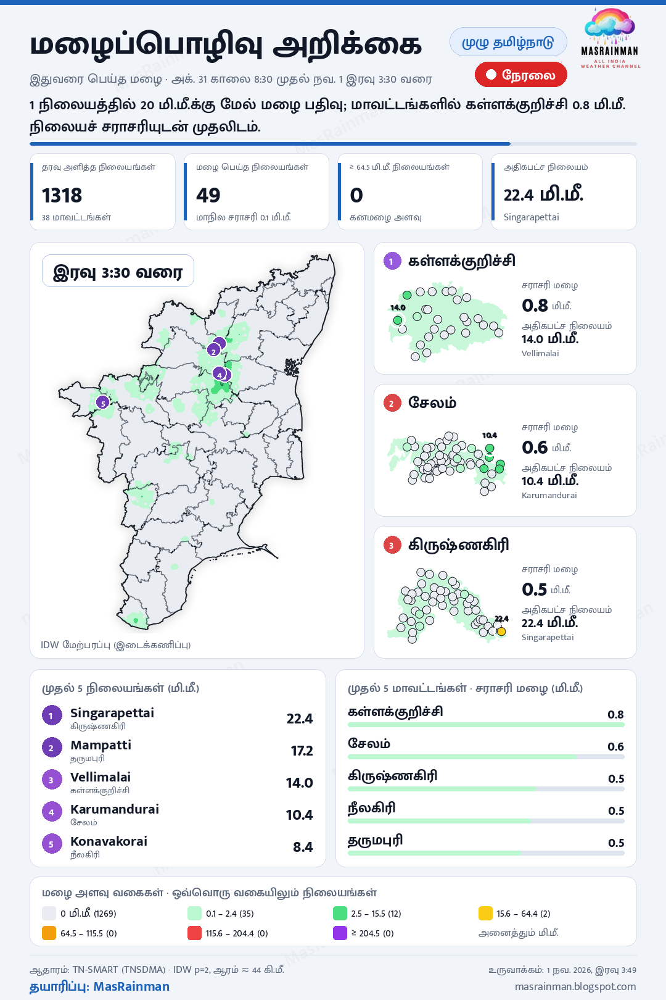

## Karnataka · Rain so far (live)
up to 01 Nov, 3:30 AM — [MP4](files/rain_ka_live_2026-11-01_0330.mp4) · [GIF](files/rain_ka_live_2026-11-01_0330.gif) · [PNG](files/rain_ka_live_2026-11-01_0330.png)

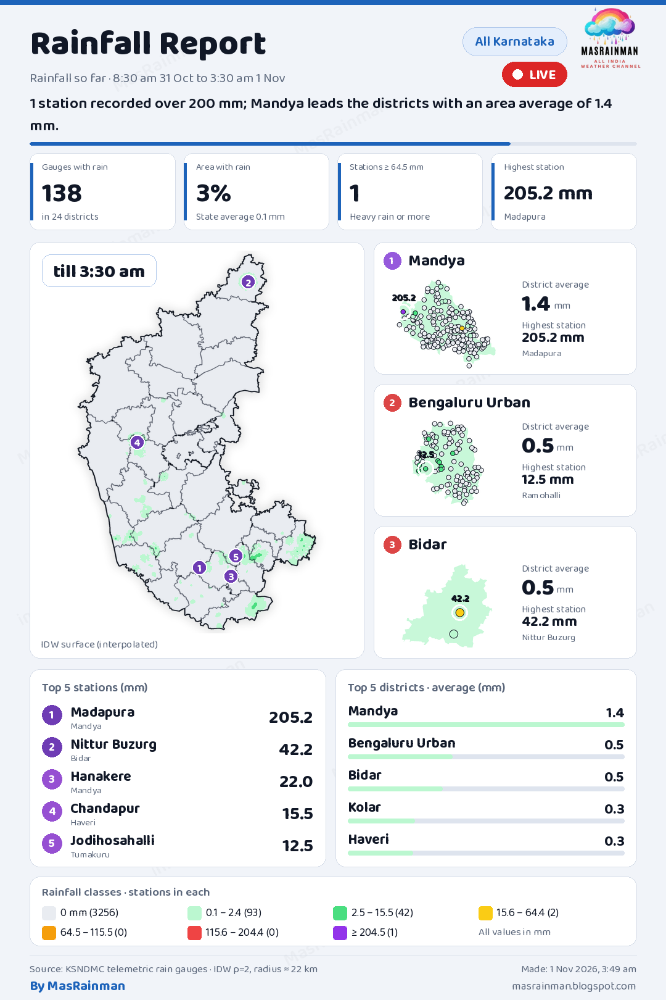

## Andhra Pradesh · Rain so far (live)
up to 01 Nov, 3:00 AM — [MP4](files/rain_ap_live_2026-11-01_0300.mp4) · [GIF](files/rain_ap_live_2026-11-01_0300.gif) · [PNG](files/rain_ap_live_2026-11-01_0300.png)

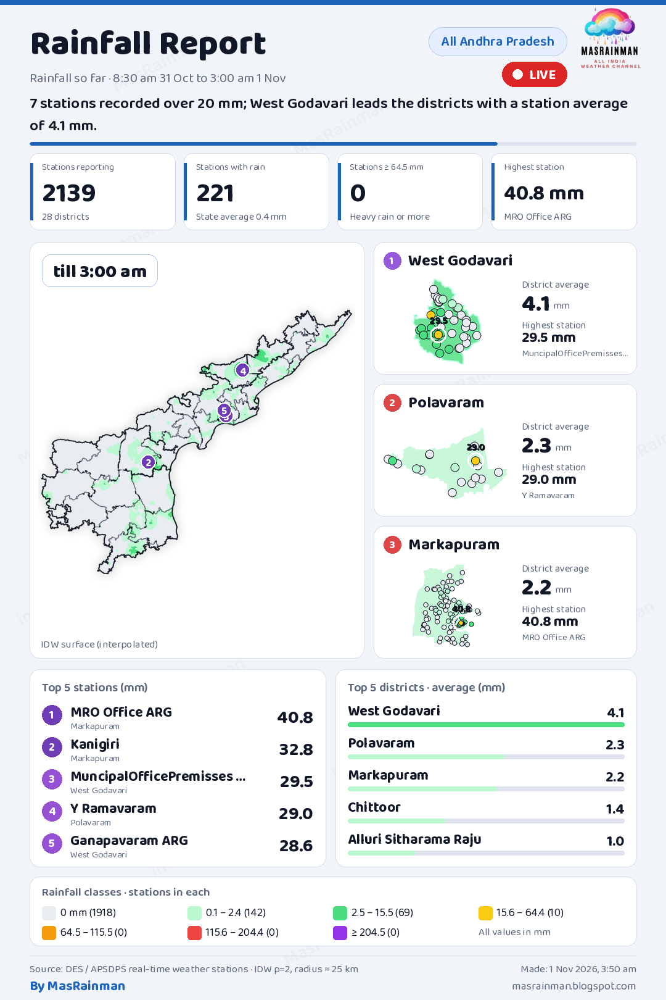

## Tamil Nadu · Satellite rain, past 24 hours
24 h up to 31 Oct, 10:29 AM — [MP4](files/rain_sat24_2026-10-31_1029_en.mp4) · [PNG](files/rain_sat24_2026-10-31_1029_en.png)

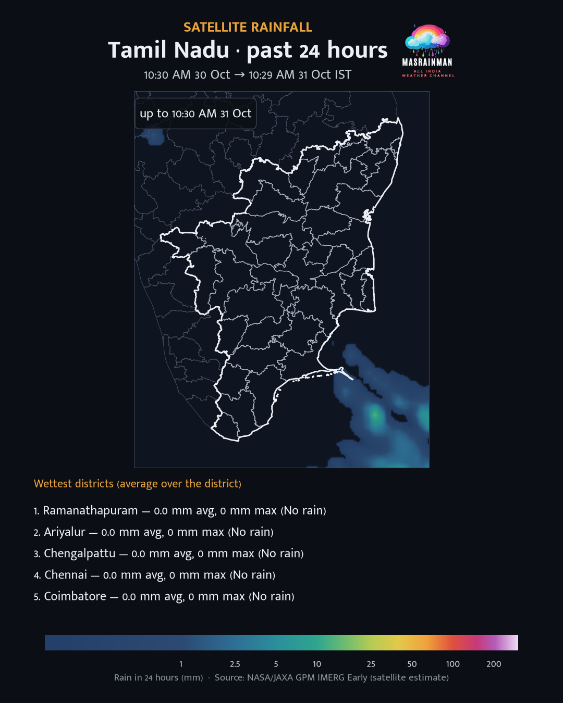

## Karnataka · Satellite rain, past 24 hours
24 h up to 31 Oct, 10:29 AM — [MP4](files/rain_ka_sat24_2026-10-31_1029_en.mp4) · [PNG](files/rain_ka_sat24_2026-10-31_1029_en.png)

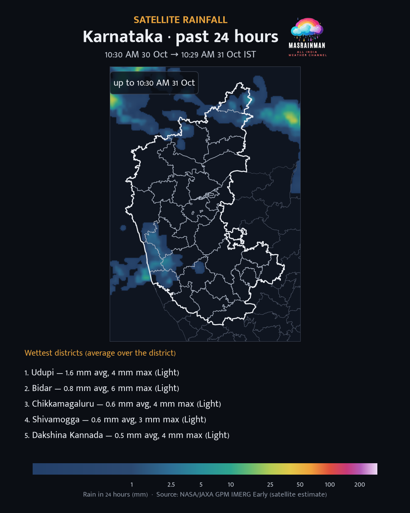

## Andhra Pradesh · Satellite rain, past 24 hours
24 h up to 31 Oct, 10:29 AM — [MP4](files/rain_ap_sat24_2026-10-31_1029_en.mp4) · [PNG](files/rain_ap_sat24_2026-10-31_1029_en.png)

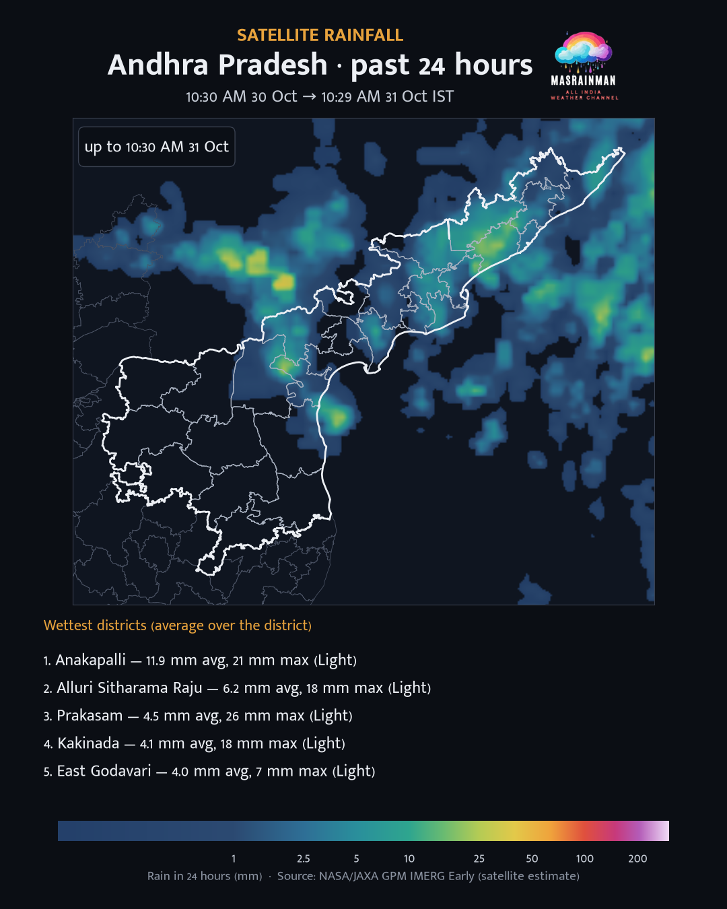

## Tamil Nadu · Past 24 hours, hour by hour
rain-day 31 Oct 2026 — [MP4](files/rain_live24_2026-10-31.mp4) · [PNG](files/rain_live24_2026-10-31.png)

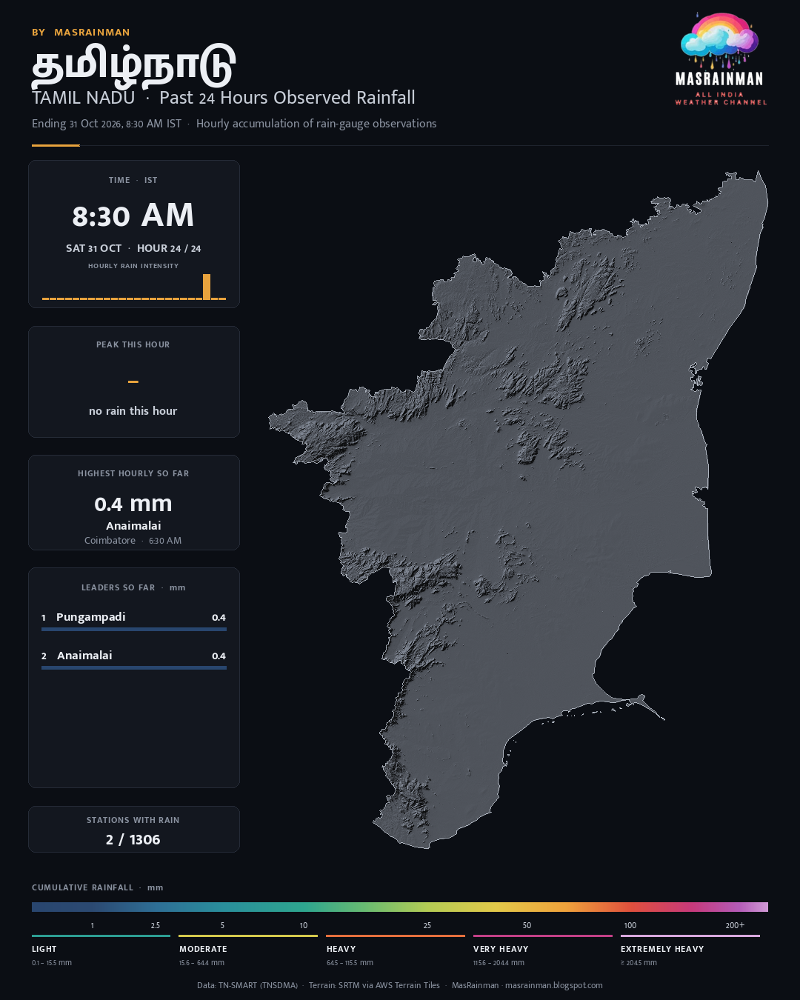

## Kerala · 24-hour rain (Malayalam)
rain-day 31 Oct 2026 — [MP4](files/rain_kl_daily_2026-10-31_ml.mp4) · [GIF](files/rain_kl_daily_2026-10-31_ml.gif) · [PNG](files/rain_kl_daily_2026-10-31_ml.png)

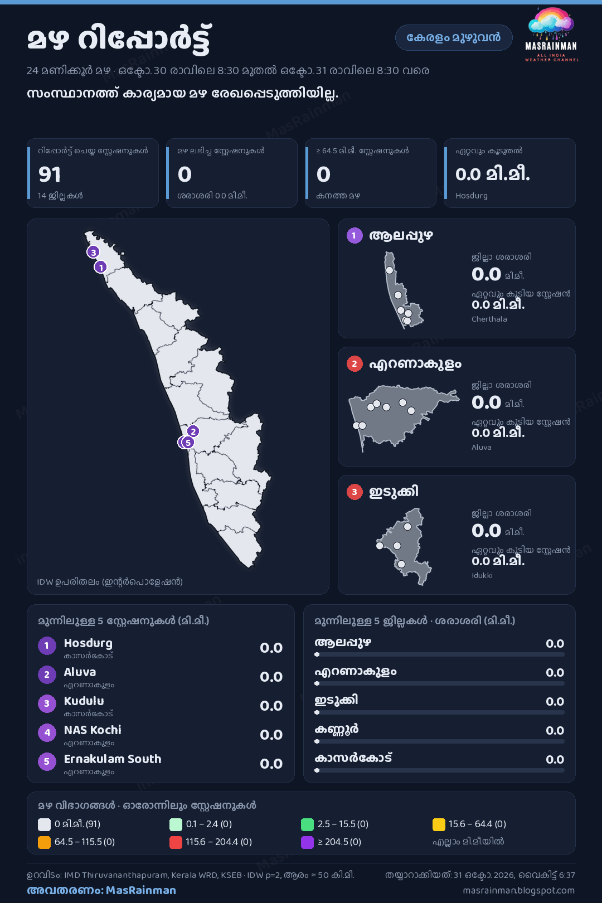

## Kerala · 24-hour rain (English)
rain-day 31 Oct 2026 — [MP4](files/rain_kl_daily_2026-10-31_en.mp4) · [GIF](files/rain_kl_daily_2026-10-31_en.gif) · [PNG](files/rain_kl_daily_2026-10-31_en.png)

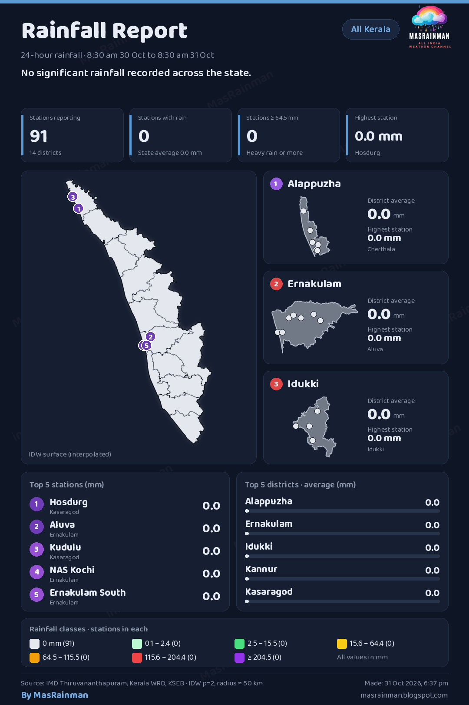

## Kerala · Total rain (multi-day) (Malayalam)
19 Oct → 31 Oct 2026 — [MP4](files/rain_kl_accum_2026-10-19_to_2026-10-31_ml.mp4) · [GIF](files/rain_kl_accum_2026-10-19_to_2026-10-31_ml.gif) · [PNG](files/rain_kl_accum_2026-10-19_to_2026-10-31_ml.png) · [Station list](files/rain_kl_accum_2026-10-19_to_2026-10-31_ml_list.png)

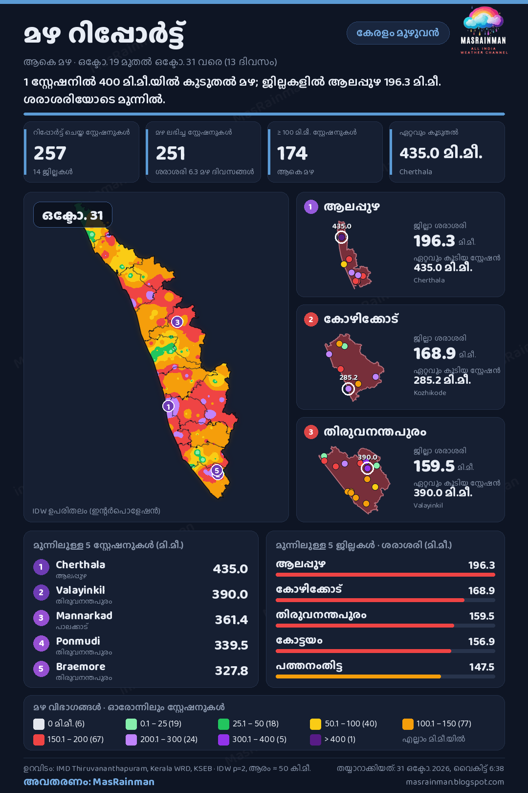

## Kerala · Total rain (multi-day) (English)
19 Oct → 31 Oct 2026 — [MP4](files/rain_kl_accum_2026-10-19_to_2026-10-31_en.mp4) · [GIF](files/rain_kl_accum_2026-10-19_to_2026-10-31_en.gif) · [PNG](files/rain_kl_accum_2026-10-19_to_2026-10-31_en.png) · [Station list](files/rain_kl_accum_2026-10-19_to_2026-10-31_en_list.png)

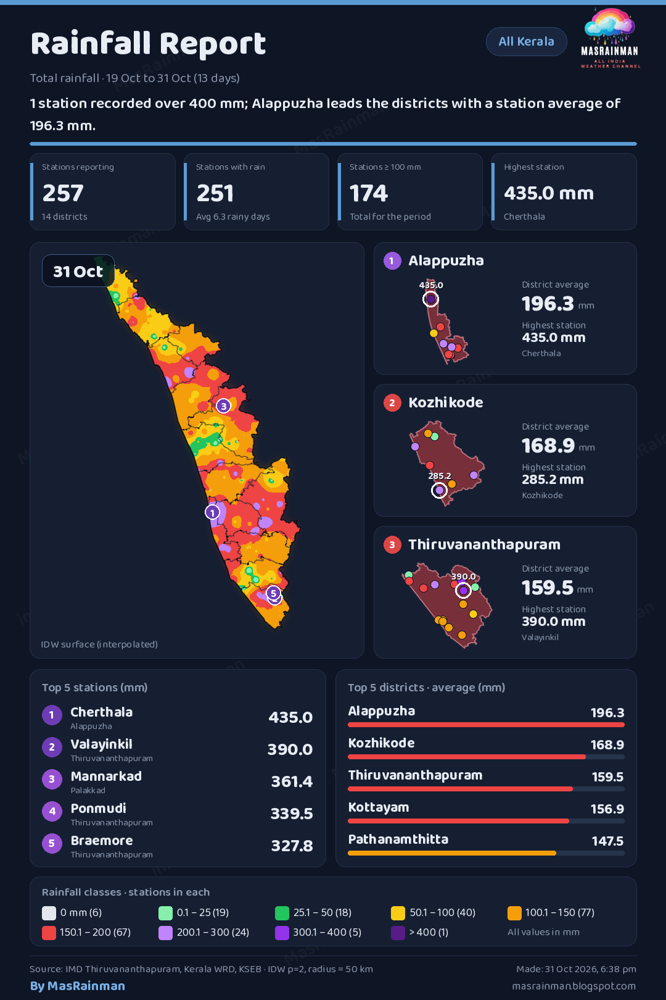

## Tamil Nadu · 24-hour rain
rain-day 31 Oct 2026 — [MP4](files/rain_daily_2026-10-31.mp4) · [GIF](files/rain_daily_2026-10-31.gif) · [PNG](files/rain_daily_2026-10-31.png) · [Station list](files/rain_daily_2026-10-31_list.png)

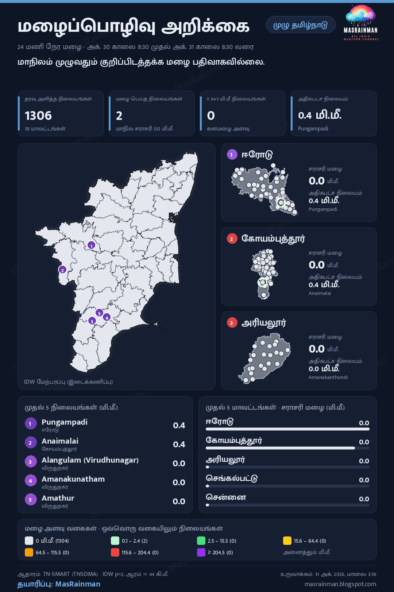

## Andhra Pradesh · 24-hour rain
rain-day 31 Oct 2026 — [MP4](files/rain_ap_daily_2026-10-31.mp4) · [GIF](files/rain_ap_daily_2026-10-31.gif) · [PNG](files/rain_ap_daily_2026-10-31.png) · [Station list](files/rain_ap_daily_2026-10-31_list.png)

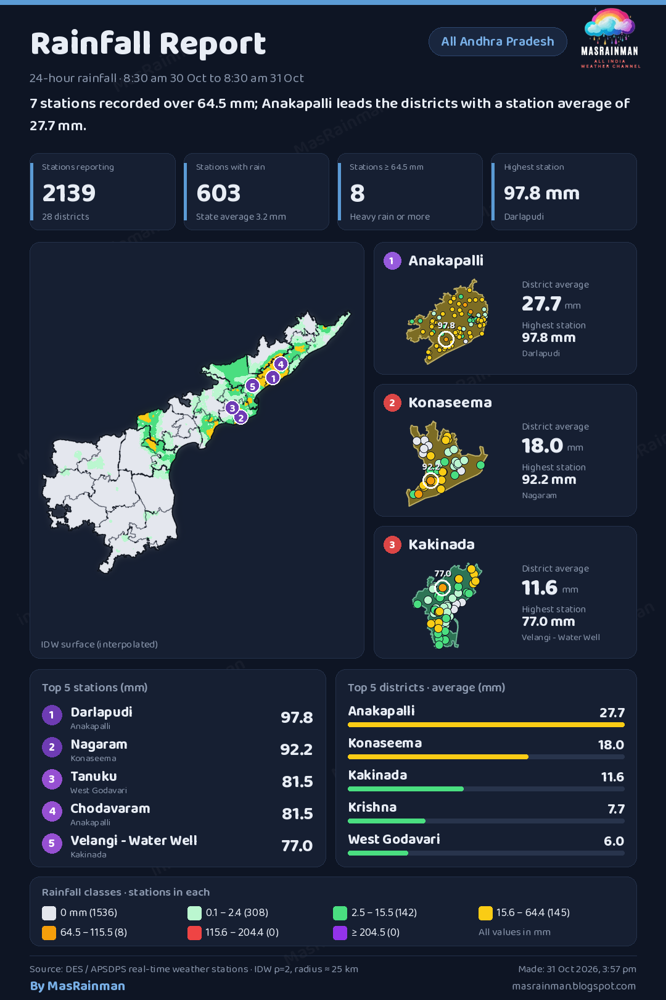

## Andhra Pradesh · Total rain (multi-day)
24 Oct → 31 Oct 2026 — [MP4](files/rain_ap_accum_2026-10-24_to_2026-10-31.mp4) · [GIF](files/rain_ap_accum_2026-10-24_to_2026-10-31.gif) · [PNG](files/rain_ap_accum_2026-10-24_to_2026-10-31.png) · [Station list](files/rain_ap_accum_2026-10-24_to_2026-10-31_list.png)

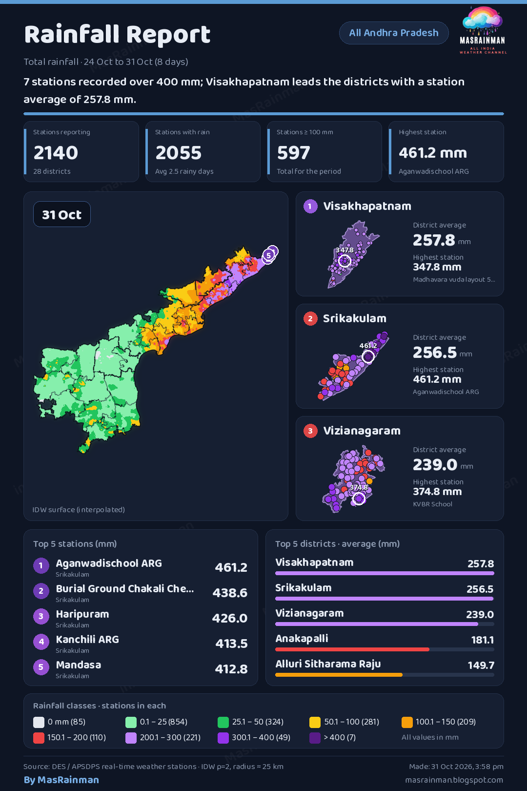

## Tamil Nadu · Total rain (multi-day)
01 Oct → 31 Oct 2026 — [MP4](files/rain_accum_2026-10-01_to_2026-10-31.mp4) · [GIF](files/rain_accum_2026-10-01_to_2026-10-31.gif) · [PNG](files/rain_accum_2026-10-01_to_2026-10-31.png) · [Station list](files/rain_accum_2026-10-01_to_2026-10-31_list.png)

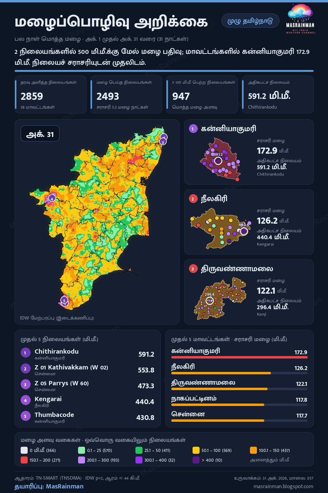

## Karnataka · Satellite radar 3D pass
pass at 30 Oct, 12:59 PM — [MP4](files/rain_ka_gpm3d_2026-10-30_1259_en.mp4) · [PNG](files/rain_ka_gpm3d_2026-10-30_1259_en.png)

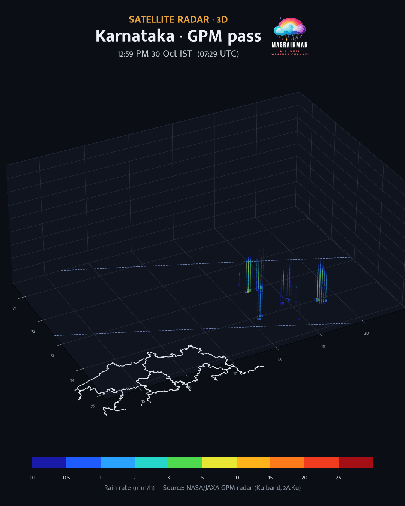

## Andhra Pradesh · Satellite radar 3D pass
pass at 29 Oct, 11:37 PM — [MP4](files/rain_ap_gpm3d_2026-10-29_2337_en.mp4) · [PNG](files/rain_ap_gpm3d_2026-10-29_2337_en.png)

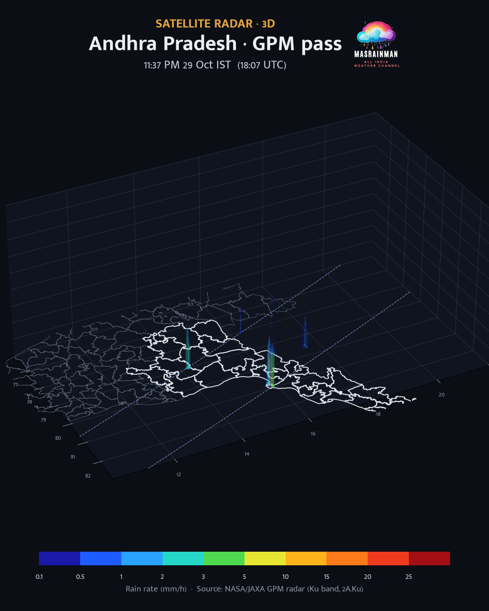

## Tamil Nadu · Satellite radar 3D pass
pass at 29 Oct, 12:20 AM — [MP4](files/rain_gpm3d_2026-10-29_0020_en.mp4) · [PNG](files/rain_gpm3d_2026-10-29_0020_en.png)

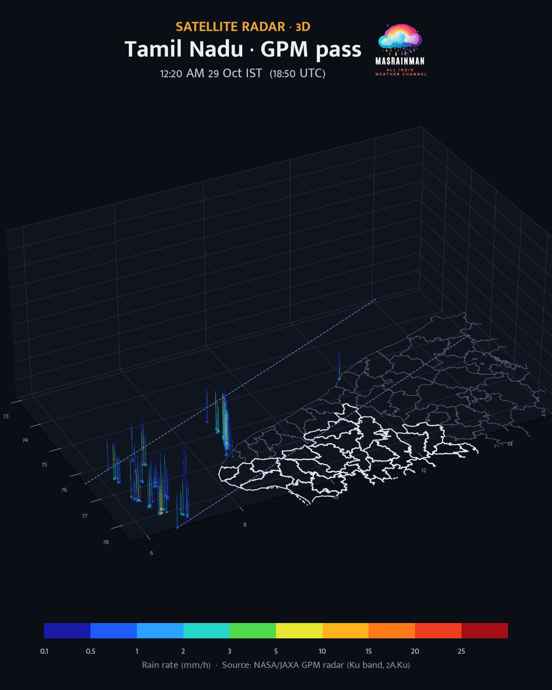

## All reports

| Report | Period | Files |
|---|---|---|
| Tamil Nadu · Rain so far (live) | up to 01 Nov, 3:30 AM | [MP4](files/rain_live_2026-11-01_0330.mp4) [GIF](files/rain_live_2026-11-01_0330.gif) [PNG](files/rain_live_2026-11-01_0330.png) |
| Karnataka · Rain so far (live) | up to 01 Nov, 3:30 AM | [MP4](files/rain_ka_live_2026-11-01_0330.mp4) [GIF](files/rain_ka_live_2026-11-01_0330.gif) [PNG](files/rain_ka_live_2026-11-01_0330.png) |
| Andhra Pradesh · Rain so far (live) | up to 01 Nov, 3:00 AM | [MP4](files/rain_ap_live_2026-11-01_0300.mp4) [GIF](files/rain_ap_live_2026-11-01_0300.gif) [PNG](files/rain_ap_live_2026-11-01_0300.png) |
| Tamil Nadu · Rain so far (live) | up to 01 Nov, 2:30 AM | [MP4](files/rain_live_2026-11-01_0230.mp4) [GIF](files/rain_live_2026-11-01_0230.gif) [PNG](files/rain_live_2026-11-01_0230.png) |
| Karnataka · Rain so far (live) | up to 01 Nov, 2:30 AM | [MP4](files/rain_ka_live_2026-11-01_0230.mp4) [GIF](files/rain_ka_live_2026-11-01_0230.gif) [PNG](files/rain_ka_live_2026-11-01_0230.png) |
| Andhra Pradesh · Rain so far (live) | up to 01 Nov, 2:00 AM | [MP4](files/rain_ap_live_2026-11-01_0200.mp4) [GIF](files/rain_ap_live_2026-11-01_0200.gif) [PNG](files/rain_ap_live_2026-11-01_0200.png) |
| Tamil Nadu · Rain so far (live) | up to 01 Nov, 1:30 AM | [MP4](files/rain_live_2026-11-01_0130.mp4) [GIF](files/rain_live_2026-11-01_0130.gif) [PNG](files/rain_live_2026-11-01_0130.png) |
| Karnataka · Rain so far (live) | up to 01 Nov, 1:15 AM | [MP4](files/rain_ka_live_2026-11-01_0115.mp4) [GIF](files/rain_ka_live_2026-11-01_0115.gif) [PNG](files/rain_ka_live_2026-11-01_0115.png) |
| Andhra Pradesh · Rain so far (live) | up to 01 Nov, 1:00 AM | [MP4](files/rain_ap_live_2026-11-01_0100.mp4) [GIF](files/rain_ap_live_2026-11-01_0100.gif) [PNG](files/rain_ap_live_2026-11-01_0100.png) |
| Karnataka · Rain so far (live) | up to 01 Nov, 12:30 AM | [MP4](files/rain_ka_live_2026-11-01_0030.mp4) [GIF](files/rain_ka_live_2026-11-01_0030.gif) [PNG](files/rain_ka_live_2026-11-01_0030.png) |
| Andhra Pradesh · Rain so far (live) | up to 01 Nov, 12:00 AM | [MP4](files/rain_ap_live_2026-11-01_0000.mp4) [GIF](files/rain_ap_live_2026-11-01_0000.gif) [PNG](files/rain_ap_live_2026-11-01_0000.png) |
| Tamil Nadu · Rain so far (live) | up to 31 Oct, 11:30 PM | [MP4](files/rain_live_2026-10-31_2330.mp4) [GIF](files/rain_live_2026-10-31_2330.gif) [PNG](files/rain_live_2026-10-31_2330.png) |
| Karnataka · Rain so far (live) | up to 31 Oct, 11:30 PM | [MP4](files/rain_ka_live_2026-10-31_2330.mp4) [GIF](files/rain_ka_live_2026-10-31_2330.gif) [PNG](files/rain_ka_live_2026-10-31_2330.png) |
| Andhra Pradesh · Rain so far (live) | up to 31 Oct, 11:00 PM | [MP4](files/rain_ap_live_2026-10-31_2300.mp4) [GIF](files/rain_ap_live_2026-10-31_2300.gif) [PNG](files/rain_ap_live_2026-10-31_2300.png) |
| Karnataka · Rain so far (live) | up to 31 Oct, 10:30 PM | [MP4](files/rain_ka_live_2026-10-31_2230.mp4) [GIF](files/rain_ka_live_2026-10-31_2230.gif) [PNG](files/rain_ka_live_2026-10-31_2230.png) |
| Karnataka · Rain so far (live) | up to 31 Oct, 9:00 PM | [MP4](files/rain_ka_live_2026-10-31_2100.mp4) [GIF](files/rain_ka_live_2026-10-31_2100.gif) [PNG](files/rain_ka_live_2026-10-31_2100.png) |
| Andhra Pradesh · Rain so far (live) | up to 31 Oct, 9:00 PM | [MP4](files/rain_ap_live_2026-10-31_2100.mp4) [GIF](files/rain_ap_live_2026-10-31_2100.gif) [PNG](files/rain_ap_live_2026-10-31_2100.png) |
| Tamil Nadu · Rain so far (live) | up to 31 Oct, 8:30 PM | [MP4](files/rain_live_2026-10-31_2030.mp4) [GIF](files/rain_live_2026-10-31_2030.gif) [PNG](files/rain_live_2026-10-31_2030.png) |
| Andhra Pradesh · Rain so far (live) | up to 31 Oct, 3:00 PM | [MP4](files/rain_ap_live_2026-10-31_1500.mp4) [GIF](files/rain_ap_live_2026-10-31_1500.gif) [PNG](files/rain_ap_live_2026-10-31_1500.png) |
| Karnataka · Rain so far (live) | up to 31 Oct, 2:45 PM | [MP4](files/rain_ka_live_2026-10-31_1445.mp4) [GIF](files/rain_ka_live_2026-10-31_1445.gif) [PNG](files/rain_ka_live_2026-10-31_1445.png) |
| Tamil Nadu · Satellite rain, past 24 hours | 24 h up to 31 Oct, 10:29 AM | [MP4](files/rain_sat24_2026-10-31_1029_en.mp4) [PNG](files/rain_sat24_2026-10-31_1029_en.png) |
| Karnataka · Satellite rain, past 24 hours | 24 h up to 31 Oct, 10:29 AM | [MP4](files/rain_ka_sat24_2026-10-31_1029_en.mp4) [PNG](files/rain_ka_sat24_2026-10-31_1029_en.png) |
| Andhra Pradesh · Satellite rain, past 24 hours | 24 h up to 31 Oct, 10:29 AM | [MP4](files/rain_ap_sat24_2026-10-31_1029_en.mp4) [PNG](files/rain_ap_sat24_2026-10-31_1029_en.png) |
| Tamil Nadu · Past 24 hours, hour by hour | rain-day 31 Oct 2026 | [MP4](files/rain_live24_2026-10-31.mp4) [PNG](files/rain_live24_2026-10-31.png) |
| Kerala · 24-hour rain | rain-day 31 Oct 2026 | [MP4](files/rain_kl_daily_2026-10-31_ml.mp4) [GIF](files/rain_kl_daily_2026-10-31_ml.gif) [PNG](files/rain_kl_daily_2026-10-31_ml.png) |
| Kerala · 24-hour rain | rain-day 31 Oct 2026 | [MP4](files/rain_kl_daily_2026-10-31_en.mp4) [GIF](files/rain_kl_daily_2026-10-31_en.gif) [PNG](files/rain_kl_daily_2026-10-31_en.png) |
| Kerala · Total rain (multi-day) | 19 Oct → 31 Oct 2026 | [MP4](files/rain_kl_accum_2026-10-19_to_2026-10-31_ml.mp4) [GIF](files/rain_kl_accum_2026-10-19_to_2026-10-31_ml.gif) [PNG](files/rain_kl_accum_2026-10-19_to_2026-10-31_ml.png) [LIST](files/rain_kl_accum_2026-10-19_to_2026-10-31_ml_list.png) |
| Kerala · Total rain (multi-day) | 19 Oct → 31 Oct 2026 | [MP4](files/rain_kl_accum_2026-10-19_to_2026-10-31_en.mp4) [GIF](files/rain_kl_accum_2026-10-19_to_2026-10-31_en.gif) [PNG](files/rain_kl_accum_2026-10-19_to_2026-10-31_en.png) [LIST](files/rain_kl_accum_2026-10-19_to_2026-10-31_en_list.png) |
| Tamil Nadu · 24-hour rain | rain-day 31 Oct 2026 | [MP4](files/rain_daily_2026-10-31.mp4) [GIF](files/rain_daily_2026-10-31.gif) [PNG](files/rain_daily_2026-10-31.png) [LIST](files/rain_daily_2026-10-31_list.png) |
| Andhra Pradesh · 24-hour rain | rain-day 31 Oct 2026 | [MP4](files/rain_ap_daily_2026-10-31.mp4) [GIF](files/rain_ap_daily_2026-10-31.gif) [PNG](files/rain_ap_daily_2026-10-31.png) [LIST](files/rain_ap_daily_2026-10-31_list.png) |
| Andhra Pradesh · Total rain (multi-day) | 24 Oct → 31 Oct 2026 | [MP4](files/rain_ap_accum_2026-10-24_to_2026-10-31.mp4) [GIF](files/rain_ap_accum_2026-10-24_to_2026-10-31.gif) [PNG](files/rain_ap_accum_2026-10-24_to_2026-10-31.png) [LIST](files/rain_ap_accum_2026-10-24_to_2026-10-31_list.png) |
| Tamil Nadu · Total rain (multi-day) | 01 Oct → 31 Oct 2026 | [MP4](files/rain_accum_2026-10-01_to_2026-10-31.mp4) [GIF](files/rain_accum_2026-10-01_to_2026-10-31.gif) [PNG](files/rain_accum_2026-10-01_to_2026-10-31.png) [LIST](files/rain_accum_2026-10-01_to_2026-10-31_list.png) |
| Tamil Nadu · Rain so far (live) | up to 31 Oct, 7:30 AM | [MP4](files/rain_live_2026-10-31_0730.mp4) [GIF](files/rain_live_2026-10-31_0730.gif) [PNG](files/rain_live_2026-10-31_0730.png) |
| Karnataka · Rain so far (live) | up to 31 Oct, 7:30 AM | [MP4](files/rain_ka_live_2026-10-31_0730.mp4) [GIF](files/rain_ka_live_2026-10-31_0730.gif) [PNG](files/rain_ka_live_2026-10-31_0730.png) |
| Andhra Pradesh · Rain so far (live) | up to 31 Oct, 7:00 AM | [MP4](files/rain_ap_live_2026-10-31_0700.mp4) [GIF](files/rain_ap_live_2026-10-31_0700.gif) [PNG](files/rain_ap_live_2026-10-31_0700.png) |
| Karnataka · Rain so far (live) | up to 31 Oct, 4:15 AM | [MP4](files/rain_ka_live_2026-10-31_0415.mp4) [GIF](files/rain_ka_live_2026-10-31_0415.gif) [PNG](files/rain_ka_live_2026-10-31_0415.png) |
| Andhra Pradesh · Rain so far (live) | up to 31 Oct, 4:00 AM | [MP4](files/rain_ap_live_2026-10-31_0400.mp4) [GIF](files/rain_ap_live_2026-10-31_0400.gif) [PNG](files/rain_ap_live_2026-10-31_0400.png) |
| Andhra Pradesh · Rain so far (live) | up to 31 Oct, 12:00 AM | [MP4](files/rain_ap_live_2026-10-31_0000.mp4) [GIF](files/rain_ap_live_2026-10-31_0000.gif) [PNG](files/rain_ap_live_2026-10-31_0000.png) |
| Karnataka · Rain so far (live) | up to 30 Oct, 11:45 PM | [MP4](files/rain_ka_live_2026-10-30_2345.mp4) [GIF](files/rain_ka_live_2026-10-30_2345.gif) [PNG](files/rain_ka_live_2026-10-30_2345.png) |
| Tamil Nadu · Rain so far (live) | up to 30 Oct, 11:30 PM | [MP4](files/rain_live_2026-10-30_2330.mp4) [GIF](files/rain_live_2026-10-30_2330.gif) [PNG](files/rain_live_2026-10-30_2330.png) |
| Tamil Nadu · Rain so far (live) | up to 30 Oct, 6:30 PM | [MP4](files/rain_live_2026-10-30_1830.mp4) [GIF](files/rain_live_2026-10-30_1830.gif) [PNG](files/rain_live_2026-10-30_1830.png) |
| Karnataka · Rain so far (live) | up to 30 Oct, 6:15 PM | [MP4](files/rain_ka_live_2026-10-30_1815.mp4) [GIF](files/rain_ka_live_2026-10-30_1815.gif) [PNG](files/rain_ka_live_2026-10-30_1815.png) |
| Andhra Pradesh · Rain so far (live) | up to 30 Oct, 6:00 PM | [MP4](files/rain_ap_live_2026-10-30_1800.mp4) [GIF](files/rain_ap_live_2026-10-30_1800.gif) [PNG](files/rain_ap_live_2026-10-30_1800.png) |
| Karnataka · Satellite radar 3D pass | pass at 30 Oct, 12:59 PM | [MP4](files/rain_ka_gpm3d_2026-10-30_1259_en.mp4) [PNG](files/rain_ka_gpm3d_2026-10-30_1259_en.png) |
| Karnataka · Rain so far (live) | up to 30 Oct, 11:00 AM | [MP4](files/rain_ka_live_2026-10-30_1100.mp4) [GIF](files/rain_ka_live_2026-10-30_1100.gif) [PNG](files/rain_ka_live_2026-10-30_1100.png) |
| Andhra Pradesh · Rain so far (live) | up to 30 Oct, 11:00 AM | [MP4](files/rain_ap_live_2026-10-30_1100.mp4) [GIF](files/rain_ap_live_2026-10-30_1100.gif) [PNG](files/rain_ap_live_2026-10-30_1100.png) |
| Tamil Nadu · Rain so far (live) | up to 30 Oct, 10:30 AM | [MP4](files/rain_live_2026-10-30_1030.mp4) [GIF](files/rain_live_2026-10-30_1030.gif) [PNG](files/rain_live_2026-10-30_1030.png) |
| Tamil Nadu · Past 24 hours, hour by hour | rain-day 30 Oct 2026 | [MP4](files/rain_live24_2026-10-30.mp4) [PNG](files/rain_live24_2026-10-30.png) |
| Kerala · 24-hour rain | rain-day 30 Oct 2026 | [MP4](files/rain_kl_daily_2026-10-30_ml.mp4) [GIF](files/rain_kl_daily_2026-10-30_ml.gif) [PNG](files/rain_kl_daily_2026-10-30_ml.png) [LIST](files/rain_kl_daily_2026-10-30_ml_list.png) |
| Kerala · 24-hour rain | rain-day 30 Oct 2026 | [MP4](files/rain_kl_daily_2026-10-30_en.mp4) [GIF](files/rain_kl_daily_2026-10-30_en.gif) [PNG](files/rain_kl_daily_2026-10-30_en.png) [LIST](files/rain_kl_daily_2026-10-30_en_list.png) |
| Kerala · Total rain (multi-day) | 19 Oct → 30 Oct 2026 | [MP4](files/rain_kl_accum_2026-10-19_to_2026-10-30_ml.mp4) [GIF](files/rain_kl_accum_2026-10-19_to_2026-10-30_ml.gif) [PNG](files/rain_kl_accum_2026-10-19_to_2026-10-30_ml.png) [LIST](files/rain_kl_accum_2026-10-19_to_2026-10-30_ml_list.png) |
| Kerala · Total rain (multi-day) | 19 Oct → 30 Oct 2026 | [MP4](files/rain_kl_accum_2026-10-19_to_2026-10-30_en.mp4) [GIF](files/rain_kl_accum_2026-10-19_to_2026-10-30_en.gif) [PNG](files/rain_kl_accum_2026-10-19_to_2026-10-30_en.png) [LIST](files/rain_kl_accum_2026-10-19_to_2026-10-30_en_list.png) |
| Tamil Nadu · 24-hour rain | rain-day 30 Oct 2026 | [MP4](files/rain_daily_2026-10-30.mp4) [GIF](files/rain_daily_2026-10-30.gif) [PNG](files/rain_daily_2026-10-30.png) [LIST](files/rain_daily_2026-10-30_list.png) |
| Andhra Pradesh · 24-hour rain | rain-day 30 Oct 2026 | [MP4](files/rain_ap_daily_2026-10-30.mp4) [GIF](files/rain_ap_daily_2026-10-30.gif) [PNG](files/rain_ap_daily_2026-10-30.png) [LIST](files/rain_ap_daily_2026-10-30_list.png) |
| Andhra Pradesh · Total rain (multi-day) | 24 Oct → 30 Oct 2026 | [MP4](files/rain_ap_accum_2026-10-24_to_2026-10-30.mp4) [GIF](files/rain_ap_accum_2026-10-24_to_2026-10-30.gif) [PNG](files/rain_ap_accum_2026-10-24_to_2026-10-30.png) [LIST](files/rain_ap_accum_2026-10-24_to_2026-10-30_list.png) |
| Tamil Nadu · Total rain (multi-day) | 01 Oct → 30 Oct 2026 | [MP4](files/rain_accum_2026-10-01_to_2026-10-30.mp4) [GIF](files/rain_accum_2026-10-01_to_2026-10-30.gif) [PNG](files/rain_accum_2026-10-01_to_2026-10-30.png) [LIST](files/rain_accum_2026-10-01_to_2026-10-30_list.png) |
| Tamil Nadu · Rain so far (live) | up to 30 Oct, 4:30 AM | [MP4](files/rain_live_2026-10-30_0430.mp4) [GIF](files/rain_live_2026-10-30_0430.gif) [PNG](files/rain_live_2026-10-30_0430.png) |
| Karnataka · Rain so far (live) | up to 30 Oct, 4:30 AM | [MP4](files/rain_ka_live_2026-10-30_0430.mp4) [GIF](files/rain_ka_live_2026-10-30_0430.gif) [PNG](files/rain_ka_live_2026-10-30_0430.png) |
| Andhra Pradesh · Rain so far (live) | up to 30 Oct, 4:00 AM | [MP4](files/rain_ap_live_2026-10-30_0400.mp4) [GIF](files/rain_ap_live_2026-10-30_0400.gif) [PNG](files/rain_ap_live_2026-10-30_0400.png) |
| Karnataka · Rain so far (live) | up to 30 Oct, 1:30 AM | [MP4](files/rain_ka_live_2026-10-30_0130.mp4) [GIF](files/rain_ka_live_2026-10-30_0130.gif) [PNG](files/rain_ka_live_2026-10-30_0130.png) |
| Andhra Pradesh · Rain so far (live) | up to 30 Oct, 1:00 AM | [MP4](files/rain_ap_live_2026-10-30_0100.mp4) [GIF](files/rain_ap_live_2026-10-30_0100.gif) [PNG](files/rain_ap_live_2026-10-30_0100.png) |
| Tamil Nadu · Rain so far (live) | up to 30 Oct, 12:30 AM | [MP4](files/rain_live_2026-10-30_0030.mp4) [GIF](files/rain_live_2026-10-30_0030.gif) [PNG](files/rain_live_2026-10-30_0030.png) |
| Karnataka · Rain so far (live) | up to 30 Oct, 12:30 AM | [MP4](files/rain_ka_live_2026-10-30_0030.mp4) [GIF](files/rain_ka_live_2026-10-30_0030.gif) [PNG](files/rain_ka_live_2026-10-30_0030.png) |
| Andhra Pradesh · Rain so far (live) | up to 30 Oct, 12:00 AM | [MP4](files/rain_ap_live_2026-10-30_0000.mp4) [GIF](files/rain_ap_live_2026-10-30_0000.gif) [PNG](files/rain_ap_live_2026-10-30_0000.png) |
| Andhra Pradesh · Satellite radar 3D pass | pass at 29 Oct, 11:37 PM | [MP4](files/rain_ap_gpm3d_2026-10-29_2337_en.mp4) [PNG](files/rain_ap_gpm3d_2026-10-29_2337_en.png) |
| Tamil Nadu · Rain so far (live) | up to 29 Oct, 11:30 PM | [MP4](files/rain_live_2026-10-29_2330.mp4) [GIF](files/rain_live_2026-10-29_2330.gif) [PNG](files/rain_live_2026-10-29_2330.png) |
| Karnataka · Rain so far (live) | up to 29 Oct, 11:30 PM | [MP4](files/rain_ka_live_2026-10-29_2330.mp4) [GIF](files/rain_ka_live_2026-10-29_2330.gif) [PNG](files/rain_ka_live_2026-10-29_2330.png) |
| Andhra Pradesh · Rain so far (live) | up to 29 Oct, 11:00 PM | [MP4](files/rain_ap_live_2026-10-29_2300.mp4) [GIF](files/rain_ap_live_2026-10-29_2300.gif) [PNG](files/rain_ap_live_2026-10-29_2300.png) |
| Tamil Nadu · Rain so far (live) | up to 29 Oct, 10:30 PM | [MP4](files/rain_live_2026-10-29_2230.mp4) [GIF](files/rain_live_2026-10-29_2230.gif) [PNG](files/rain_live_2026-10-29_2230.png) |
| Karnataka · Rain so far (live) | up to 29 Oct, 10:30 PM | [MP4](files/rain_ka_live_2026-10-29_2230.mp4) [GIF](files/rain_ka_live_2026-10-29_2230.gif) [PNG](files/rain_ka_live_2026-10-29_2230.png) |
| Andhra Pradesh · Rain so far (live) | up to 29 Oct, 10:00 PM | [MP4](files/rain_ap_live_2026-10-29_2200.mp4) [GIF](files/rain_ap_live_2026-10-29_2200.gif) [PNG](files/rain_ap_live_2026-10-29_2200.png) |
| Tamil Nadu · Rain so far (live) | up to 29 Oct, 9:30 PM | [MP4](files/rain_live_2026-10-29_2130.mp4) [GIF](files/rain_live_2026-10-29_2130.gif) [PNG](files/rain_live_2026-10-29_2130.png) |
| Karnataka · Rain so far (live) | up to 29 Oct, 9:30 PM | [MP4](files/rain_ka_live_2026-10-29_2130.mp4) [GIF](files/rain_ka_live_2026-10-29_2130.gif) [PNG](files/rain_ka_live_2026-10-29_2130.png) |
| Andhra Pradesh · Rain so far (live) | up to 29 Oct, 9:00 PM | [MP4](files/rain_ap_live_2026-10-29_2100.mp4) [GIF](files/rain_ap_live_2026-10-29_2100.gif) [PNG](files/rain_ap_live_2026-10-29_2100.png) |
| Karnataka · Rain so far (live) | up to 29 Oct, 8:45 PM | [MP4](files/rain_ka_live_2026-10-29_2045.mp4) [GIF](files/rain_ka_live_2026-10-29_2045.gif) [PNG](files/rain_ka_live_2026-10-29_2045.png) |
| Tamil Nadu · Rain so far (live) | up to 29 Oct, 8:30 PM | [MP4](files/rain_live_2026-10-29_2030.mp4) [GIF](files/rain_live_2026-10-29_2030.gif) [PNG](files/rain_live_2026-10-29_2030.png) |
| Andhra Pradesh · Rain so far (live) | up to 29 Oct, 8:00 PM | [MP4](files/rain_ap_live_2026-10-29_2000.mp4) [GIF](files/rain_ap_live_2026-10-29_2000.gif) [PNG](files/rain_ap_live_2026-10-29_2000.png) |
| Karnataka · Rain so far (live) | up to 29 Oct, 7:45 PM | [MP4](files/rain_ka_live_2026-10-29_1945.mp4) [GIF](files/rain_ka_live_2026-10-29_1945.gif) [PNG](files/rain_ka_live_2026-10-29_1945.png) |
| Tamil Nadu · Rain so far (live) | up to 29 Oct, 7:30 PM | [MP4](files/rain_live_2026-10-29_1930.mp4) [GIF](files/rain_live_2026-10-29_1930.gif) [PNG](files/rain_live_2026-10-29_1930.png) |
| Tamil Nadu · Rain so far (live) | up to 29 Oct, 6:30 PM | [MP4](files/rain_live_2026-10-29_1830.mp4) [GIF](files/rain_live_2026-10-29_1830.gif) [PNG](files/rain_live_2026-10-29_1830.png) |
| Karnataka · Rain so far (live) | up to 29 Oct, 6:15 PM | [MP4](files/rain_ka_live_2026-10-29_1815.mp4) [GIF](files/rain_ka_live_2026-10-29_1815.gif) [PNG](files/rain_ka_live_2026-10-29_1815.png) |
| Andhra Pradesh · Rain so far (live) | up to 29 Oct, 6:00 PM | [MP4](files/rain_ap_live_2026-10-29_1800.mp4) [GIF](files/rain_ap_live_2026-10-29_1800.gif) [PNG](files/rain_ap_live_2026-10-29_1800.png) |
| Tamil Nadu · Rain so far (live) | up to 29 Oct, 5:30 PM | [MP4](files/rain_live_2026-10-29_1730.mp4) [GIF](files/rain_live_2026-10-29_1730.gif) [PNG](files/rain_live_2026-10-29_1730.png) |
| Karnataka · Rain so far (live) | up to 29 Oct, 5:30 PM | [MP4](files/rain_ka_live_2026-10-29_1730.mp4) [GIF](files/rain_ka_live_2026-10-29_1730.gif) [PNG](files/rain_ka_live_2026-10-29_1730.png) |
| Andhra Pradesh · Rain so far (live) | up to 29 Oct, 5:00 PM | [MP4](files/rain_ap_live_2026-10-29_1700.mp4) [GIF](files/rain_ap_live_2026-10-29_1700.gif) [PNG](files/rain_ap_live_2026-10-29_1700.png) |
| Tamil Nadu · Rain so far (live) | up to 29 Oct, 4:30 PM | [MP4](files/rain_live_2026-10-29_1630.mp4) [GIF](files/rain_live_2026-10-29_1630.gif) [PNG](files/rain_live_2026-10-29_1630.png) |
| Karnataka · Rain so far (live) | up to 29 Oct, 4:30 PM | [MP4](files/rain_ka_live_2026-10-29_1630.mp4) [GIF](files/rain_ka_live_2026-10-29_1630.gif) [PNG](files/rain_ka_live_2026-10-29_1630.png) |
| Andhra Pradesh · Rain so far (live) | up to 29 Oct, 4:00 PM | [MP4](files/rain_ap_live_2026-10-29_1600.mp4) [GIF](files/rain_ap_live_2026-10-29_1600.gif) [PNG](files/rain_ap_live_2026-10-29_1600.png) |
| Tamil Nadu · Rain so far (live) | up to 29 Oct, 3:30 PM | [MP4](files/rain_live_2026-10-29_1530.mp4) [GIF](files/rain_live_2026-10-29_1530.gif) [PNG](files/rain_live_2026-10-29_1530.png) |
| Andhra Pradesh · Rain so far (live) | up to 29 Oct, 3:00 PM | [MP4](files/rain_ap_live_2026-10-29_1500.mp4) [GIF](files/rain_ap_live_2026-10-29_1500.gif) [PNG](files/rain_ap_live_2026-10-29_1500.png) |
| Tamil Nadu · Rain so far (live) | up to 29 Oct, 2:30 PM | [MP4](files/rain_live_2026-10-29_1430.mp4) [GIF](files/rain_live_2026-10-29_1430.gif) [PNG](files/rain_live_2026-10-29_1430.png) |
| Andhra Pradesh · Rain so far (live) | up to 29 Oct, 2:00 PM | [MP4](files/rain_ap_live_2026-10-29_1400.mp4) [GIF](files/rain_ap_live_2026-10-29_1400.gif) [PNG](files/rain_ap_live_2026-10-29_1400.png) |
| Tamil Nadu · Rain so far (live) | up to 29 Oct, 1:30 PM | [MP4](files/rain_live_2026-10-29_1330.mp4) [GIF](files/rain_live_2026-10-29_1330.gif) [PNG](files/rain_live_2026-10-29_1330.png) |
| Tamil Nadu · Rain so far (live) | up to 29 Oct, 12:30 PM | [MP4](files/rain_live_2026-10-29_1230.mp4) [GIF](files/rain_live_2026-10-29_1230.gif) [PNG](files/rain_live_2026-10-29_1230.png) |
| Tamil Nadu · Rain so far (live) | up to 29 Oct, 11:30 AM | [MP4](files/rain_live_2026-10-29_1130.mp4) [GIF](files/rain_live_2026-10-29_1130.gif) [PNG](files/rain_live_2026-10-29_1130.png) |
| Tamil Nadu · Past 24 hours, hour by hour | rain-day 29 Oct 2026 | [MP4](files/rain_live24_2026-10-29.mp4) [PNG](files/rain_live24_2026-10-29.png) |
| Kerala · 24-hour rain | rain-day 29 Oct 2026 | [MP4](files/rain_kl_daily_2026-10-29_ml.mp4) [GIF](files/rain_kl_daily_2026-10-29_ml.gif) [PNG](files/rain_kl_daily_2026-10-29_ml.png) [LIST](files/rain_kl_daily_2026-10-29_ml_list.png) |
| Kerala · 24-hour rain | rain-day 29 Oct 2026 | [MP4](files/rain_kl_daily_2026-10-29_en.mp4) [GIF](files/rain_kl_daily_2026-10-29_en.gif) [PNG](files/rain_kl_daily_2026-10-29_en.png) [LIST](files/rain_kl_daily_2026-10-29_en_list.png) |
| Kerala · Total rain (multi-day) | 19 Oct → 29 Oct 2026 | [MP4](files/rain_kl_accum_2026-10-19_to_2026-10-29_ml.mp4) [GIF](files/rain_kl_accum_2026-10-19_to_2026-10-29_ml.gif) [PNG](files/rain_kl_accum_2026-10-19_to_2026-10-29_ml.png) [LIST](files/rain_kl_accum_2026-10-19_to_2026-10-29_ml_list.png) |
| Kerala · Total rain (multi-day) | 19 Oct → 29 Oct 2026 | [MP4](files/rain_kl_accum_2026-10-19_to_2026-10-29_en.mp4) [GIF](files/rain_kl_accum_2026-10-19_to_2026-10-29_en.gif) [PNG](files/rain_kl_accum_2026-10-19_to_2026-10-29_en.png) [LIST](files/rain_kl_accum_2026-10-19_to_2026-10-29_en_list.png) |
| Tamil Nadu · 24-hour rain | rain-day 29 Oct 2026 | [MP4](files/rain_daily_2026-10-29.mp4) [GIF](files/rain_daily_2026-10-29.gif) [PNG](files/rain_daily_2026-10-29.png) [LIST](files/rain_daily_2026-10-29_list.png) |
| Andhra Pradesh · 24-hour rain | rain-day 29 Oct 2026 | [MP4](files/rain_ap_daily_2026-10-29.mp4) [GIF](files/rain_ap_daily_2026-10-29.gif) [PNG](files/rain_ap_daily_2026-10-29.png) [LIST](files/rain_ap_daily_2026-10-29_list.png) |
| Andhra Pradesh · Total rain (multi-day) | 24 Oct → 29 Oct 2026 | [MP4](files/rain_ap_accum_2026-10-24_to_2026-10-29.mp4) [GIF](files/rain_ap_accum_2026-10-24_to_2026-10-29.gif) [PNG](files/rain_ap_accum_2026-10-24_to_2026-10-29.png) [LIST](files/rain_ap_accum_2026-10-24_to_2026-10-29_list.png) |
| Tamil Nadu · Total rain (multi-day) | 01 Oct → 29 Oct 2026 | [MP4](files/rain_accum_2026-10-01_to_2026-10-29.mp4) [GIF](files/rain_accum_2026-10-01_to_2026-10-29.gif) [PNG](files/rain_accum_2026-10-01_to_2026-10-29.png) [LIST](files/rain_accum_2026-10-01_to_2026-10-29_list.png) |
| Tamil Nadu · Satellite radar 3D pass | pass at 29 Oct, 12:20 AM | [MP4](files/rain_gpm3d_2026-10-29_0020_en.mp4) [PNG](files/rain_gpm3d_2026-10-29_0020_en.png) |
| Andhra Pradesh · Satellite radar 3D pass | pass at 28 Oct, 12:48 PM | [MP4](files/rain_ap_gpm3d_2026-10-28_1248_en.mp4) [PNG](files/rain_ap_gpm3d_2026-10-28_1248_en.png) |
| Tamil Nadu · Satellite radar 3D pass | pass at 28 Oct, 12:47 PM | [MP4](files/rain_gpm3d_2026-10-28_1247_en.mp4) [PNG](files/rain_gpm3d_2026-10-28_1247_en.png) |
| Tamil Nadu · Satellite rain, past 24 hours | 24 h up to 28 Oct, 10:29 AM | [MP4](files/rain_sat24_2026-10-28_1029_en.mp4) [PNG](files/rain_sat24_2026-10-28_1029_en.png) |
| Karnataka · Satellite rain, past 24 hours | 24 h up to 28 Oct, 10:29 AM | [MP4](files/rain_ka_sat24_2026-10-28_1029_en.mp4) [PNG](files/rain_ka_sat24_2026-10-28_1029_en.png) |
| Andhra Pradesh · Satellite rain, past 24 hours | 24 h up to 28 Oct, 10:29 AM | [MP4](files/rain_ap_sat24_2026-10-28_1029_en.mp4) [PNG](files/rain_ap_sat24_2026-10-28_1029_en.png) |
| Tamil Nadu · Past 24 hours, hour by hour | rain-day 28 Oct 2026 | [MP4](files/rain_live24_2026-10-28.mp4) [PNG](files/rain_live24_2026-10-28.png) |
| Kerala · 24-hour rain | rain-day 28 Oct 2026 | [MP4](files/rain_kl_daily_2026-10-28_ml.mp4) [GIF](files/rain_kl_daily_2026-10-28_ml.gif) [PNG](files/rain_kl_daily_2026-10-28_ml.png) [LIST](files/rain_kl_daily_2026-10-28_ml_list.png) |
| Kerala · 24-hour rain | rain-day 28 Oct 2026 | [MP4](files/rain_kl_daily_2026-10-28_en.mp4) [GIF](files/rain_kl_daily_2026-10-28_en.gif) [PNG](files/rain_kl_daily_2026-10-28_en.png) [LIST](files/rain_kl_daily_2026-10-28_en_list.png) |
| Kerala · Total rain (multi-day) | 19 Oct → 28 Oct 2026 | [MP4](files/rain_kl_accum_2026-10-19_to_2026-10-28_ml.mp4) [GIF](files/rain_kl_accum_2026-10-19_to_2026-10-28_ml.gif) [PNG](files/rain_kl_accum_2026-10-19_to_2026-10-28_ml.png) [LIST](files/rain_kl_accum_2026-10-19_to_2026-10-28_ml_list.png) |
| Kerala · Total rain (multi-day) | 19 Oct → 28 Oct 2026 | [MP4](files/rain_kl_accum_2026-10-19_to_2026-10-28_en.mp4) [GIF](files/rain_kl_accum_2026-10-19_to_2026-10-28_en.gif) [PNG](files/rain_kl_accum_2026-10-19_to_2026-10-28_en.png) [LIST](files/rain_kl_accum_2026-10-19_to_2026-10-28_en_list.png) |
| Tamil Nadu · 24-hour rain | rain-day 28 Oct 2026 | [MP4](files/rain_daily_2026-10-28.mp4) [GIF](files/rain_daily_2026-10-28.gif) [PNG](files/rain_daily_2026-10-28.png) [LIST](files/rain_daily_2026-10-28_list.png) |
| Andhra Pradesh · 24-hour rain | rain-day 28 Oct 2026 | [MP4](files/rain_ap_daily_2026-10-28.mp4) [GIF](files/rain_ap_daily_2026-10-28.gif) [PNG](files/rain_ap_daily_2026-10-28.png) [LIST](files/rain_ap_daily_2026-10-28_list.png) |
| Andhra Pradesh · Total rain (multi-day) | 24 Oct → 28 Oct 2026 | [MP4](files/rain_ap_accum_2026-10-24_to_2026-10-28.mp4) [GIF](files/rain_ap_accum_2026-10-24_to_2026-10-28.gif) [PNG](files/rain_ap_accum_2026-10-24_to_2026-10-28.png) [LIST](files/rain_ap_accum_2026-10-24_to_2026-10-28_list.png) |
| Tamil Nadu · Total rain (multi-day) | 01 Oct → 28 Oct 2026 | [MP4](files/rain_accum_2026-10-01_to_2026-10-28.mp4) [GIF](files/rain_accum_2026-10-01_to_2026-10-28.gif) [PNG](files/rain_accum_2026-10-01_to_2026-10-28.png) [LIST](files/rain_accum_2026-10-01_to_2026-10-28_list.png) |
| Tamil Nadu · Past 24 hours, hour by hour | rain-day 27 Oct 2026 | [MP4](files/rain_live24_2026-10-27.mp4) [PNG](files/rain_live24_2026-10-27.png) |
| Kerala · 24-hour rain | rain-day 27 Oct 2026 | [MP4](files/rain_kl_daily_2026-10-27_ml.mp4) [GIF](files/rain_kl_daily_2026-10-27_ml.gif) [PNG](files/rain_kl_daily_2026-10-27_ml.png) [LIST](files/rain_kl_daily_2026-10-27_ml_list.png) |
| Kerala · 24-hour rain | rain-day 27 Oct 2026 | [MP4](files/rain_kl_daily_2026-10-27_en.mp4) [GIF](files/rain_kl_daily_2026-10-27_en.gif) [PNG](files/rain_kl_daily_2026-10-27_en.png) [LIST](files/rain_kl_daily_2026-10-27_en_list.png) |
| Kerala · Total rain (multi-day) | 19 Oct → 27 Oct 2026 | [MP4](files/rain_kl_accum_2026-10-19_to_2026-10-27_ml.mp4) [GIF](files/rain_kl_accum_2026-10-19_to_2026-10-27_ml.gif) [PNG](files/rain_kl_accum_2026-10-19_to_2026-10-27_ml.png) [LIST](files/rain_kl_accum_2026-10-19_to_2026-10-27_ml_list.png) |
| Kerala · Total rain (multi-day) | 19 Oct → 27 Oct 2026 | [MP4](files/rain_kl_accum_2026-10-19_to_2026-10-27_en.mp4) [GIF](files/rain_kl_accum_2026-10-19_to_2026-10-27_en.gif) [PNG](files/rain_kl_accum_2026-10-19_to_2026-10-27_en.png) [LIST](files/rain_kl_accum_2026-10-19_to_2026-10-27_en_list.png) |
| Tamil Nadu · 24-hour rain | rain-day 27 Oct 2026 | [MP4](files/rain_daily_2026-10-27.mp4) [GIF](files/rain_daily_2026-10-27.gif) [PNG](files/rain_daily_2026-10-27.png) [LIST](files/rain_daily_2026-10-27_list.png) |
| Andhra Pradesh · 24-hour rain | rain-day 27 Oct 2026 | [MP4](files/rain_ap_daily_2026-10-27.mp4) [GIF](files/rain_ap_daily_2026-10-27.gif) [PNG](files/rain_ap_daily_2026-10-27.png) [LIST](files/rain_ap_daily_2026-10-27_list.png) |
| Andhra Pradesh · Total rain (multi-day) | 24 Oct → 27 Oct 2026 | [MP4](files/rain_ap_accum_2026-10-24_to_2026-10-27.mp4) [GIF](files/rain_ap_accum_2026-10-24_to_2026-10-27.gif) [PNG](files/rain_ap_accum_2026-10-24_to_2026-10-27.png) [LIST](files/rain_ap_accum_2026-10-24_to_2026-10-27_list.png) |
| Tamil Nadu · Total rain (multi-day) | 01 Oct → 27 Oct 2026 | [MP4](files/rain_accum_2026-10-01_to_2026-10-27.mp4) [GIF](files/rain_accum_2026-10-01_to_2026-10-27.gif) [PNG](files/rain_accum_2026-10-01_to_2026-10-27.png) [LIST](files/rain_accum_2026-10-01_to_2026-10-27_list.png) |
| Tamil Nadu · Satellite rain, past 24 hours | 24 h up to 27 Oct, 6:29 AM | [MP4](files/rain_sat24_2026-10-27_0629_en.mp4) [PNG](files/rain_sat24_2026-10-27_0629_en.png) |
| Karnataka · Satellite rain, past 24 hours | 24 h up to 27 Oct, 6:29 AM | [MP4](files/rain_ka_sat24_2026-10-27_0629_en.mp4) [PNG](files/rain_ka_sat24_2026-10-27_0629_en.png) |
| Andhra Pradesh · Satellite rain, past 24 hours | 24 h up to 27 Oct, 6:29 AM | [MP4](files/rain_ap_sat24_2026-10-27_0629_en.mp4) [PNG](files/rain_ap_sat24_2026-10-27_0629_en.png) |
| Tamil Nadu · Past 24 hours, hour by hour | rain-day 26 Oct 2026 | [MP4](files/rain_live24_2026-10-26.mp4) [PNG](files/rain_live24_2026-10-26.png) |
| Kerala · 24-hour rain | rain-day 26 Oct 2026 | [MP4](files/rain_kl_daily_2026-10-26_ml.mp4) [GIF](files/rain_kl_daily_2026-10-26_ml.gif) [PNG](files/rain_kl_daily_2026-10-26_ml.png) [LIST](files/rain_kl_daily_2026-10-26_ml_list.png) |
| Kerala · 24-hour rain | rain-day 26 Oct 2026 | [MP4](files/rain_kl_daily_2026-10-26_en.mp4) [GIF](files/rain_kl_daily_2026-10-26_en.gif) [PNG](files/rain_kl_daily_2026-10-26_en.png) [LIST](files/rain_kl_daily_2026-10-26_en_list.png) |
| Kerala · Total rain (multi-day) | 19 Oct → 26 Oct 2026 | [MP4](files/rain_kl_accum_2026-10-19_to_2026-10-26_ml.mp4) [GIF](files/rain_kl_accum_2026-10-19_to_2026-10-26_ml.gif) [PNG](files/rain_kl_accum_2026-10-19_to_2026-10-26_ml.png) [LIST](files/rain_kl_accum_2026-10-19_to_2026-10-26_ml_list.png) |
| Kerala · Total rain (multi-day) | 19 Oct → 26 Oct 2026 | [MP4](files/rain_kl_accum_2026-10-19_to_2026-10-26_en.mp4) [GIF](files/rain_kl_accum_2026-10-19_to_2026-10-26_en.gif) [PNG](files/rain_kl_accum_2026-10-19_to_2026-10-26_en.png) [LIST](files/rain_kl_accum_2026-10-19_to_2026-10-26_en_list.png) |
| Tamil Nadu · 24-hour rain | rain-day 26 Oct 2026 | [MP4](files/rain_daily_2026-10-26.mp4) [GIF](files/rain_daily_2026-10-26.gif) [PNG](files/rain_daily_2026-10-26.png) [LIST](files/rain_daily_2026-10-26_list.png) |
| Andhra Pradesh · 24-hour rain | rain-day 26 Oct 2026 | [MP4](files/rain_ap_daily_2026-10-26.mp4) [GIF](files/rain_ap_daily_2026-10-26.gif) [PNG](files/rain_ap_daily_2026-10-26.png) [LIST](files/rain_ap_daily_2026-10-26_list.png) |
| Andhra Pradesh · Total rain (multi-day) | 24 Oct → 26 Oct 2026 | [MP4](files/rain_ap_accum_2026-10-24_to_2026-10-26.mp4) [GIF](files/rain_ap_accum_2026-10-24_to_2026-10-26.gif) [PNG](files/rain_ap_accum_2026-10-24_to_2026-10-26.png) [LIST](files/rain_ap_accum_2026-10-24_to_2026-10-26_list.png) |
| Tamil Nadu · Total rain (multi-day) | 01 Oct → 26 Oct 2026 | [MP4](files/rain_accum_2026-10-01_to_2026-10-26.mp4) [GIF](files/rain_accum_2026-10-01_to_2026-10-26.gif) [PNG](files/rain_accum_2026-10-01_to_2026-10-26.png) [LIST](files/rain_accum_2026-10-01_to_2026-10-26_list.png) |
| Kerala · 24-hour rain | rain-day 25 Oct 2026 | [MP4](files/rain_kl_daily_2026-10-25_ml.mp4) [GIF](files/rain_kl_daily_2026-10-25_ml.gif) [PNG](files/rain_kl_daily_2026-10-25_ml.png) [LIST](files/rain_kl_daily_2026-10-25_ml_list.png) |
| Kerala · 24-hour rain | rain-day 25 Oct 2026 | [MP4](files/rain_kl_daily_2026-10-25_en.mp4) [GIF](files/rain_kl_daily_2026-10-25_en.gif) [PNG](files/rain_kl_daily_2026-10-25_en.png) [LIST](files/rain_kl_daily_2026-10-25_en_list.png) |
| Kerala · Total rain (multi-day) | 19 Oct → 25 Oct 2026 | [MP4](files/rain_kl_accum_2026-10-19_to_2026-10-25_ml.mp4) [GIF](files/rain_kl_accum_2026-10-19_to_2026-10-25_ml.gif) [PNG](files/rain_kl_accum_2026-10-19_to_2026-10-25_ml.png) [LIST](files/rain_kl_accum_2026-10-19_to_2026-10-25_ml_list.png) |
| Kerala · Total rain (multi-day) | 19 Oct → 25 Oct 2026 | [MP4](files/rain_kl_accum_2026-10-19_to_2026-10-25_en.mp4) [GIF](files/rain_kl_accum_2026-10-19_to_2026-10-25_en.gif) [PNG](files/rain_kl_accum_2026-10-19_to_2026-10-25_en.png) [LIST](files/rain_kl_accum_2026-10-19_to_2026-10-25_en_list.png) |
| Tamil Nadu · 24-hour rain | rain-day 25 Oct 2026 | [MP4](files/rain_daily_2026-10-25.mp4) [GIF](files/rain_daily_2026-10-25.gif) [PNG](files/rain_daily_2026-10-25.png) [LIST](files/rain_daily_2026-10-25_list.png) |
| Andhra Pradesh · 24-hour rain | rain-day 25 Oct 2026 | [MP4](files/rain_ap_daily_2026-10-25.mp4) [GIF](files/rain_ap_daily_2026-10-25.gif) [PNG](files/rain_ap_daily_2026-10-25.png) [LIST](files/rain_ap_daily_2026-10-25_list.png) |
| Andhra Pradesh · Total rain (multi-day) | 24 Oct → 25 Oct 2026 | [MP4](files/rain_ap_accum_2026-10-24_to_2026-10-25.mp4) [GIF](files/rain_ap_accum_2026-10-24_to_2026-10-25.gif) [PNG](files/rain_ap_accum_2026-10-24_to_2026-10-25.png) [LIST](files/rain_ap_accum_2026-10-24_to_2026-10-25_list.png) |
| Tamil Nadu · Total rain (multi-day) | 01 Oct → 25 Oct 2026 | [MP4](files/rain_accum_2026-10-01_to_2026-10-25.mp4) [GIF](files/rain_accum_2026-10-01_to_2026-10-25.gif) [PNG](files/rain_accum_2026-10-01_to_2026-10-25.png) [LIST](files/rain_accum_2026-10-01_to_2026-10-25_list.png) |
| Tamil Nadu · 24-hour rain | rain-day 24 Oct 2026 | [MP4](files/rain_daily_2026-10-24.mp4) [GIF](files/rain_daily_2026-10-24.gif) [PNG](files/rain_daily_2026-10-24.png) |
| Tamil Nadu · Total rain (multi-day) | 01 Oct → 24 Oct 2026 | [MP4](files/rain_accum_2026-10-01_to_2026-10-24.mp4) [GIF](files/rain_accum_2026-10-01_to_2026-10-24.gif) [PNG](files/rain_accum_2026-10-01_to_2026-10-24.png) |
