# MasRainman rainfall reports

Updated 08 Nov 2026, 12:50 AM IST. Tap a file to open it; use ⋯ → *Download* (or *Open in browser*) to save it.

## KTCC · Rain so far (live)
up to 08 Nov, 12:30 AM — [MP4](files/rain_ktcc_live_2026-11-08_0030.mp4) · [GIF](files/rain_ktcc_live_2026-11-08_0030.gif) · [PNG](files/rain_ktcc_live_2026-11-08_0030.png)

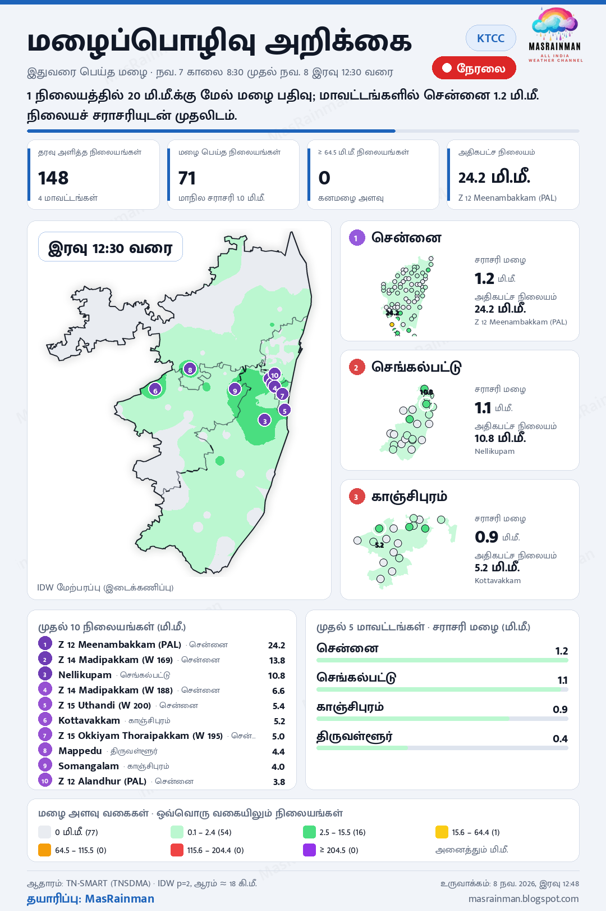

## Karnataka · Rain so far (live)
up to 08 Nov, 12:30 AM — [MP4](files/rain_ka_live_2026-11-08_0030.mp4) · [GIF](files/rain_ka_live_2026-11-08_0030.gif) · [PNG](files/rain_ka_live_2026-11-08_0030.png)

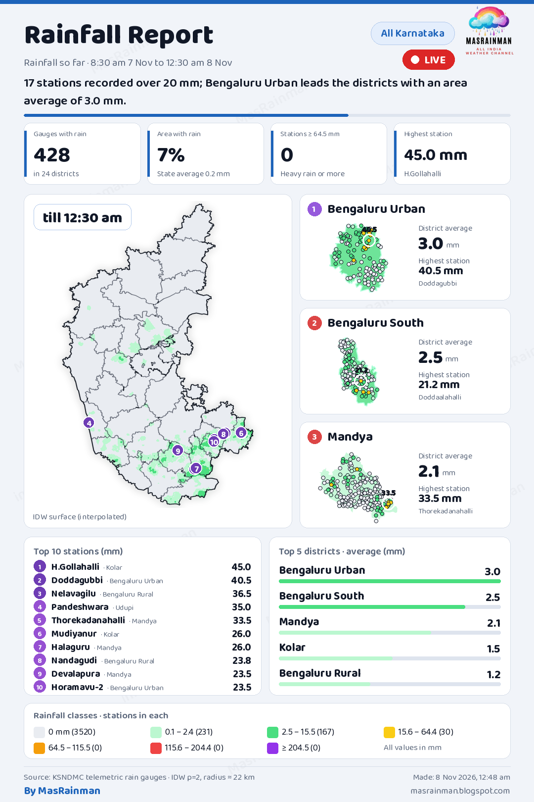

## Tamil Nadu · Rain so far (live)
up to 07 Nov, 11:30 PM — [MP4](files/rain_live_2026-11-07_2330.mp4) · [GIF](files/rain_live_2026-11-07_2330.gif) · [PNG](files/rain_live_2026-11-07_2330.png)

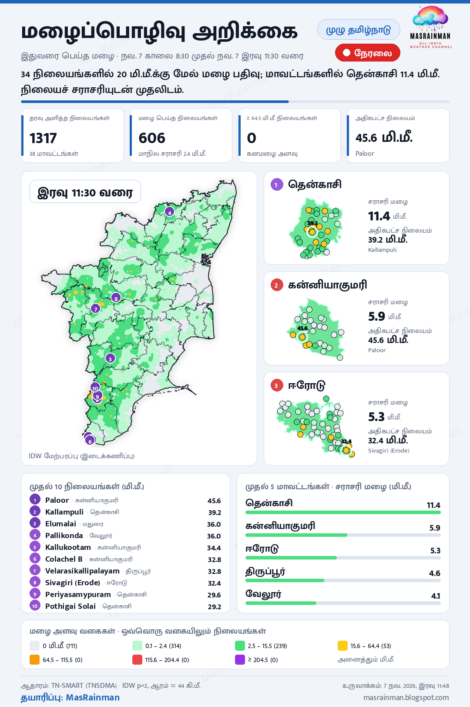

## Telangana · Rain so far (live)
up to 07 Nov, 11:00 PM — [MP4](files/rain_tg_live_2026-11-07_2300.mp4) · [GIF](files/rain_tg_live_2026-11-07_2300.gif) · [PNG](files/rain_tg_live_2026-11-07_2300.png)

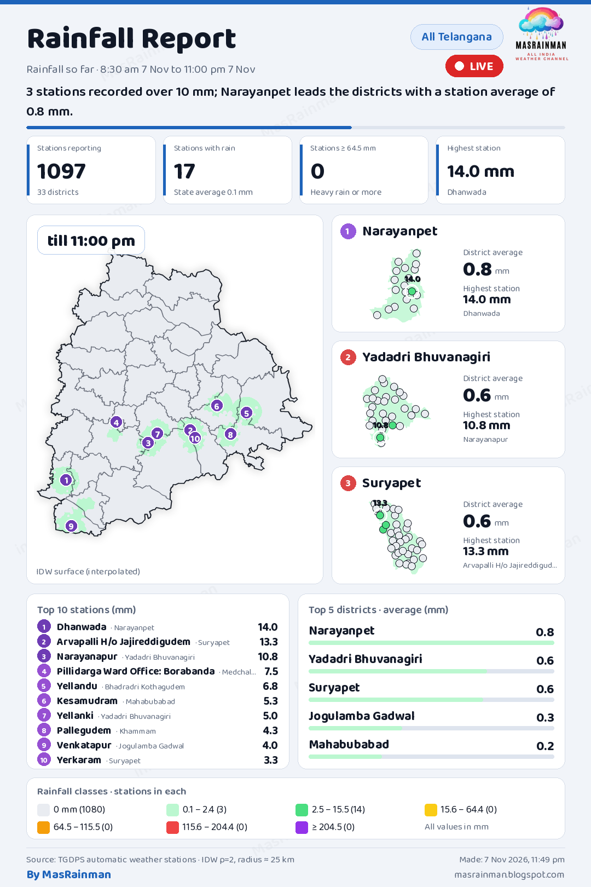

## Andhra Pradesh · Rain so far (live)
up to 07 Nov, 9:00 PM — [MP4](files/rain_ap_live_2026-11-07_2100.mp4) · [GIF](files/rain_ap_live_2026-11-07_2100.gif) · [PNG](files/rain_ap_live_2026-11-07_2100.png)

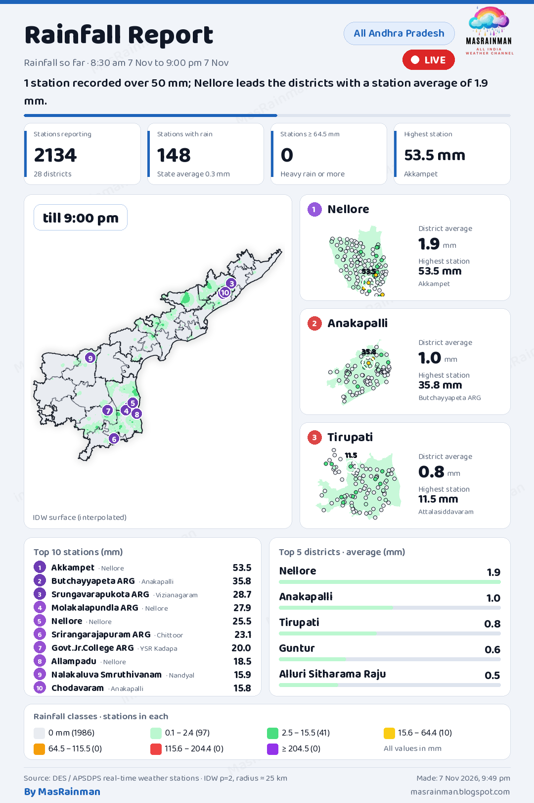

## Tamil Nadu · Satellite rain, past 24 hours
24 h up to 07 Nov, 11:29 AM — [MP4](files/rain_sat24_2026-11-07_1129_en.mp4) · [PNG](files/rain_sat24_2026-11-07_1129_en.png)

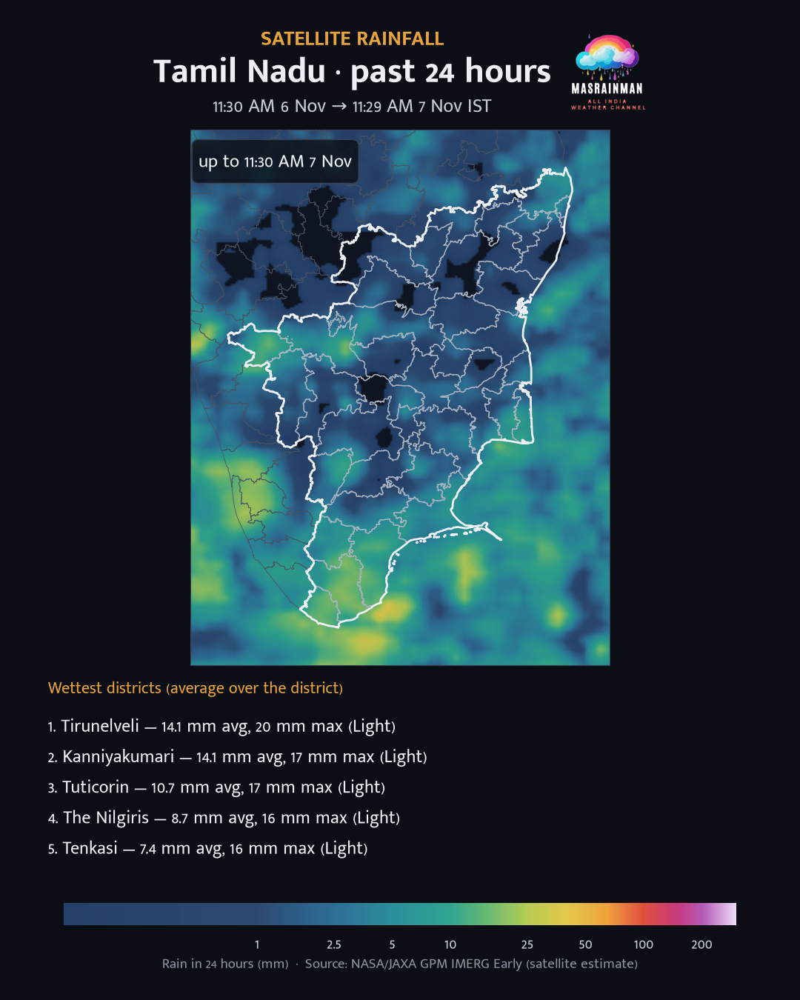

## Karnataka · Satellite rain, past 24 hours
24 h up to 07 Nov, 11:29 AM — [MP4](files/rain_ka_sat24_2026-11-07_1129_en.mp4) · [PNG](files/rain_ka_sat24_2026-11-07_1129_en.png)

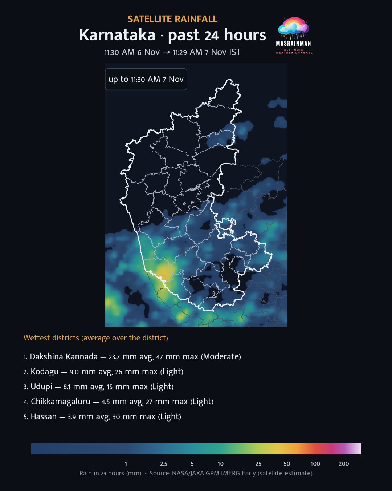

## Andhra Pradesh · Satellite rain, past 24 hours
24 h up to 07 Nov, 11:29 AM — [MP4](files/rain_ap_sat24_2026-11-07_1129_en.mp4) · [PNG](files/rain_ap_sat24_2026-11-07_1129_en.png)

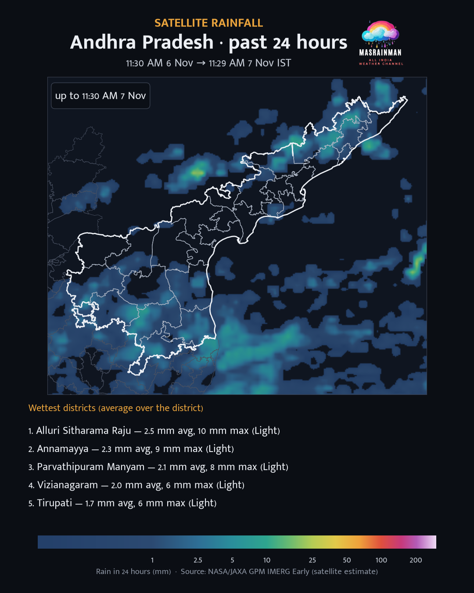

## Telangana · Past 24 hours, hour by hour
rain-day 07 Nov 2026 — [MP4](files/rain_tg_live24_2026-11-07.mp4) · [PNG](files/rain_tg_live24_2026-11-07.png)

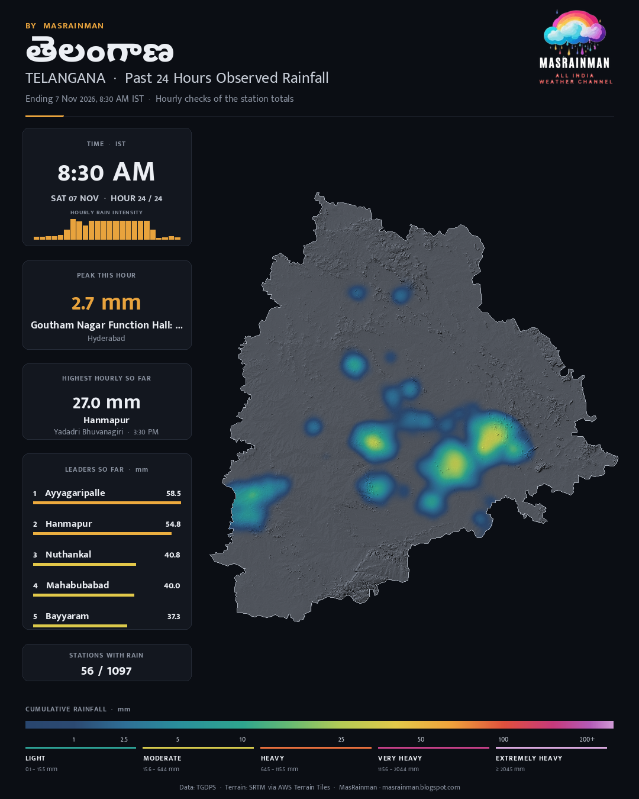

## Telangana · 24-hour rain
rain-day 07 Nov 2026 — [MP4](files/rain_tg_daily_2026-11-07.mp4) · [GIF](files/rain_tg_daily_2026-11-07.gif) · [PNG](files/rain_tg_daily_2026-11-07.png) · [Station list](files/rain_tg_daily_2026-11-07_list.png)

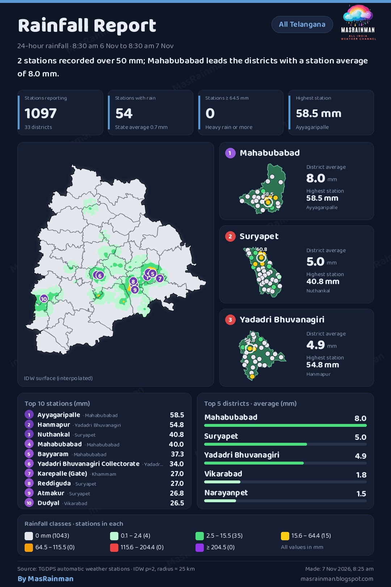

## Telangana · Total rain (multi-day)
03 Nov → 07 Nov 2026 — [MP4](files/rain_tg_accum_2026-11-03_to_2026-11-07.mp4) · [GIF](files/rain_tg_accum_2026-11-03_to_2026-11-07.gif) · [PNG](files/rain_tg_accum_2026-11-03_to_2026-11-07.png) · [Station list](files/rain_tg_accum_2026-11-03_to_2026-11-07_list.png)

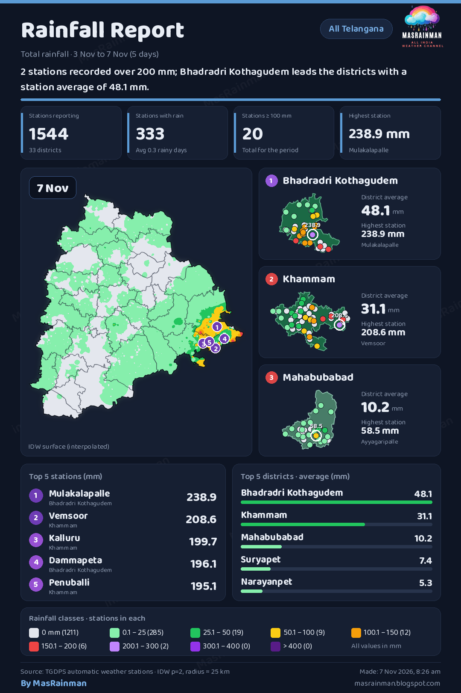

## Tamil Nadu · Past 24 hours, hour by hour
rain-day 07 Nov 2026 — [MP4](files/rain_live24_2026-11-07.mp4) · [PNG](files/rain_live24_2026-11-07.png)

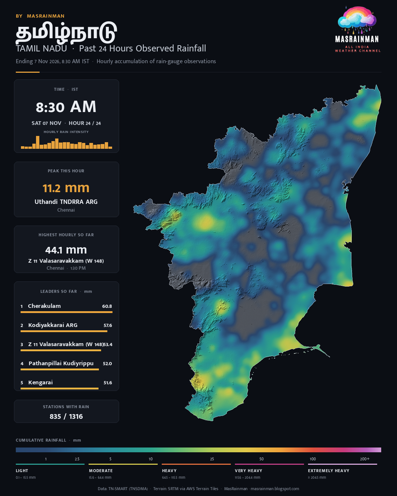

## KTCC · Past 24 hours, hour by hour
rain-day 07 Nov 2026 — [MP4](files/rain_ktcc_live24_2026-11-07.mp4) · [PNG](files/rain_ktcc_live24_2026-11-07.png)

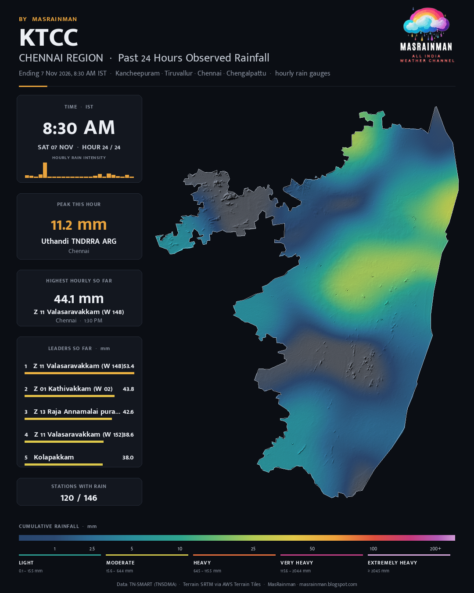

## Kerala · 24-hour rain (Malayalam)
rain-day 07 Nov 2026 — [MP4](files/rain_kl_daily_2026-11-07_ml.mp4) · [GIF](files/rain_kl_daily_2026-11-07_ml.gif) · [PNG](files/rain_kl_daily_2026-11-07_ml.png) · [Station list](files/rain_kl_daily_2026-11-07_ml_list.png)

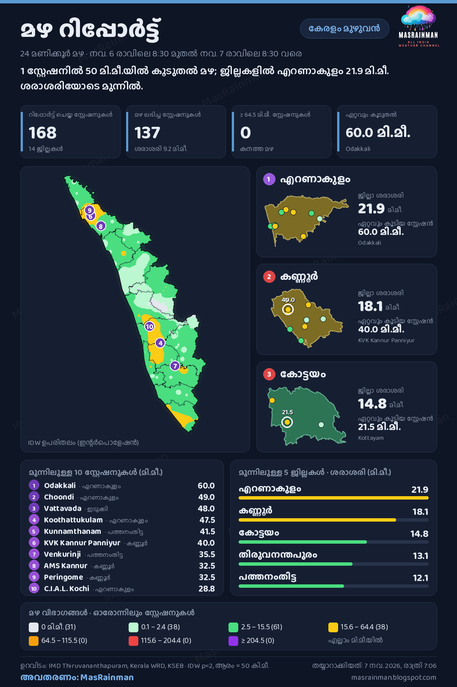

## Kerala · 24-hour rain (English)
rain-day 07 Nov 2026 — [MP4](files/rain_kl_daily_2026-11-07_en.mp4) · [GIF](files/rain_kl_daily_2026-11-07_en.gif) · [PNG](files/rain_kl_daily_2026-11-07_en.png) · [Station list](files/rain_kl_daily_2026-11-07_en_list.png)

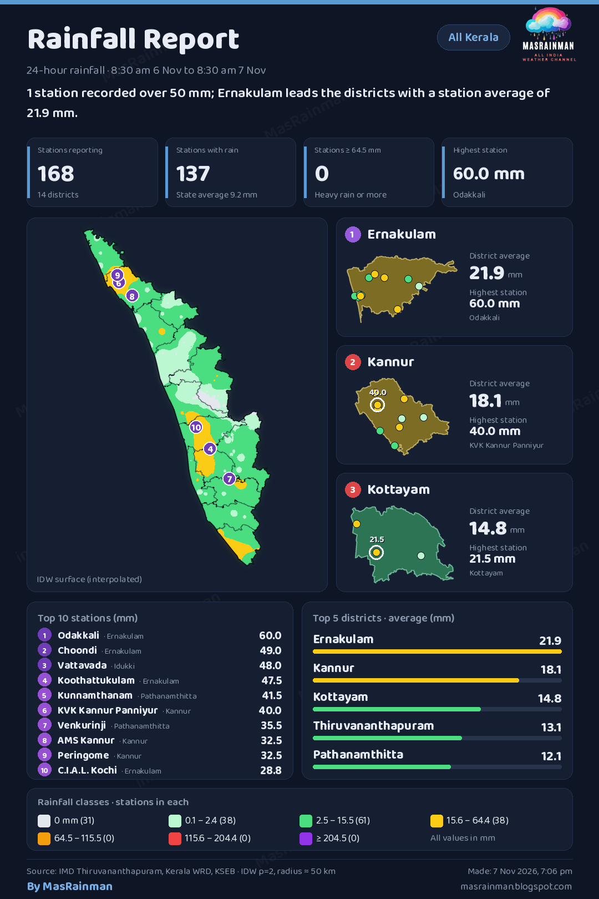

## Kerala · Total rain (multi-day) (Malayalam)
19 Oct → 07 Nov 2026 — [MP4](files/rain_kl_accum_2026-10-19_to_2026-11-07_ml.mp4) · [GIF](files/rain_kl_accum_2026-10-19_to_2026-11-07_ml.gif) · [PNG](files/rain_kl_accum_2026-10-19_to_2026-11-07_ml.png) · [Station list](files/rain_kl_accum_2026-10-19_to_2026-11-07_ml_list.png)

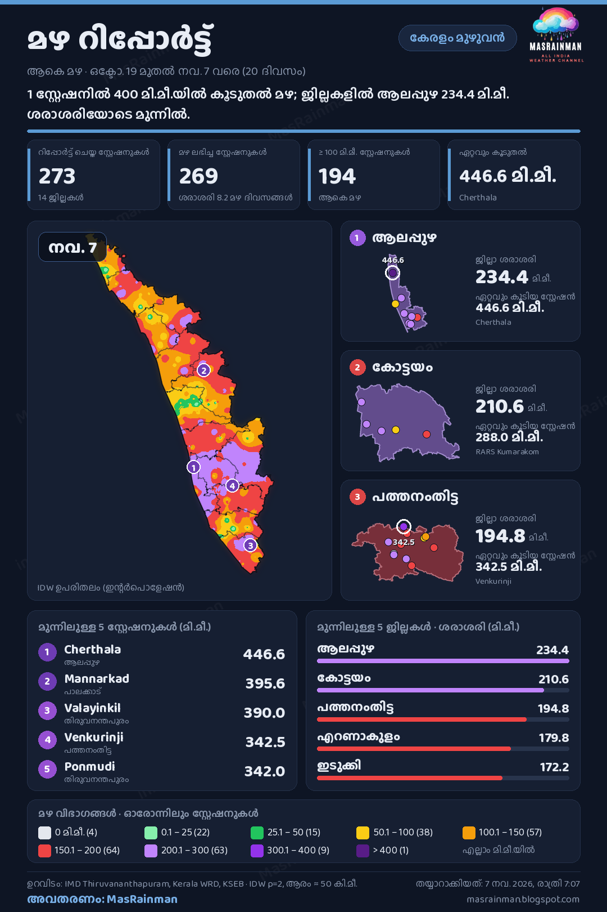

## Kerala · Total rain (multi-day) (English)
19 Oct → 07 Nov 2026 — [MP4](files/rain_kl_accum_2026-10-19_to_2026-11-07_en.mp4) · [GIF](files/rain_kl_accum_2026-10-19_to_2026-11-07_en.gif) · [PNG](files/rain_kl_accum_2026-10-19_to_2026-11-07_en.png) · [Station list](files/rain_kl_accum_2026-10-19_to_2026-11-07_en_list.png)

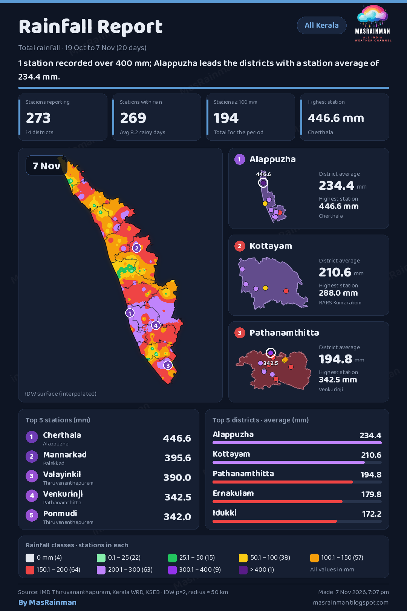

## Karnataka · Past 24 hours, hour by hour
rain-day 07 Nov 2026 — [MP4](files/rain_ka_live24_2026-11-07.mp4) · [PNG](files/rain_ka_live24_2026-11-07.png)

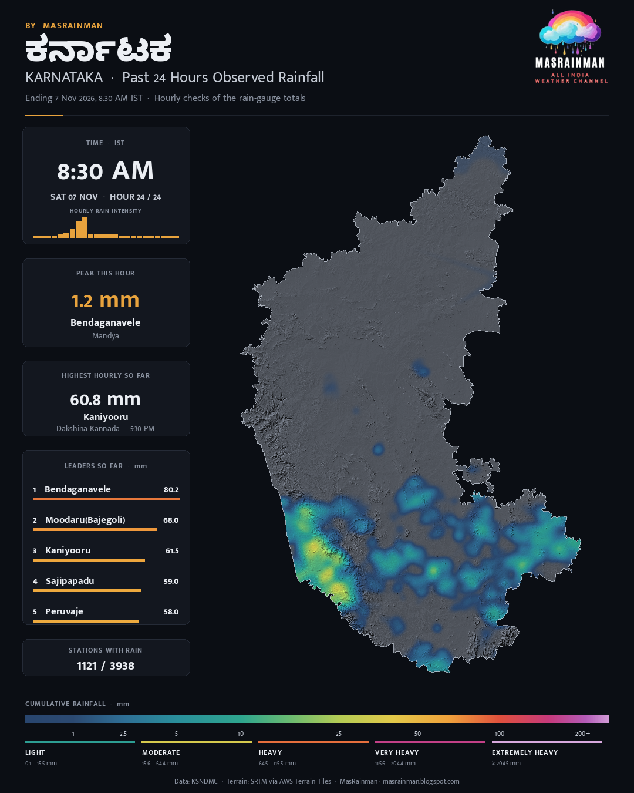

## Tamil Nadu · 24-hour rain
rain-day 07 Nov 2026 — [MP4](files/rain_daily_2026-11-07.mp4) · [GIF](files/rain_daily_2026-11-07.gif) · [PNG](files/rain_daily_2026-11-07.png) · [Station list](files/rain_daily_2026-11-07_list.png)

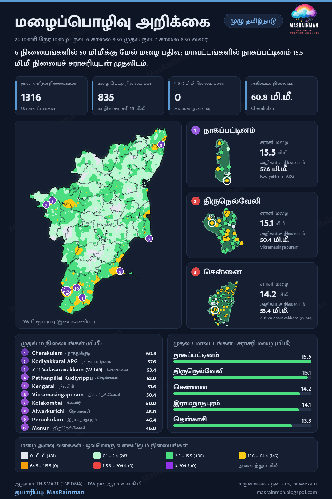

## Andhra Pradesh · Past 24 hours, hour by hour
rain-day 07 Nov 2026 — [MP4](files/rain_ap_live24_2026-11-07.mp4) · [PNG](files/rain_ap_live24_2026-11-07.png)

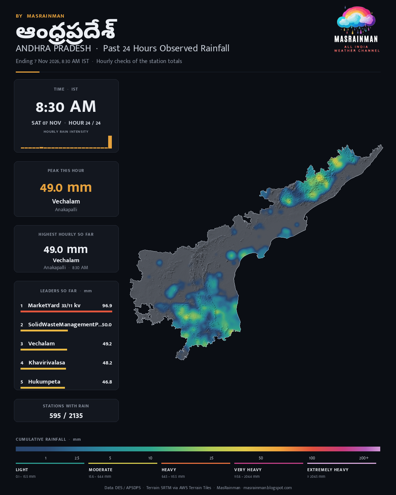

## Andhra Pradesh · 24-hour rain
rain-day 07 Nov 2026 — [MP4](files/rain_ap_daily_2026-11-07.mp4) · [GIF](files/rain_ap_daily_2026-11-07.gif) · [PNG](files/rain_ap_daily_2026-11-07.png) · [Station list](files/rain_ap_daily_2026-11-07_list.png)

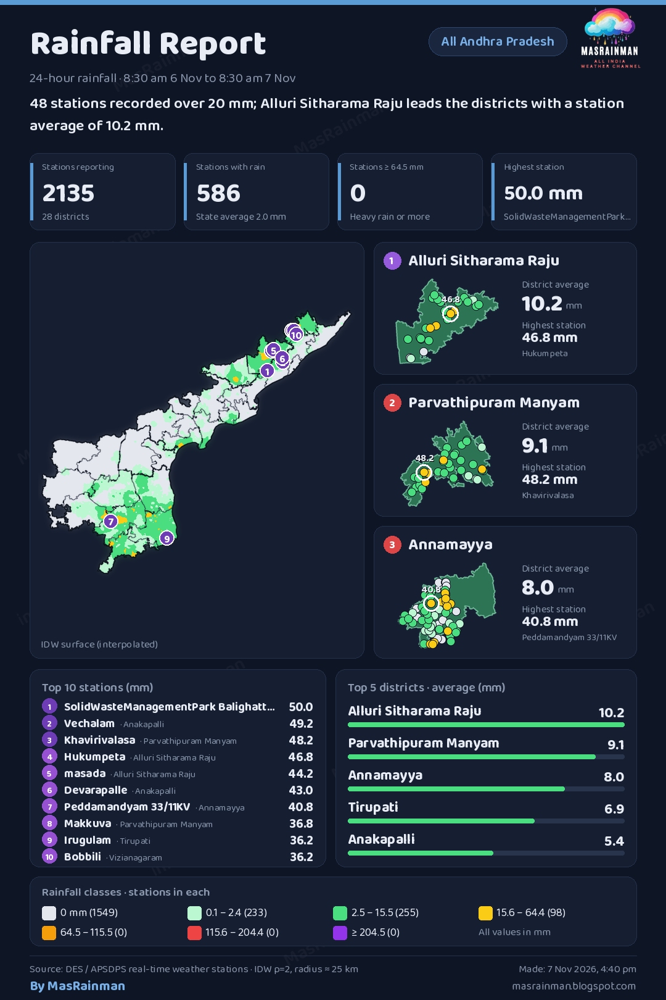

## Andhra Pradesh · Total rain (multi-day)
24 Oct → 07 Nov 2026 — [MP4](files/rain_ap_accum_2026-10-24_to_2026-11-07.mp4) · [GIF](files/rain_ap_accum_2026-10-24_to_2026-11-07.gif) · [PNG](files/rain_ap_accum_2026-10-24_to_2026-11-07.png) · [Station list](files/rain_ap_accum_2026-10-24_to_2026-11-07_list.png)

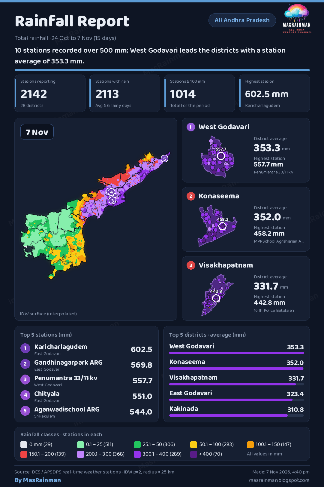

## Tamil Nadu · Total rain (multi-day)
01 Oct → 07 Nov 2026 — [MP4](files/rain_accum_2026-10-01_to_2026-11-07.mp4) · [GIF](files/rain_accum_2026-10-01_to_2026-11-07.gif) · [PNG](files/rain_accum_2026-10-01_to_2026-11-07.png) · [Station list](files/rain_accum_2026-10-01_to_2026-11-07_list.png)

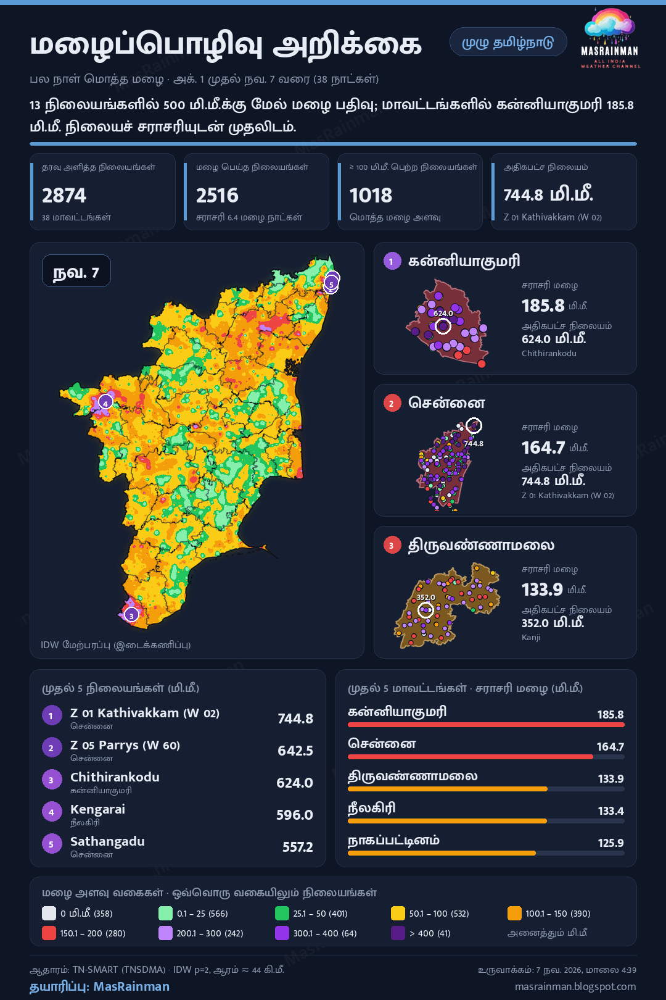

## Tamil Nadu · Satellite radar 3D pass
pass at 05 Nov, 9:55 PM — [MP4](files/rain_gpm3d_2026-11-05_2155_en.mp4) · [PNG](files/rain_gpm3d_2026-11-05_2155_en.png)

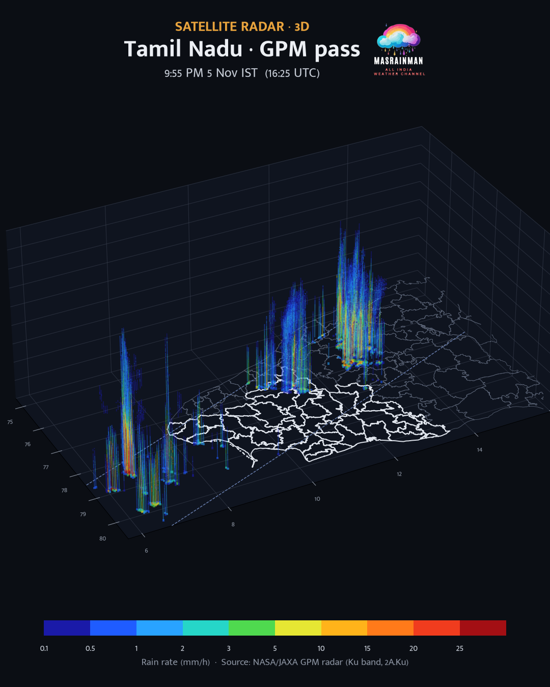

## Karnataka · Satellite radar 3D pass
pass at 05 Nov, 9:54 PM — [MP4](files/rain_ka_gpm3d_2026-11-05_2154_en.mp4) · [PNG](files/rain_ka_gpm3d_2026-11-05_2154_en.png)

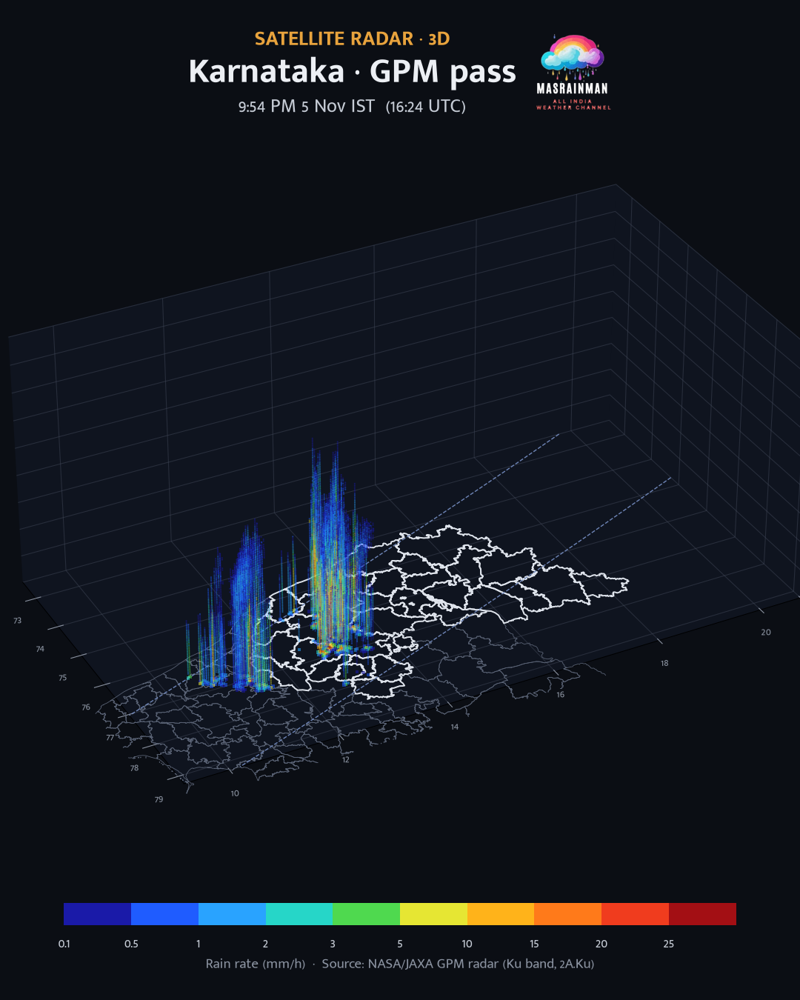

## Andhra Pradesh · Satellite radar 3D pass
pass at 05 Nov, 9:54 PM — [MP4](files/rain_ap_gpm3d_2026-11-05_2154_en.mp4) · [PNG](files/rain_ap_gpm3d_2026-11-05_2154_en.png)

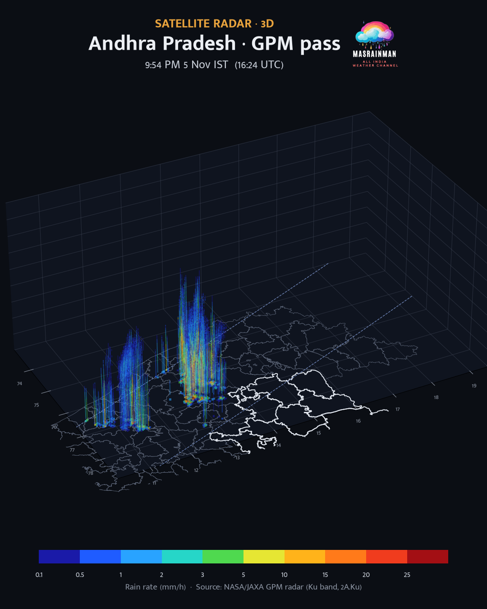

## Tamil Nadu · Monthly total
October 2026 — [MP4](files/rain_month_2026-10.mp4) · [GIF](files/rain_month_2026-10.gif) · [PNG](files/rain_month_2026-10.png)

## All reports

| Report | Period | Files |
|---|---|---|
| KTCC · Rain so far (live) | up to 08 Nov, 12:30 AM | [MP4](files/rain_ktcc_live_2026-11-08_0030.mp4) [GIF](files/rain_ktcc_live_2026-11-08_0030.gif) [PNG](files/rain_ktcc_live_2026-11-08_0030.png) |
| Karnataka · Rain so far (live) | up to 08 Nov, 12:30 AM | [MP4](files/rain_ka_live_2026-11-08_0030.mp4) [GIF](files/rain_ka_live_2026-11-08_0030.gif) [PNG](files/rain_ka_live_2026-11-08_0030.png) |
| Tamil Nadu · Rain so far (live) | up to 07 Nov, 11:30 PM | [MP4](files/rain_live_2026-11-07_2330.mp4) [GIF](files/rain_live_2026-11-07_2330.gif) [PNG](files/rain_live_2026-11-07_2330.png) |
| Karnataka · Rain so far (live) | up to 07 Nov, 11:30 PM | [MP4](files/rain_ka_live_2026-11-07_2330.mp4) [GIF](files/rain_ka_live_2026-11-07_2330.gif) [PNG](files/rain_ka_live_2026-11-07_2330.png) |
| Telangana · Rain so far (live) | up to 07 Nov, 11:00 PM | [MP4](files/rain_tg_live_2026-11-07_2300.mp4) [GIF](files/rain_tg_live_2026-11-07_2300.gif) [PNG](files/rain_tg_live_2026-11-07_2300.png) |
| Tamil Nadu · Rain so far (live) | up to 07 Nov, 10:30 PM | [MP4](files/rain_live_2026-11-07_2230.mp4) [GIF](files/rain_live_2026-11-07_2230.gif) [PNG](files/rain_live_2026-11-07_2230.png) |
| KTCC · Rain so far (live) | up to 07 Nov, 10:30 PM | [MP4](files/rain_ktcc_live_2026-11-07_2230.mp4) [GIF](files/rain_ktcc_live_2026-11-07_2230.gif) [PNG](files/rain_ktcc_live_2026-11-07_2230.png) |
| Karnataka · Rain so far (live) | up to 07 Nov, 10:30 PM | [MP4](files/rain_ka_live_2026-11-07_2230.mp4) [GIF](files/rain_ka_live_2026-11-07_2230.gif) [PNG](files/rain_ka_live_2026-11-07_2230.png) |
| Telangana · Rain so far (live) | up to 07 Nov, 10:00 PM | [MP4](files/rain_tg_live_2026-11-07_2200.mp4) [GIF](files/rain_tg_live_2026-11-07_2200.gif) [PNG](files/rain_tg_live_2026-11-07_2200.png) |
| Tamil Nadu · Rain so far (live) | up to 07 Nov, 9:30 PM | [MP4](files/rain_live_2026-11-07_2130.mp4) [GIF](files/rain_live_2026-11-07_2130.gif) [PNG](files/rain_live_2026-11-07_2130.png) |
| Karnataka · Rain so far (live) | up to 07 Nov, 9:30 PM | [MP4](files/rain_ka_live_2026-11-07_2130.mp4) [GIF](files/rain_ka_live_2026-11-07_2130.gif) [PNG](files/rain_ka_live_2026-11-07_2130.png) |
| Telangana · Rain so far (live) | up to 07 Nov, 9:00 PM | [MP4](files/rain_tg_live_2026-11-07_2100.mp4) [GIF](files/rain_tg_live_2026-11-07_2100.gif) [PNG](files/rain_tg_live_2026-11-07_2100.png) |
| Andhra Pradesh · Rain so far (live) | up to 07 Nov, 9:00 PM | [MP4](files/rain_ap_live_2026-11-07_2100.mp4) [GIF](files/rain_ap_live_2026-11-07_2100.gif) [PNG](files/rain_ap_live_2026-11-07_2100.png) |
| KTCC · Rain so far (live) | up to 07 Nov, 8:30 PM | [MP4](files/rain_ktcc_live_2026-11-07_2030.mp4) [GIF](files/rain_ktcc_live_2026-11-07_2030.gif) [PNG](files/rain_ktcc_live_2026-11-07_2030.png) |
| Tamil Nadu · Rain so far (live) | up to 07 Nov, 7:30 PM | [MP4](files/rain_live_2026-11-07_1930.mp4) [GIF](files/rain_live_2026-11-07_1930.gif) [PNG](files/rain_live_2026-11-07_1930.png) |
| KTCC · Rain so far (live) | up to 07 Nov, 7:30 PM | [MP4](files/rain_ktcc_live_2026-11-07_1930.mp4) [GIF](files/rain_ktcc_live_2026-11-07_1930.gif) [PNG](files/rain_ktcc_live_2026-11-07_1930.png) |
| Karnataka · Rain so far (live) | up to 07 Nov, 7:15 PM | [MP4](files/rain_ka_live_2026-11-07_1915.mp4) [GIF](files/rain_ka_live_2026-11-07_1915.gif) [PNG](files/rain_ka_live_2026-11-07_1915.png) |
| Telangana · Rain so far (live) | up to 07 Nov, 7:00 PM | [MP4](files/rain_tg_live_2026-11-07_1900.mp4) [GIF](files/rain_tg_live_2026-11-07_1900.gif) [PNG](files/rain_tg_live_2026-11-07_1900.png) |
| Tamil Nadu · Rain so far (live) | up to 07 Nov, 3:30 PM | [MP4](files/rain_live_2026-11-07_1530.mp4) [GIF](files/rain_live_2026-11-07_1530.gif) [PNG](files/rain_live_2026-11-07_1530.png) |
| KTCC · Rain so far (live) | up to 07 Nov, 3:30 PM | [MP4](files/rain_ktcc_live_2026-11-07_1530.mp4) [GIF](files/rain_ktcc_live_2026-11-07_1530.gif) [PNG](files/rain_ktcc_live_2026-11-07_1530.png) |
| Karnataka · Rain so far (live) | up to 07 Nov, 3:30 PM | [MP4](files/rain_ka_live_2026-11-07_1530.mp4) [GIF](files/rain_ka_live_2026-11-07_1530.gif) [PNG](files/rain_ka_live_2026-11-07_1530.png) |
| Telangana · Rain so far (live) | up to 07 Nov, 3:00 PM | [MP4](files/rain_tg_live_2026-11-07_1500.mp4) [GIF](files/rain_tg_live_2026-11-07_1500.gif) [PNG](files/rain_tg_live_2026-11-07_1500.png) |
| Andhra Pradesh · Rain so far (live) | up to 07 Nov, 3:00 PM | [MP4](files/rain_ap_live_2026-11-07_1500.mp4) [GIF](files/rain_ap_live_2026-11-07_1500.gif) [PNG](files/rain_ap_live_2026-11-07_1500.png) |
| Telangana · Rain so far (live) | up to 07 Nov, 2:00 PM | [MP4](files/rain_tg_live_2026-11-07_1400.mp4) [GIF](files/rain_tg_live_2026-11-07_1400.gif) [PNG](files/rain_tg_live_2026-11-07_1400.png) |
| KTCC · Rain so far (live) | up to 07 Nov, 1:30 PM | [MP4](files/rain_ktcc_live_2026-11-07_1330.mp4) [GIF](files/rain_ktcc_live_2026-11-07_1330.gif) [PNG](files/rain_ktcc_live_2026-11-07_1330.png) |
| Tamil Nadu · Rain so far (live) | up to 07 Nov, 11:30 AM | [MP4](files/rain_live_2026-11-07_1130.mp4) [GIF](files/rain_live_2026-11-07_1130.gif) [PNG](files/rain_live_2026-11-07_1130.png) |
| Tamil Nadu · Satellite rain, past 24 hours | 24 h up to 07 Nov, 11:29 AM | [MP4](files/rain_sat24_2026-11-07_1129_en.mp4) [PNG](files/rain_sat24_2026-11-07_1129_en.png) |
| Karnataka · Satellite rain, past 24 hours | 24 h up to 07 Nov, 11:29 AM | [MP4](files/rain_ka_sat24_2026-11-07_1129_en.mp4) [PNG](files/rain_ka_sat24_2026-11-07_1129_en.png) |
| Andhra Pradesh · Satellite rain, past 24 hours | 24 h up to 07 Nov, 11:29 AM | [MP4](files/rain_ap_sat24_2026-11-07_1129_en.mp4) [PNG](files/rain_ap_sat24_2026-11-07_1129_en.png) |
| Karnataka · Rain so far (live) | up to 07 Nov, 11:15 AM | [MP4](files/rain_ka_live_2026-11-07_1115.mp4) [GIF](files/rain_ka_live_2026-11-07_1115.gif) [PNG](files/rain_ka_live_2026-11-07_1115.png) |
| Telangana · Rain so far (live) | up to 07 Nov, 11:00 AM | [MP4](files/rain_tg_live_2026-11-07_1100.mp4) [GIF](files/rain_tg_live_2026-11-07_1100.gif) [PNG](files/rain_tg_live_2026-11-07_1100.png) |
| Andhra Pradesh · Rain so far (live) | up to 07 Nov, 11:00 AM | [MP4](files/rain_ap_live_2026-11-07_1100.mp4) [GIF](files/rain_ap_live_2026-11-07_1100.gif) [PNG](files/rain_ap_live_2026-11-07_1100.png) |
| KTCC · Rain so far (live) | up to 07 Nov, 10:30 AM | [MP4](files/rain_ktcc_live_2026-11-07_1030.mp4) [GIF](files/rain_ktcc_live_2026-11-07_1030.gif) [PNG](files/rain_ktcc_live_2026-11-07_1030.png) |
| Telangana · Past 24 hours, hour by hour | rain-day 07 Nov 2026 | [MP4](files/rain_tg_live24_2026-11-07.mp4) [PNG](files/rain_tg_live24_2026-11-07.png) |
| Telangana · 24-hour rain | rain-day 07 Nov 2026 | [MP4](files/rain_tg_daily_2026-11-07.mp4) [GIF](files/rain_tg_daily_2026-11-07.gif) [PNG](files/rain_tg_daily_2026-11-07.png) [LIST](files/rain_tg_daily_2026-11-07_list.png) |
| Telangana · Total rain (multi-day) | 03 Nov → 07 Nov 2026 | [MP4](files/rain_tg_accum_2026-11-03_to_2026-11-07.mp4) [GIF](files/rain_tg_accum_2026-11-03_to_2026-11-07.gif) [PNG](files/rain_tg_accum_2026-11-03_to_2026-11-07.png) [LIST](files/rain_tg_accum_2026-11-03_to_2026-11-07_list.png) |
| Tamil Nadu · Past 24 hours, hour by hour | rain-day 07 Nov 2026 | [MP4](files/rain_live24_2026-11-07.mp4) [PNG](files/rain_live24_2026-11-07.png) |
| KTCC · Past 24 hours, hour by hour | rain-day 07 Nov 2026 | [MP4](files/rain_ktcc_live24_2026-11-07.mp4) [PNG](files/rain_ktcc_live24_2026-11-07.png) |
| Kerala · 24-hour rain | rain-day 07 Nov 2026 | [MP4](files/rain_kl_daily_2026-11-07_ml.mp4) [GIF](files/rain_kl_daily_2026-11-07_ml.gif) [PNG](files/rain_kl_daily_2026-11-07_ml.png) [LIST](files/rain_kl_daily_2026-11-07_ml_list.png) |
| Kerala · 24-hour rain | rain-day 07 Nov 2026 | [MP4](files/rain_kl_daily_2026-11-07_en.mp4) [GIF](files/rain_kl_daily_2026-11-07_en.gif) [PNG](files/rain_kl_daily_2026-11-07_en.png) [LIST](files/rain_kl_daily_2026-11-07_en_list.png) |
| Kerala · Total rain (multi-day) | 19 Oct → 07 Nov 2026 | [MP4](files/rain_kl_accum_2026-10-19_to_2026-11-07_ml.mp4) [GIF](files/rain_kl_accum_2026-10-19_to_2026-11-07_ml.gif) [PNG](files/rain_kl_accum_2026-10-19_to_2026-11-07_ml.png) [LIST](files/rain_kl_accum_2026-10-19_to_2026-11-07_ml_list.png) |
| Kerala · Total rain (multi-day) | 19 Oct → 07 Nov 2026 | [MP4](files/rain_kl_accum_2026-10-19_to_2026-11-07_en.mp4) [GIF](files/rain_kl_accum_2026-10-19_to_2026-11-07_en.gif) [PNG](files/rain_kl_accum_2026-10-19_to_2026-11-07_en.png) [LIST](files/rain_kl_accum_2026-10-19_to_2026-11-07_en_list.png) |
| Karnataka · Past 24 hours, hour by hour | rain-day 07 Nov 2026 | [MP4](files/rain_ka_live24_2026-11-07.mp4) [PNG](files/rain_ka_live24_2026-11-07.png) |
| Tamil Nadu · 24-hour rain | rain-day 07 Nov 2026 | [MP4](files/rain_daily_2026-11-07.mp4) [GIF](files/rain_daily_2026-11-07.gif) [PNG](files/rain_daily_2026-11-07.png) [LIST](files/rain_daily_2026-11-07_list.png) |
| Andhra Pradesh · Past 24 hours, hour by hour | rain-day 07 Nov 2026 | [MP4](files/rain_ap_live24_2026-11-07.mp4) [PNG](files/rain_ap_live24_2026-11-07.png) |
| Andhra Pradesh · 24-hour rain | rain-day 07 Nov 2026 | [MP4](files/rain_ap_daily_2026-11-07.mp4) [GIF](files/rain_ap_daily_2026-11-07.gif) [PNG](files/rain_ap_daily_2026-11-07.png) [LIST](files/rain_ap_daily_2026-11-07_list.png) |
| Andhra Pradesh · Total rain (multi-day) | 24 Oct → 07 Nov 2026 | [MP4](files/rain_ap_accum_2026-10-24_to_2026-11-07.mp4) [GIF](files/rain_ap_accum_2026-10-24_to_2026-11-07.gif) [PNG](files/rain_ap_accum_2026-10-24_to_2026-11-07.png) [LIST](files/rain_ap_accum_2026-10-24_to_2026-11-07_list.png) |
| Tamil Nadu · Total rain (multi-day) | 01 Oct → 07 Nov 2026 | [MP4](files/rain_accum_2026-10-01_to_2026-11-07.mp4) [GIF](files/rain_accum_2026-10-01_to_2026-11-07.gif) [PNG](files/rain_accum_2026-10-01_to_2026-11-07.png) [LIST](files/rain_accum_2026-10-01_to_2026-11-07_list.png) |
| Telangana · Rain so far (live) | up to 07 Nov, 8:00 AM | [MP4](files/rain_tg_live_2026-11-07_0800.mp4) [GIF](files/rain_tg_live_2026-11-07_0800.gif) [PNG](files/rain_tg_live_2026-11-07_0800.png) |
| Karnataka · Rain so far (live) | up to 07 Nov, 8:00 AM | [MP4](files/rain_ka_live_2026-11-07_0800.mp4) [GIF](files/rain_ka_live_2026-11-07_0800.gif) [PNG](files/rain_ka_live_2026-11-07_0800.png) |
| Andhra Pradesh · Rain so far (live) | up to 07 Nov, 8:00 AM | [MP4](files/rain_ap_live_2026-11-07_0800.mp4) [GIF](files/rain_ap_live_2026-11-07_0800.gif) [PNG](files/rain_ap_live_2026-11-07_0800.png) |
| Tamil Nadu · Rain so far (live) | up to 07 Nov, 7:30 AM | [MP4](files/rain_live_2026-11-07_0730.mp4) [GIF](files/rain_live_2026-11-07_0730.gif) [PNG](files/rain_live_2026-11-07_0730.png) |
| KTCC · Rain so far (live) | up to 07 Nov, 7:30 AM | [MP4](files/rain_ktcc_live_2026-11-07_0730.mp4) [GIF](files/rain_ktcc_live_2026-11-07_0730.gif) [PNG](files/rain_ktcc_live_2026-11-07_0730.png) |
| KTCC · Rain so far (live) | up to 07 Nov, 6:30 AM | [MP4](files/rain_ktcc_live_2026-11-07_0630.mp4) [GIF](files/rain_ktcc_live_2026-11-07_0630.gif) [PNG](files/rain_ktcc_live_2026-11-07_0630.png) |
| Karnataka · Rain so far (live) | up to 07 Nov, 5:45 AM | [MP4](files/rain_ka_live_2026-11-07_0545.mp4) [GIF](files/rain_ka_live_2026-11-07_0545.gif) [PNG](files/rain_ka_live_2026-11-07_0545.png) |
| Tamil Nadu · Rain so far (live) | up to 07 Nov, 5:30 AM | [MP4](files/rain_live_2026-11-07_0530.mp4) [GIF](files/rain_live_2026-11-07_0530.gif) [PNG](files/rain_live_2026-11-07_0530.png) |
| KTCC · Rain so far (live) | up to 07 Nov, 5:30 AM | [MP4](files/rain_ktcc_live_2026-11-07_0530.mp4) [GIF](files/rain_ktcc_live_2026-11-07_0530.gif) [PNG](files/rain_ktcc_live_2026-11-07_0530.png) |
| Andhra Pradesh · Rain so far (live) | up to 07 Nov, 5:00 AM | [MP4](files/rain_ap_live_2026-11-07_0500.mp4) [GIF](files/rain_ap_live_2026-11-07_0500.gif) [PNG](files/rain_ap_live_2026-11-07_0500.png) |
| KTCC · Rain so far (live) | up to 07 Nov, 4:30 AM | [MP4](files/rain_ktcc_live_2026-11-07_0430.mp4) [GIF](files/rain_ktcc_live_2026-11-07_0430.gif) [PNG](files/rain_ktcc_live_2026-11-07_0430.png) |
| Karnataka · Rain so far (live) | up to 07 Nov, 4:15 AM | [MP4](files/rain_ka_live_2026-11-07_0415.mp4) [GIF](files/rain_ka_live_2026-11-07_0415.gif) [PNG](files/rain_ka_live_2026-11-07_0415.png) |
| Telangana · Rain so far (live) | up to 07 Nov, 4:00 AM | [MP4](files/rain_tg_live_2026-11-07_0400.mp4) [GIF](files/rain_tg_live_2026-11-07_0400.gif) [PNG](files/rain_tg_live_2026-11-07_0400.png) |
| KTCC · Rain so far (live) | up to 07 Nov, 3:30 AM | [MP4](files/rain_ktcc_live_2026-11-07_0330.mp4) [GIF](files/rain_ktcc_live_2026-11-07_0330.gif) [PNG](files/rain_ktcc_live_2026-11-07_0330.png) |
| Telangana · Rain so far (live) | up to 06 Nov, 11:00 PM | [MP4](files/rain_tg_live_2026-11-06_2300.mp4) [GIF](files/rain_tg_live_2026-11-06_2300.gif) [PNG](files/rain_tg_live_2026-11-06_2300.png) |
| Andhra Pradesh · Rain so far (live) | up to 06 Nov, 11:00 PM | [MP4](files/rain_ap_live_2026-11-06_2300.mp4) [GIF](files/rain_ap_live_2026-11-06_2300.gif) [PNG](files/rain_ap_live_2026-11-06_2300.png) |
| Karnataka · Rain so far (live) | up to 06 Nov, 10:45 PM | [MP4](files/rain_ka_live_2026-11-06_2245.mp4) [GIF](files/rain_ka_live_2026-11-06_2245.gif) [PNG](files/rain_ka_live_2026-11-06_2245.png) |
| Tamil Nadu · Rain so far (live) | up to 06 Nov, 10:30 PM | [MP4](files/rain_live_2026-11-06_2230.mp4) [GIF](files/rain_live_2026-11-06_2230.gif) [PNG](files/rain_live_2026-11-06_2230.png) |
| KTCC · Rain so far (live) | up to 06 Nov, 10:30 PM | [MP4](files/rain_ktcc_live_2026-11-06_2230.mp4) [GIF](files/rain_ktcc_live_2026-11-06_2230.gif) [PNG](files/rain_ktcc_live_2026-11-06_2230.png) |
| KTCC · Rain so far (live) | up to 06 Nov, 9:30 PM | [MP4](files/rain_ktcc_live_2026-11-06_2130.mp4) [GIF](files/rain_ktcc_live_2026-11-06_2130.gif) [PNG](files/rain_ktcc_live_2026-11-06_2130.png) |
| Tamil Nadu · Rain so far (live) | up to 06 Nov, 5:30 PM | [MP4](files/rain_live_2026-11-06_1730.mp4) [GIF](files/rain_live_2026-11-06_1730.gif) [PNG](files/rain_live_2026-11-06_1730.png) |
| KTCC · Rain so far (live) | up to 06 Nov, 5:30 PM | [MP4](files/rain_ktcc_live_2026-11-06_1730.mp4) [GIF](files/rain_ktcc_live_2026-11-06_1730.gif) [PNG](files/rain_ktcc_live_2026-11-06_1730.png) |
| Karnataka · Rain so far (live) | up to 06 Nov, 5:30 PM | [MP4](files/rain_ka_live_2026-11-06_1730.mp4) [GIF](files/rain_ka_live_2026-11-06_1730.gif) [PNG](files/rain_ka_live_2026-11-06_1730.png) |
| Telangana · Rain so far (live) | up to 06 Nov, 5:00 PM | [MP4](files/rain_tg_live_2026-11-06_1700.mp4) [GIF](files/rain_tg_live_2026-11-06_1700.gif) [PNG](files/rain_tg_live_2026-11-06_1700.png) |
| Andhra Pradesh · Rain so far (live) | up to 06 Nov, 5:00 PM | [MP4](files/rain_ap_live_2026-11-06_1700.mp4) [GIF](files/rain_ap_live_2026-11-06_1700.gif) [PNG](files/rain_ap_live_2026-11-06_1700.png) |
| Tamil Nadu · Rain so far (live) | up to 06 Nov, 4:30 PM | [MP4](files/rain_live_2026-11-06_1630.mp4) [GIF](files/rain_live_2026-11-06_1630.gif) [PNG](files/rain_live_2026-11-06_1630.png) |
| KTCC · Rain so far (live) | up to 06 Nov, 4:30 PM | [MP4](files/rain_ktcc_live_2026-11-06_1630.mp4) [GIF](files/rain_ktcc_live_2026-11-06_1630.gif) [PNG](files/rain_ktcc_live_2026-11-06_1630.png) |
| Karnataka · Rain so far (live) | up to 06 Nov, 4:30 PM | [MP4](files/rain_ka_live_2026-11-06_1630.mp4) [GIF](files/rain_ka_live_2026-11-06_1630.gif) [PNG](files/rain_ka_live_2026-11-06_1630.png) |
| Telangana · Rain so far (live) | up to 06 Nov, 4:00 PM | [MP4](files/rain_tg_live_2026-11-06_1600.mp4) [GIF](files/rain_tg_live_2026-11-06_1600.gif) [PNG](files/rain_tg_live_2026-11-06_1600.png) |
| Andhra Pradesh · Rain so far (live) | up to 06 Nov, 4:00 PM | [MP4](files/rain_ap_live_2026-11-06_1600.mp4) [GIF](files/rain_ap_live_2026-11-06_1600.gif) [PNG](files/rain_ap_live_2026-11-06_1600.png) |
| Tamil Nadu · Rain so far (live) | up to 06 Nov, 3:30 PM | [MP4](files/rain_live_2026-11-06_1530.mp4) [GIF](files/rain_live_2026-11-06_1530.gif) [PNG](files/rain_live_2026-11-06_1530.png) |
| KTCC · Rain so far (live) | up to 06 Nov, 3:30 PM | [MP4](files/rain_ktcc_live_2026-11-06_1530.mp4) [GIF](files/rain_ktcc_live_2026-11-06_1530.gif) [PNG](files/rain_ktcc_live_2026-11-06_1530.png) |
| Karnataka · Rain so far (live) | up to 06 Nov, 3:30 PM | [MP4](files/rain_ka_live_2026-11-06_1530.mp4) [GIF](files/rain_ka_live_2026-11-06_1530.gif) [PNG](files/rain_ka_live_2026-11-06_1530.png) |
| Telangana · Rain so far (live) | up to 06 Nov, 3:00 PM | [MP4](files/rain_tg_live_2026-11-06_1500.mp4) [GIF](files/rain_tg_live_2026-11-06_1500.gif) [PNG](files/rain_tg_live_2026-11-06_1500.png) |
| Tamil Nadu · Rain so far (live) | up to 06 Nov, 2:30 PM | [MP4](files/rain_live_2026-11-06_1430.mp4) [GIF](files/rain_live_2026-11-06_1430.gif) [PNG](files/rain_live_2026-11-06_1430.png) |
| KTCC · Rain so far (live) | up to 06 Nov, 2:30 PM | [MP4](files/rain_ktcc_live_2026-11-06_1430.mp4) [GIF](files/rain_ktcc_live_2026-11-06_1430.gif) [PNG](files/rain_ktcc_live_2026-11-06_1430.png) |
| Karnataka · Rain so far (live) | up to 06 Nov, 2:30 PM | [MP4](files/rain_ka_live_2026-11-06_1430.mp4) [GIF](files/rain_ka_live_2026-11-06_1430.gif) [PNG](files/rain_ka_live_2026-11-06_1430.png) |
| Telangana · Rain so far (live) | up to 06 Nov, 2:00 PM | [MP4](files/rain_tg_live_2026-11-06_1400.mp4) [GIF](files/rain_tg_live_2026-11-06_1400.gif) [PNG](files/rain_tg_live_2026-11-06_1400.png) |
| Andhra Pradesh · Rain so far (live) | up to 06 Nov, 2:00 PM | [MP4](files/rain_ap_live_2026-11-06_1400.mp4) [GIF](files/rain_ap_live_2026-11-06_1400.gif) [PNG](files/rain_ap_live_2026-11-06_1400.png) |
| Tamil Nadu · Rain so far (live) | up to 06 Nov, 1:30 PM | [MP4](files/rain_live_2026-11-06_1330.mp4) [GIF](files/rain_live_2026-11-06_1330.gif) [PNG](files/rain_live_2026-11-06_1330.png) |
| KTCC · Rain so far (live) | up to 06 Nov, 1:30 PM | [MP4](files/rain_ktcc_live_2026-11-06_1330.mp4) [GIF](files/rain_ktcc_live_2026-11-06_1330.gif) [PNG](files/rain_ktcc_live_2026-11-06_1330.png) |
| Karnataka · Rain so far (live) | up to 06 Nov, 1:30 PM | [MP4](files/rain_ka_live_2026-11-06_1330.mp4) [GIF](files/rain_ka_live_2026-11-06_1330.gif) [PNG](files/rain_ka_live_2026-11-06_1330.png) |
| Telangana · Rain so far (live) | up to 06 Nov, 1:00 PM | [MP4](files/rain_tg_live_2026-11-06_1300.mp4) [GIF](files/rain_tg_live_2026-11-06_1300.gif) [PNG](files/rain_tg_live_2026-11-06_1300.png) |
| Andhra Pradesh · Rain so far (live) | up to 06 Nov, 1:00 PM | [MP4](files/rain_ap_live_2026-11-06_1300.mp4) [GIF](files/rain_ap_live_2026-11-06_1300.gif) [PNG](files/rain_ap_live_2026-11-06_1300.png) |
| Karnataka · Rain so far (live) | up to 06 Nov, 12:30 PM | [MP4](files/rain_ka_live_2026-11-06_1230.mp4) [GIF](files/rain_ka_live_2026-11-06_1230.gif) [PNG](files/rain_ka_live_2026-11-06_1230.png) |
| Andhra Pradesh · Rain so far (live) | up to 06 Nov, 12:00 PM | [MP4](files/rain_ap_live_2026-11-06_1200.mp4) [GIF](files/rain_ap_live_2026-11-06_1200.gif) [PNG](files/rain_ap_live_2026-11-06_1200.png) |
| Tamil Nadu · Rain so far (live) | up to 06 Nov, 11:30 AM | [MP4](files/rain_live_2026-11-06_1130.mp4) [GIF](files/rain_live_2026-11-06_1130.gif) [PNG](files/rain_live_2026-11-06_1130.png) |
| Karnataka · Rain so far (live) | up to 06 Nov, 11:30 AM | [MP4](files/rain_ka_live_2026-11-06_1130.mp4) [GIF](files/rain_ka_live_2026-11-06_1130.gif) [PNG](files/rain_ka_live_2026-11-06_1130.png) |
| Tamil Nadu · Satellite rain, past 24 hours | 24 h up to 06 Nov, 11:29 AM | [MP4](files/rain_sat24_2026-11-06_1129_en.mp4) [PNG](files/rain_sat24_2026-11-06_1129_en.png) |
| Karnataka · Satellite rain, past 24 hours | 24 h up to 06 Nov, 11:29 AM | [MP4](files/rain_ka_sat24_2026-11-06_1129_en.mp4) [PNG](files/rain_ka_sat24_2026-11-06_1129_en.png) |
| Andhra Pradesh · Satellite rain, past 24 hours | 24 h up to 06 Nov, 11:29 AM | [MP4](files/rain_ap_sat24_2026-11-06_1129_en.mp4) [PNG](files/rain_ap_sat24_2026-11-06_1129_en.png) |
| Telangana · Rain so far (live) | up to 06 Nov, 11:00 AM | [MP4](files/rain_tg_live_2026-11-06_1100.mp4) [GIF](files/rain_tg_live_2026-11-06_1100.gif) [PNG](files/rain_tg_live_2026-11-06_1100.png) |
| Tamil Nadu · Rain so far (live) | up to 06 Nov, 10:30 AM | [MP4](files/rain_live_2026-11-06_1030.mp4) [GIF](files/rain_live_2026-11-06_1030.gif) [PNG](files/rain_live_2026-11-06_1030.png) |
| Karnataka · Rain so far (live) | up to 06 Nov, 10:30 AM | [MP4](files/rain_ka_live_2026-11-06_1030.mp4) [GIF](files/rain_ka_live_2026-11-06_1030.gif) [PNG](files/rain_ka_live_2026-11-06_1030.png) |
| Andhra Pradesh · Rain so far (live) | up to 06 Nov, 10:00 AM | [MP4](files/rain_ap_live_2026-11-06_1000.mp4) [GIF](files/rain_ap_live_2026-11-06_1000.gif) [PNG](files/rain_ap_live_2026-11-06_1000.png) |
| Karnataka · Rain so far (live) | up to 06 Nov, 9:30 AM | [MP4](files/rain_ka_live_2026-11-06_0930.mp4) [GIF](files/rain_ka_live_2026-11-06_0930.gif) [PNG](files/rain_ka_live_2026-11-06_0930.png) |
| Telangana · Rain so far (live) | up to 06 Nov, 9:00 AM | [MP4](files/rain_tg_live_2026-11-06_0900.mp4) [GIF](files/rain_tg_live_2026-11-06_0900.gif) [PNG](files/rain_tg_live_2026-11-06_0900.png) |
| Andhra Pradesh · Rain so far (live) | up to 06 Nov, 9:00 AM | [MP4](files/rain_ap_live_2026-11-06_0900.mp4) [GIF](files/rain_ap_live_2026-11-06_0900.gif) [PNG](files/rain_ap_live_2026-11-06_0900.png) |
| Telangana · Past 24 hours, hour by hour | rain-day 06 Nov 2026 | [MP4](files/rain_tg_live24_2026-11-06.mp4) [PNG](files/rain_tg_live24_2026-11-06.png) |
| Telangana · 24-hour rain | rain-day 06 Nov 2026 | [MP4](files/rain_tg_daily_2026-11-06.mp4) [GIF](files/rain_tg_daily_2026-11-06.gif) [PNG](files/rain_tg_daily_2026-11-06.png) |
| Telangana · Total rain (multi-day) | 03 Nov → 06 Nov 2026 | [MP4](files/rain_tg_accum_2026-11-03_to_2026-11-06.mp4) [GIF](files/rain_tg_accum_2026-11-03_to_2026-11-06.gif) [PNG](files/rain_tg_accum_2026-11-03_to_2026-11-06.png) [LIST](files/rain_tg_accum_2026-11-03_to_2026-11-06_list.png) |
| Tamil Nadu · Rain so far (live) | up to 06 Nov, 8:30 AM | [MP4](files/rain_live_2026-11-06_0830.mp4) [GIF](files/rain_live_2026-11-06_0830.gif) [PNG](files/rain_live_2026-11-06_0830.png) |
| Tamil Nadu · Past 24 hours, hour by hour | rain-day 06 Nov 2026 | [MP4](files/rain_live24_2026-11-06.mp4) [PNG](files/rain_live24_2026-11-06.png) |
| KTCC · Past 24 hours, hour by hour | rain-day 06 Nov 2026 | [MP4](files/rain_ktcc_live24_2026-11-06.mp4) [PNG](files/rain_ktcc_live24_2026-11-06.png) |
| Kerala · 24-hour rain | rain-day 06 Nov 2026 | [MP4](files/rain_kl_daily_2026-11-06_ml.mp4) [GIF](files/rain_kl_daily_2026-11-06_ml.gif) [PNG](files/rain_kl_daily_2026-11-06_ml.png) [LIST](files/rain_kl_daily_2026-11-06_ml_list.png) |
| Kerala · 24-hour rain | rain-day 06 Nov 2026 | [MP4](files/rain_kl_daily_2026-11-06_en.mp4) [GIF](files/rain_kl_daily_2026-11-06_en.gif) [PNG](files/rain_kl_daily_2026-11-06_en.png) [LIST](files/rain_kl_daily_2026-11-06_en_list.png) |
| Kerala · Total rain (multi-day) | 19 Oct → 06 Nov 2026 | [MP4](files/rain_kl_accum_2026-10-19_to_2026-11-06_ml.mp4) [GIF](files/rain_kl_accum_2026-10-19_to_2026-11-06_ml.gif) [PNG](files/rain_kl_accum_2026-10-19_to_2026-11-06_ml.png) [LIST](files/rain_kl_accum_2026-10-19_to_2026-11-06_ml_list.png) |
| Kerala · Total rain (multi-day) | 19 Oct → 06 Nov 2026 | [MP4](files/rain_kl_accum_2026-10-19_to_2026-11-06_en.mp4) [GIF](files/rain_kl_accum_2026-10-19_to_2026-11-06_en.gif) [PNG](files/rain_kl_accum_2026-10-19_to_2026-11-06_en.png) [LIST](files/rain_kl_accum_2026-10-19_to_2026-11-06_en_list.png) |
| Karnataka · Rain so far (live) | up to 06 Nov, 8:30 AM | [MP4](files/rain_ka_live_2026-11-06_0830.mp4) [GIF](files/rain_ka_live_2026-11-06_0830.gif) [PNG](files/rain_ka_live_2026-11-06_0830.png) |
| Karnataka · Past 24 hours, hour by hour | rain-day 06 Nov 2026 | [MP4](files/rain_ka_live24_2026-11-06.mp4) [PNG](files/rain_ka_live24_2026-11-06.png) |
| Tamil Nadu · 24-hour rain | rain-day 06 Nov 2026 | [MP4](files/rain_daily_2026-11-06.mp4) [GIF](files/rain_daily_2026-11-06.gif) [PNG](files/rain_daily_2026-11-06.png) [LIST](files/rain_daily_2026-11-06_list.png) |
| Andhra Pradesh · Past 24 hours, hour by hour | rain-day 06 Nov 2026 | [MP4](files/rain_ap_live24_2026-11-06.mp4) [PNG](files/rain_ap_live24_2026-11-06.png) |
| Andhra Pradesh · 24-hour rain | rain-day 06 Nov 2026 | [MP4](files/rain_ap_daily_2026-11-06.mp4) [GIF](files/rain_ap_daily_2026-11-06.gif) [PNG](files/rain_ap_daily_2026-11-06.png) [LIST](files/rain_ap_daily_2026-11-06_list.png) |
| Andhra Pradesh · Total rain (multi-day) | 24 Oct → 06 Nov 2026 | [MP4](files/rain_ap_accum_2026-10-24_to_2026-11-06.mp4) [GIF](files/rain_ap_accum_2026-10-24_to_2026-11-06.gif) [PNG](files/rain_ap_accum_2026-10-24_to_2026-11-06.png) [LIST](files/rain_ap_accum_2026-10-24_to_2026-11-06_list.png) |
| Tamil Nadu · Total rain (multi-day) | 01 Oct → 06 Nov 2026 | [MP4](files/rain_accum_2026-10-01_to_2026-11-06.mp4) [GIF](files/rain_accum_2026-10-01_to_2026-11-06.gif) [PNG](files/rain_accum_2026-10-01_to_2026-11-06.png) [LIST](files/rain_accum_2026-10-01_to_2026-11-06_list.png) |
| Karnataka · Rain so far (live) | up to 06 Nov, 7:30 AM | [MP4](files/rain_ka_live_2026-11-06_0730.mp4) [GIF](files/rain_ka_live_2026-11-06_0730.gif) [PNG](files/rain_ka_live_2026-11-06_0730.png) |
| Telangana · Rain so far (live) | up to 06 Nov, 7:00 AM | [MP4](files/rain_tg_live_2026-11-06_0700.mp4) [GIF](files/rain_tg_live_2026-11-06_0700.gif) [PNG](files/rain_tg_live_2026-11-06_0700.png) |
| Andhra Pradesh · Rain so far (live) | up to 06 Nov, 7:00 AM | [MP4](files/rain_ap_live_2026-11-06_0700.mp4) [GIF](files/rain_ap_live_2026-11-06_0700.gif) [PNG](files/rain_ap_live_2026-11-06_0700.png) |
| Tamil Nadu · Rain so far (live) | up to 06 Nov, 6:30 AM | [MP4](files/rain_live_2026-11-06_0630.mp4) [GIF](files/rain_live_2026-11-06_0630.gif) [PNG](files/rain_live_2026-11-06_0630.png) |
| Karnataka · Rain so far (live) | up to 06 Nov, 6:30 AM | [MP4](files/rain_ka_live_2026-11-06_0630.mp4) [GIF](files/rain_ka_live_2026-11-06_0630.gif) [PNG](files/rain_ka_live_2026-11-06_0630.png) |
| Telangana · Rain so far (live) | up to 06 Nov, 6:00 AM | [MP4](files/rain_tg_live_2026-11-06_0600.mp4) [GIF](files/rain_tg_live_2026-11-06_0600.gif) [PNG](files/rain_tg_live_2026-11-06_0600.png) |
| Karnataka · Rain so far (live) | up to 06 Nov, 6:00 AM | [MP4](files/rain_ka_live_2026-11-06_0600.mp4) [GIF](files/rain_ka_live_2026-11-06_0600.gif) [PNG](files/rain_ka_live_2026-11-06_0600.png) |
| Andhra Pradesh · Rain so far (live) | up to 06 Nov, 6:00 AM | [MP4](files/rain_ap_live_2026-11-06_0600.mp4) [GIF](files/rain_ap_live_2026-11-06_0600.gif) [PNG](files/rain_ap_live_2026-11-06_0600.png) |
| Tamil Nadu · Rain so far (live) | up to 06 Nov, 5:30 AM | [MP4](files/rain_live_2026-11-06_0530.mp4) [GIF](files/rain_live_2026-11-06_0530.gif) [PNG](files/rain_live_2026-11-06_0530.png) |
| Telangana · Rain so far (live) | up to 06 Nov, 5:00 AM | [MP4](files/rain_tg_live_2026-11-06_0500.mp4) [GIF](files/rain_tg_live_2026-11-06_0500.gif) [PNG](files/rain_tg_live_2026-11-06_0500.png) |
| Tamil Nadu · Rain so far (live) | up to 06 Nov, 4:30 AM | [MP4](files/rain_live_2026-11-06_0430.mp4) [GIF](files/rain_live_2026-11-06_0430.gif) [PNG](files/rain_live_2026-11-06_0430.png) |
| Tamil Nadu · Rain so far (live) | up to 06 Nov, 3:30 AM | [MP4](files/rain_live_2026-11-06_0330.mp4) [GIF](files/rain_live_2026-11-06_0330.gif) [PNG](files/rain_live_2026-11-06_0330.png) |
| Telangana · Rain so far (live) | up to 06 Nov, 3:00 AM | [MP4](files/rain_tg_live_2026-11-06_0300.mp4) [GIF](files/rain_tg_live_2026-11-06_0300.gif) [PNG](files/rain_tg_live_2026-11-06_0300.png) |
| Andhra Pradesh · Rain so far (live) | up to 06 Nov, 3:00 AM | [MP4](files/rain_ap_live_2026-11-06_0300.mp4) [GIF](files/rain_ap_live_2026-11-06_0300.gif) [PNG](files/rain_ap_live_2026-11-06_0300.png) |
| Tamil Nadu · Rain so far (live) | up to 06 Nov, 2:30 AM | [MP4](files/rain_live_2026-11-06_0230.mp4) [GIF](files/rain_live_2026-11-06_0230.gif) [PNG](files/rain_live_2026-11-06_0230.png) |
| Telangana · Rain so far (live) | up to 06 Nov, 2:00 AM | [MP4](files/rain_tg_live_2026-11-06_0200.mp4) [GIF](files/rain_tg_live_2026-11-06_0200.gif) [PNG](files/rain_tg_live_2026-11-06_0200.png) |
| Andhra Pradesh · Rain so far (live) | up to 06 Nov, 2:00 AM | [MP4](files/rain_ap_live_2026-11-06_0200.mp4) [GIF](files/rain_ap_live_2026-11-06_0200.gif) [PNG](files/rain_ap_live_2026-11-06_0200.png) |
| Tamil Nadu · Rain so far (live) | up to 06 Nov, 1:30 AM | [MP4](files/rain_live_2026-11-06_0130.mp4) [GIF](files/rain_live_2026-11-06_0130.gif) [PNG](files/rain_live_2026-11-06_0130.png) |
| Telangana · Rain so far (live) | up to 06 Nov, 1:00 AM | [MP4](files/rain_tg_live_2026-11-06_0100.mp4) [GIF](files/rain_tg_live_2026-11-06_0100.gif) [PNG](files/rain_tg_live_2026-11-06_0100.png) |
| Andhra Pradesh · Rain so far (live) | up to 06 Nov, 1:00 AM | [MP4](files/rain_ap_live_2026-11-06_0100.mp4) [GIF](files/rain_ap_live_2026-11-06_0100.gif) [PNG](files/rain_ap_live_2026-11-06_0100.png) |
| Tamil Nadu · Rain so far (live) | up to 06 Nov, 12:30 AM | [MP4](files/rain_live_2026-11-06_0030.mp4) [GIF](files/rain_live_2026-11-06_0030.gif) [PNG](files/rain_live_2026-11-06_0030.png) |
| Telangana · Rain so far (live) | up to 06 Nov, 12:00 AM | [MP4](files/rain_tg_live_2026-11-06_0000.mp4) [GIF](files/rain_tg_live_2026-11-06_0000.gif) [PNG](files/rain_tg_live_2026-11-06_0000.png) |
| Andhra Pradesh · Rain so far (live) | up to 06 Nov, 12:00 AM | [MP4](files/rain_ap_live_2026-11-06_0000.mp4) [GIF](files/rain_ap_live_2026-11-06_0000.gif) [PNG](files/rain_ap_live_2026-11-06_0000.png) |
| Andhra Pradesh · Rain so far (live) | up to 05 Nov, 11:00 PM | [MP4](files/rain_ap_live_2026-11-05_2300.mp4) [GIF](files/rain_ap_live_2026-11-05_2300.gif) [PNG](files/rain_ap_live_2026-11-05_2300.png) |
| Tamil Nadu · Satellite radar 3D pass | pass at 05 Nov, 9:55 PM | [MP4](files/rain_gpm3d_2026-11-05_2155_en.mp4) [PNG](files/rain_gpm3d_2026-11-05_2155_en.png) |
| Karnataka · Satellite radar 3D pass | pass at 05 Nov, 9:54 PM | [MP4](files/rain_ka_gpm3d_2026-11-05_2154_en.mp4) [PNG](files/rain_ka_gpm3d_2026-11-05_2154_en.png) |
| Andhra Pradesh · Satellite radar 3D pass | pass at 05 Nov, 9:54 PM | [MP4](files/rain_ap_gpm3d_2026-11-05_2154_en.mp4) [PNG](files/rain_ap_gpm3d_2026-11-05_2154_en.png) |
| Andhra Pradesh · Rain so far (live) | up to 05 Nov, 9:00 PM | [MP4](files/rain_ap_live_2026-11-05_2100.mp4) [GIF](files/rain_ap_live_2026-11-05_2100.gif) [PNG](files/rain_ap_live_2026-11-05_2100.png) |
| Andhra Pradesh · Rain so far (live) | up to 05 Nov, 8:00 PM | [MP4](files/rain_ap_live_2026-11-05_2000.mp4) [GIF](files/rain_ap_live_2026-11-05_2000.gif) [PNG](files/rain_ap_live_2026-11-05_2000.png) |
| Andhra Pradesh · Rain so far (live) | up to 05 Nov, 7:00 PM | [MP4](files/rain_ap_live_2026-11-05_1900.mp4) [GIF](files/rain_ap_live_2026-11-05_1900.gif) [PNG](files/rain_ap_live_2026-11-05_1900.png) |
| Andhra Pradesh · Rain so far (live) | up to 05 Nov, 6:00 PM | [MP4](files/rain_ap_live_2026-11-05_1800.mp4) [GIF](files/rain_ap_live_2026-11-05_1800.gif) [PNG](files/rain_ap_live_2026-11-05_1800.png) |
| Tamil Nadu · Satellite rain, past 24 hours | 24 h up to 05 Nov, 11:29 AM | [MP4](files/rain_sat24_2026-11-05_1129_en.mp4) [PNG](files/rain_sat24_2026-11-05_1129_en.png) |
| Karnataka · Satellite rain, past 24 hours | 24 h up to 05 Nov, 11:29 AM | [MP4](files/rain_ka_sat24_2026-11-05_1129_en.mp4) [PNG](files/rain_ka_sat24_2026-11-05_1129_en.png) |
| Andhra Pradesh · Satellite rain, past 24 hours | 24 h up to 05 Nov, 11:29 AM | [MP4](files/rain_ap_sat24_2026-11-05_1129_en.mp4) [PNG](files/rain_ap_sat24_2026-11-05_1129_en.png) |
| Andhra Pradesh · Satellite radar 3D pass | pass at 05 Nov, 10:23 AM | [MP4](files/rain_ap_gpm3d_2026-11-05_1023_en.mp4) [PNG](files/rain_ap_gpm3d_2026-11-05_1023_en.png) |
| Tamil Nadu · Satellite radar 3D pass | pass at 05 Nov, 10:21 AM | [MP4](files/rain_gpm3d_2026-11-05_1021_en.mp4) [PNG](files/rain_gpm3d_2026-11-05_1021_en.png) |
| Telangana · Past 24 hours, hour by hour | rain-day 05 Nov 2026 | [MP4](files/rain_tg_live24_2026-11-05.mp4) [PNG](files/rain_tg_live24_2026-11-05.png) |
| Telangana · 24-hour rain | rain-day 05 Nov 2026 | [MP4](files/rain_tg_daily_2026-11-05.mp4) [GIF](files/rain_tg_daily_2026-11-05.gif) [PNG](files/rain_tg_daily_2026-11-05.png) |
| Tamil Nadu · Past 24 hours, hour by hour | rain-day 05 Nov 2026 | [MP4](files/rain_live24_2026-11-05.mp4) [PNG](files/rain_live24_2026-11-05.png) |
| Kerala · 24-hour rain | rain-day 05 Nov 2026 | [MP4](files/rain_kl_daily_2026-11-05_ml.mp4) [GIF](files/rain_kl_daily_2026-11-05_ml.gif) [PNG](files/rain_kl_daily_2026-11-05_ml.png) [LIST](files/rain_kl_daily_2026-11-05_ml_list.png) |
| Kerala · 24-hour rain | rain-day 05 Nov 2026 | [MP4](files/rain_kl_daily_2026-11-05_en.mp4) [GIF](files/rain_kl_daily_2026-11-05_en.gif) [PNG](files/rain_kl_daily_2026-11-05_en.png) [LIST](files/rain_kl_daily_2026-11-05_en_list.png) |
| Karnataka · Past 24 hours, hour by hour | rain-day 05 Nov 2026 | [MP4](files/rain_ka_live24_2026-11-05.mp4) [PNG](files/rain_ka_live24_2026-11-05.png) |
| Tamil Nadu · 24-hour rain | rain-day 05 Nov 2026 | [MP4](files/rain_daily_2026-11-05.mp4) [GIF](files/rain_daily_2026-11-05.gif) [PNG](files/rain_daily_2026-11-05.png) [LIST](files/rain_daily_2026-11-05_list.png) |
| Andhra Pradesh · Past 24 hours, hour by hour | rain-day 05 Nov 2026 | [MP4](files/rain_ap_live24_2026-11-05.mp4) [PNG](files/rain_ap_live24_2026-11-05.png) |
| Tamil Nadu · Satellite rain, past 24 hours | 24 h up to 04 Nov, 12:29 PM | [MP4](files/rain_sat24_2026-11-04_1229_en.mp4) [PNG](files/rain_sat24_2026-11-04_1229_en.png) |
| Karnataka · Satellite rain, past 24 hours | 24 h up to 04 Nov, 12:29 PM | [MP4](files/rain_ka_sat24_2026-11-04_1229_en.mp4) [PNG](files/rain_ka_sat24_2026-11-04_1229_en.png) |
| Andhra Pradesh · Satellite rain, past 24 hours | 24 h up to 04 Nov, 12:29 PM | [MP4](files/rain_ap_sat24_2026-11-04_1229_en.mp4) [PNG](files/rain_ap_sat24_2026-11-04_1229_en.png) |
| Andhra Pradesh · Satellite radar 3D pass | pass at 04 Nov, 11:05 AM | [MP4](files/rain_ap_gpm3d_2026-11-04_1105_en.mp4) [PNG](files/rain_ap_gpm3d_2026-11-04_1105_en.png) |
| Karnataka · Satellite radar 3D pass | pass at 04 Nov, 11:04 AM | [MP4](files/rain_ka_gpm3d_2026-11-04_1104_en.mp4) [PNG](files/rain_ka_gpm3d_2026-11-04_1104_en.png) |
| Tamil Nadu · Satellite radar 3D pass | pass at 04 Nov, 11:03 AM | [MP4](files/rain_gpm3d_2026-11-04_1103_en.mp4) [PNG](files/rain_gpm3d_2026-11-04_1103_en.png) |
| Telangana · Past 24 hours, hour by hour | rain-day 04 Nov 2026 | [MP4](files/rain_tg_live24_2026-11-04.mp4) [PNG](files/rain_tg_live24_2026-11-04.png) |
| Telangana · 24-hour rain | rain-day 04 Nov 2026 | [MP4](files/rain_tg_daily_2026-11-04.mp4) [GIF](files/rain_tg_daily_2026-11-04.gif) [PNG](files/rain_tg_daily_2026-11-04.png) [LIST](files/rain_tg_daily_2026-11-04_list.png) |
| Tamil Nadu · Past 24 hours, hour by hour | rain-day 04 Nov 2026 | [MP4](files/rain_live24_2026-11-04.mp4) [PNG](files/rain_live24_2026-11-04.png) |
| Kerala · 24-hour rain | rain-day 04 Nov 2026 | [MP4](files/rain_kl_daily_2026-11-04_ml.mp4) [GIF](files/rain_kl_daily_2026-11-04_ml.gif) [PNG](files/rain_kl_daily_2026-11-04_ml.png) [LIST](files/rain_kl_daily_2026-11-04_ml_list.png) |
| Kerala · 24-hour rain | rain-day 04 Nov 2026 | [MP4](files/rain_kl_daily_2026-11-04_en.mp4) [GIF](files/rain_kl_daily_2026-11-04_en.gif) [PNG](files/rain_kl_daily_2026-11-04_en.png) [LIST](files/rain_kl_daily_2026-11-04_en_list.png) |
| Karnataka · Past 24 hours, hour by hour | rain-day 04 Nov 2026 | [MP4](files/rain_ka_live24_2026-11-04.mp4) [PNG](files/rain_ka_live24_2026-11-04.png) |
| Tamil Nadu · 24-hour rain | rain-day 04 Nov 2026 | [MP4](files/rain_daily_2026-11-04.mp4) [GIF](files/rain_daily_2026-11-04.gif) [PNG](files/rain_daily_2026-11-04.png) [LIST](files/rain_daily_2026-11-04_list.png) |
| Andhra Pradesh · Past 24 hours, hour by hour | rain-day 04 Nov 2026 | [MP4](files/rain_ap_live24_2026-11-04.mp4) [PNG](files/rain_ap_live24_2026-11-04.png) |
| Andhra Pradesh · 24-hour rain | rain-day 04 Nov 2026 | [MP4](files/rain_ap_daily_2026-11-04.mp4) [GIF](files/rain_ap_daily_2026-11-04.gif) [PNG](files/rain_ap_daily_2026-11-04.png) [LIST](files/rain_ap_daily_2026-11-04_list.png) |
| Andhra Pradesh · Satellite radar 3D pass | pass at 03 Nov, 9:43 PM | [MP4](files/rain_ap_gpm3d_2026-11-03_2143_en.mp4) [PNG](files/rain_ap_gpm3d_2026-11-03_2143_en.png) |
| Karnataka · Satellite radar 3D pass | pass at 03 Nov, 11:46 AM | [MP4](files/rain_ka_gpm3d_2026-11-03_1146_en.mp4) [PNG](files/rain_ka_gpm3d_2026-11-03_1146_en.png) |
| Tamil Nadu · Satellite rain, past 24 hours | 24 h up to 03 Nov, 11:29 AM | [MP4](files/rain_sat24_2026-11-03_1129_en.mp4) [PNG](files/rain_sat24_2026-11-03_1129_en.png) |
| Karnataka · Satellite rain, past 24 hours | 24 h up to 03 Nov, 11:29 AM | [MP4](files/rain_ka_sat24_2026-11-03_1129_en.mp4) [PNG](files/rain_ka_sat24_2026-11-03_1129_en.png) |
| Andhra Pradesh · Satellite rain, past 24 hours | 24 h up to 03 Nov, 11:29 AM | [MP4](files/rain_ap_sat24_2026-11-03_1129_en.mp4) [PNG](files/rain_ap_sat24_2026-11-03_1129_en.png) |
| Telangana · 24-hour rain | rain-day 03 Nov 2026 | [MP4](files/rain_tg_daily_2026-11-03.mp4) [GIF](files/rain_tg_daily_2026-11-03.gif) [PNG](files/rain_tg_daily_2026-11-03.png) [LIST](files/rain_tg_daily_2026-11-03_list.png) |
| Tamil Nadu · Past 24 hours, hour by hour | rain-day 03 Nov 2026 | [MP4](files/rain_live24_2026-11-03.mp4) [PNG](files/rain_live24_2026-11-03.png) |
| Kerala · 24-hour rain | rain-day 03 Nov 2026 | [MP4](files/rain_kl_daily_2026-11-03_ml.mp4) [GIF](files/rain_kl_daily_2026-11-03_ml.gif) [PNG](files/rain_kl_daily_2026-11-03_ml.png) [LIST](files/rain_kl_daily_2026-11-03_ml_list.png) |
| Kerala · 24-hour rain | rain-day 03 Nov 2026 | [MP4](files/rain_kl_daily_2026-11-03_en.mp4) [GIF](files/rain_kl_daily_2026-11-03_en.gif) [PNG](files/rain_kl_daily_2026-11-03_en.png) [LIST](files/rain_kl_daily_2026-11-03_en_list.png) |
| Tamil Nadu · 24-hour rain | rain-day 03 Nov 2026 | [MP4](files/rain_daily_2026-11-03.mp4) [GIF](files/rain_daily_2026-11-03.gif) [PNG](files/rain_daily_2026-11-03.png) [LIST](files/rain_daily_2026-11-03_list.png) |
| Andhra Pradesh · 24-hour rain | rain-day 03 Nov 2026 | [MP4](files/rain_ap_daily_2026-11-03.mp4) [GIF](files/rain_ap_daily_2026-11-03.gif) [PNG](files/rain_ap_daily_2026-11-03.png) [LIST](files/rain_ap_daily_2026-11-03_list.png) |
| Tamil Nadu · Satellite radar 3D pass | pass at 02 Nov, 10:25 PM | [MP4](files/rain_gpm3d_2026-11-02_2225_en.mp4) [PNG](files/rain_gpm3d_2026-11-02_2225_en.png) |
| Andhra Pradesh · Satellite radar 3D pass | pass at 02 Nov, 10:25 PM | [MP4](files/rain_ap_gpm3d_2026-11-02_2225_en.mp4) [PNG](files/rain_ap_gpm3d_2026-11-02_2225_en.png) |
| Karnataka · Satellite radar 3D pass | pass at 02 Nov, 10:24 PM | [MP4](files/rain_ka_gpm3d_2026-11-02_2224_en.mp4) [PNG](files/rain_ka_gpm3d_2026-11-02_2224_en.png) |
| Tamil Nadu · Satellite rain, past 24 hours | 24 h up to 02 Nov, 11:29 AM | [MP4](files/rain_sat24_2026-11-02_1129_en.mp4) [PNG](files/rain_sat24_2026-11-02_1129_en.png) |
| Karnataka · Satellite rain, past 24 hours | 24 h up to 02 Nov, 11:29 AM | [MP4](files/rain_ka_sat24_2026-11-02_1129_en.mp4) [PNG](files/rain_ka_sat24_2026-11-02_1129_en.png) |
| Andhra Pradesh · Satellite rain, past 24 hours | 24 h up to 02 Nov, 11:29 AM | [MP4](files/rain_ap_sat24_2026-11-02_1129_en.mp4) [PNG](files/rain_ap_sat24_2026-11-02_1129_en.png) |
| Tamil Nadu · Past 24 hours, hour by hour | rain-day 02 Nov 2026 | [MP4](files/rain_live24_2026-11-02.mp4) [PNG](files/rain_live24_2026-11-02.png) |
| Kerala · 24-hour rain | rain-day 02 Nov 2026 | [MP4](files/rain_kl_daily_2026-11-02_ml.mp4) [GIF](files/rain_kl_daily_2026-11-02_ml.gif) [PNG](files/rain_kl_daily_2026-11-02_ml.png) [LIST](files/rain_kl_daily_2026-11-02_ml_list.png) |
| Kerala · 24-hour rain | rain-day 02 Nov 2026 | [MP4](files/rain_kl_daily_2026-11-02_en.mp4) [GIF](files/rain_kl_daily_2026-11-02_en.gif) [PNG](files/rain_kl_daily_2026-11-02_en.png) [LIST](files/rain_kl_daily_2026-11-02_en_list.png) |
| Tamil Nadu · 24-hour rain | rain-day 02 Nov 2026 | [MP4](files/rain_daily_2026-11-02.mp4) [GIF](files/rain_daily_2026-11-02.gif) [PNG](files/rain_daily_2026-11-02.png) [LIST](files/rain_daily_2026-11-02_list.png) |
| Andhra Pradesh · 24-hour rain | rain-day 02 Nov 2026 | [MP4](files/rain_ap_daily_2026-11-02.mp4) [GIF](files/rain_ap_daily_2026-11-02.gif) [PNG](files/rain_ap_daily_2026-11-02.png) [LIST](files/rain_ap_daily_2026-11-02_list.png) |
| Tamil Nadu · Satellite radar 3D pass | pass at 01 Nov, 11:08 PM | [MP4](files/rain_gpm3d_2026-11-01_2308_en.mp4) [PNG](files/rain_gpm3d_2026-11-01_2308_en.png) |
| Karnataka · Satellite radar 3D pass | pass at 01 Nov, 11:06 PM | [MP4](files/rain_ka_gpm3d_2026-11-01_2306_en.mp4) [PNG](files/rain_ka_gpm3d_2026-11-01_2306_en.png) |
| Andhra Pradesh · Satellite radar 3D pass | pass at 01 Nov, 11:36 AM | [MP4](files/rain_ap_gpm3d_2026-11-01_1136_en.mp4) [PNG](files/rain_ap_gpm3d_2026-11-01_1136_en.png) |
| Tamil Nadu · Satellite radar 3D pass | pass at 01 Nov, 11:34 AM | [MP4](files/rain_gpm3d_2026-11-01_1134_en.mp4) [PNG](files/rain_gpm3d_2026-11-01_1134_en.png) |
| Tamil Nadu · Satellite rain, past 24 hours | 24 h up to 01 Nov, 10:29 AM | [MP4](files/rain_sat24_2026-11-01_1029_en.mp4) [PNG](files/rain_sat24_2026-11-01_1029_en.png) |
| Karnataka · Satellite rain, past 24 hours | 24 h up to 01 Nov, 10:29 AM | [MP4](files/rain_ka_sat24_2026-11-01_1029_en.mp4) [PNG](files/rain_ka_sat24_2026-11-01_1029_en.png) |
| Andhra Pradesh · Satellite rain, past 24 hours | 24 h up to 01 Nov, 10:29 AM | [MP4](files/rain_ap_sat24_2026-11-01_1029_en.mp4) [PNG](files/rain_ap_sat24_2026-11-01_1029_en.png) |
| Tamil Nadu · Past 24 hours, hour by hour | rain-day 01 Nov 2026 | [MP4](files/rain_live24_2026-11-01.mp4) [PNG](files/rain_live24_2026-11-01.png) |
| Kerala · 24-hour rain | rain-day 01 Nov 2026 | [MP4](files/rain_kl_daily_2026-11-01_ml.mp4) [GIF](files/rain_kl_daily_2026-11-01_ml.gif) [PNG](files/rain_kl_daily_2026-11-01_ml.png) [LIST](files/rain_kl_daily_2026-11-01_ml_list.png) |
| Kerala · 24-hour rain | rain-day 01 Nov 2026 | [MP4](files/rain_kl_daily_2026-11-01_en.mp4) [GIF](files/rain_kl_daily_2026-11-01_en.gif) [PNG](files/rain_kl_daily_2026-11-01_en.png) [LIST](files/rain_kl_daily_2026-11-01_en_list.png) |
| Tamil Nadu · 24-hour rain | rain-day 01 Nov 2026 | [MP4](files/rain_daily_2026-11-01.mp4) [GIF](files/rain_daily_2026-11-01.gif) [PNG](files/rain_daily_2026-11-01.png) [LIST](files/rain_daily_2026-11-01_list.png) |
| Andhra Pradesh · 24-hour rain | rain-day 01 Nov 2026 | [MP4](files/rain_ap_daily_2026-11-01.mp4) [GIF](files/rain_ap_daily_2026-11-01.gif) [PNG](files/rain_ap_daily_2026-11-01.png) [LIST](files/rain_ap_daily_2026-11-01_list.png) |
| Tamil Nadu · Satellite rain, past 24 hours | 24 h up to 01 Nov, 3:29 AM | [MP4](files/rain_sat24_2026-11-01_0329_en.mp4) [PNG](files/rain_sat24_2026-11-01_0329_en.png) |
| Karnataka · Satellite rain, past 24 hours | 24 h up to 01 Nov, 3:29 AM | [MP4](files/rain_ka_sat24_2026-11-01_0329_en.mp4) [PNG](files/rain_ka_sat24_2026-11-01_0329_en.png) |
| Andhra Pradesh · Satellite rain, past 24 hours | 24 h up to 01 Nov, 3:29 AM | [MP4](files/rain_ap_sat24_2026-11-01_0329_en.mp4) [PNG](files/rain_ap_sat24_2026-11-01_0329_en.png) |
| Karnataka · Satellite radar 3D pass | pass at 31 Oct, 12:17 PM | [MP4](files/rain_ka_gpm3d_2026-10-31_1217_en.mp4) [PNG](files/rain_ka_gpm3d_2026-10-31_1217_en.png) |
| Andhra Pradesh · Satellite radar 3D pass | pass at 31 Oct, 12:17 PM | [MP4](files/rain_ap_gpm3d_2026-10-31_1217_en.mp4) [PNG](files/rain_ap_gpm3d_2026-10-31_1217_en.png) |
| Tamil Nadu · Satellite rain, past 24 hours | 24 h up to 31 Oct, 10:29 AM | [MP4](files/rain_sat24_2026-10-31_1029_en.mp4) [PNG](files/rain_sat24_2026-10-31_1029_en.png) |
| Karnataka · Satellite rain, past 24 hours | 24 h up to 31 Oct, 10:29 AM | [MP4](files/rain_ka_sat24_2026-10-31_1029_en.mp4) [PNG](files/rain_ka_sat24_2026-10-31_1029_en.png) |
| Andhra Pradesh · Satellite rain, past 24 hours | 24 h up to 31 Oct, 10:29 AM | [MP4](files/rain_ap_sat24_2026-10-31_1029_en.mp4) [PNG](files/rain_ap_sat24_2026-10-31_1029_en.png) |
| Tamil Nadu · Past 24 hours, hour by hour | rain-day 31 Oct 2026 | [MP4](files/rain_live24_2026-10-31.mp4) [PNG](files/rain_live24_2026-10-31.png) |
| Kerala · 24-hour rain | rain-day 31 Oct 2026 | [MP4](files/rain_kl_daily_2026-10-31_ml.mp4) [GIF](files/rain_kl_daily_2026-10-31_ml.gif) [PNG](files/rain_kl_daily_2026-10-31_ml.png) |
| Kerala · 24-hour rain | rain-day 31 Oct 2026 | [MP4](files/rain_kl_daily_2026-10-31_en.mp4) [GIF](files/rain_kl_daily_2026-10-31_en.gif) [PNG](files/rain_kl_daily_2026-10-31_en.png) |
| Tamil Nadu · 24-hour rain | rain-day 31 Oct 2026 | [MP4](files/rain_daily_2026-10-31.mp4) [GIF](files/rain_daily_2026-10-31.gif) [PNG](files/rain_daily_2026-10-31.png) [LIST](files/rain_daily_2026-10-31_list.png) |
| Andhra Pradesh · 24-hour rain | rain-day 31 Oct 2026 | [MP4](files/rain_ap_daily_2026-10-31.mp4) [GIF](files/rain_ap_daily_2026-10-31.gif) [PNG](files/rain_ap_daily_2026-10-31.png) [LIST](files/rain_ap_daily_2026-10-31_list.png) |
| Andhra Pradesh · Satellite radar 3D pass | pass at 30 Oct, 10:56 PM | [MP4](files/rain_ap_gpm3d_2026-10-30_2256_en.mp4) [PNG](files/rain_ap_gpm3d_2026-10-30_2256_en.png) |
| Karnataka · Satellite radar 3D pass | pass at 30 Oct, 12:59 PM | [MP4](files/rain_ka_gpm3d_2026-10-30_1259_en.mp4) [PNG](files/rain_ka_gpm3d_2026-10-30_1259_en.png) |
| Tamil Nadu · Past 24 hours, hour by hour | rain-day 30 Oct 2026 | [MP4](files/rain_live24_2026-10-30.mp4) [PNG](files/rain_live24_2026-10-30.png) |
| Kerala · 24-hour rain | rain-day 30 Oct 2026 | [MP4](files/rain_kl_daily_2026-10-30_ml.mp4) [GIF](files/rain_kl_daily_2026-10-30_ml.gif) [PNG](files/rain_kl_daily_2026-10-30_ml.png) [LIST](files/rain_kl_daily_2026-10-30_ml_list.png) |
| Kerala · 24-hour rain | rain-day 30 Oct 2026 | [MP4](files/rain_kl_daily_2026-10-30_en.mp4) [GIF](files/rain_kl_daily_2026-10-30_en.gif) [PNG](files/rain_kl_daily_2026-10-30_en.png) [LIST](files/rain_kl_daily_2026-10-30_en_list.png) |
| Tamil Nadu · 24-hour rain | rain-day 30 Oct 2026 | [MP4](files/rain_daily_2026-10-30.mp4) [GIF](files/rain_daily_2026-10-30.gif) [PNG](files/rain_daily_2026-10-30.png) [LIST](files/rain_daily_2026-10-30_list.png) |
| Andhra Pradesh · 24-hour rain | rain-day 30 Oct 2026 | [MP4](files/rain_ap_daily_2026-10-30.mp4) [GIF](files/rain_ap_daily_2026-10-30.gif) [PNG](files/rain_ap_daily_2026-10-30.png) [LIST](files/rain_ap_daily_2026-10-30_list.png) |
| Andhra Pradesh · Satellite radar 3D pass | pass at 29 Oct, 11:37 PM | [MP4](files/rain_ap_gpm3d_2026-10-29_2337_en.mp4) [PNG](files/rain_ap_gpm3d_2026-10-29_2337_en.png) |
| Tamil Nadu · Past 24 hours, hour by hour | rain-day 29 Oct 2026 | [MP4](files/rain_live24_2026-10-29.mp4) [PNG](files/rain_live24_2026-10-29.png) |
| Kerala · 24-hour rain | rain-day 29 Oct 2026 | [MP4](files/rain_kl_daily_2026-10-29_ml.mp4) [GIF](files/rain_kl_daily_2026-10-29_ml.gif) [PNG](files/rain_kl_daily_2026-10-29_ml.png) [LIST](files/rain_kl_daily_2026-10-29_ml_list.png) |
| Kerala · 24-hour rain | rain-day 29 Oct 2026 | [MP4](files/rain_kl_daily_2026-10-29_en.mp4) [GIF](files/rain_kl_daily_2026-10-29_en.gif) [PNG](files/rain_kl_daily_2026-10-29_en.png) [LIST](files/rain_kl_daily_2026-10-29_en_list.png) |
| Tamil Nadu · 24-hour rain | rain-day 29 Oct 2026 | [MP4](files/rain_daily_2026-10-29.mp4) [GIF](files/rain_daily_2026-10-29.gif) [PNG](files/rain_daily_2026-10-29.png) [LIST](files/rain_daily_2026-10-29_list.png) |
| Andhra Pradesh · 24-hour rain | rain-day 29 Oct 2026 | [MP4](files/rain_ap_daily_2026-10-29.mp4) [GIF](files/rain_ap_daily_2026-10-29.gif) [PNG](files/rain_ap_daily_2026-10-29.png) [LIST](files/rain_ap_daily_2026-10-29_list.png) |
| Tamil Nadu · Satellite radar 3D pass | pass at 29 Oct, 12:20 AM | [MP4](files/rain_gpm3d_2026-10-29_0020_en.mp4) [PNG](files/rain_gpm3d_2026-10-29_0020_en.png) |
| Tamil Nadu · Monthly total | October 2026 | [MP4](files/rain_month_2026-10.mp4) [GIF](files/rain_month_2026-10.gif) [PNG](files/rain_month_2026-10.png) |
